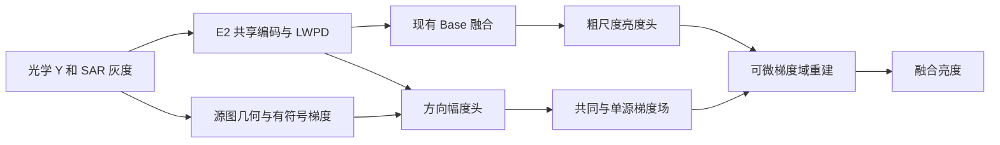

# 光学–SAR 亮暗极性解耦的边界融合设计

**状态**　首版已接入训练和验证。完整训练及 val1000 待运行。

## 1. 研究问题与贡献

光学影像和 SAR 影像可以在相同位置观测到一条地物边界，同时给出相反的亮暗顺序。例如两源剖面分别为 `0.2 → 0.8` 和 `0.8 → 0.2`。逐像素最大强度要求 `0.8 → 0.8`，最大梯度则要求幅值 `0.6`。对这种输入，两项目标发生冲突。

QXS 场景 4 的探索性筛查中，723 个同位置、跨尺度稳定、法向轴接近的双源强响应里，309 个响应反号。筛查采用 `σ=1.2、2.0` 的 Sobel 响应及双源强度前 20% 的判据。真实共同地物边界的比例需要用源图剖面独立核查。 [原 E2 融合损失](train_direct_fusion.py#L137) · [跨模态非线性辐射差异](https://arxiv.org/abs/2103.16871)

首版的贡献是把三个决定写进同一个生成模块：**共同几何如何确认、共同边界的亮暗方向由谁确定、单源边界如何进入最终亮度。** 用无符号法向寻找共同边界，用有符号梯度生成融合图。此前 E2-G1 在共同证据不足时回退到光学梯度，造成 SAR 细节大面积流失。首版因此为光学独有和 SAR 独有边界各提供一条显式路径，并分别监督。 [E2-G1 失败分析](reports/E2_G1_FAILURE_ANALYSIS_20261103.md)

## 2. 整体前向



输入 `O,S,valid` 为 `N×1×H×W`。两源均在 `[0,1]`，`valid` 沿用数据集的 SAR 非零有效性规则。编码器、固定 Haar、LWPD 方向门控和光学 Base 保留路径沿用 E2。融合阶段用本模块接管 Detail 的最终合成和亮度生成。单源重建仍使用原有的共享重建解码器，维持 E2 的训练起点。

幅度头接收 `[D_o,D_s,P_B(B_f)]`，其中每路 Detail 为 64 通道，`P_B` 将融合 Base 投影为 16 通道。首版为 `1×1: 144→32`、`3×3 depthwise`、`1×1: 32→3`，中间使用 GELU。输出三张 `H×W` 图，分别决定共同边界的幅度混合比例和两条独有分支的幅度。末层权重与偏置初始化为零。

低频头对 `B_f` 池化 4 倍，再用 `3×3: 64→32→1` 预测光学粗尺度亮度的有界修正。令 `L = clamp(P(O) + 0.1 × tanh(h_B(P(B_f))), 0, 1)`，`h_B` 末层零初始化。融合训练起点由光学提供粗尺度亮度，融合 Base 可学习有限的低频修正。实际融合亮度由第 5 节的求解器直接生成。RGB 输出沿用光学色度回填。

## 3. 源图边界证据

### 3.1 统一坐标和差分

在全分辨率计算前向差分 `D=[D_x,D_y]`，右列、底行的出域分量为零。证据、梯度合成和重建使用同一差分定义。源图边界判断使用两尺度平滑结果，梯度幅度和输出监督使用同坐标的原始差分。评估继续使用项目评价器。

对每个源计算 `g_m^f=D(G_0.8(I_m))`、`g_m^c=D(G_1.6(I_m))`，`n_m=normalize(g_m^f)`。SAR 平滑使用 `G(S·valid)/G(valid)`。SAR 的证据需要完整的细、粗尺度有效支持以及差分两端有效。有效支持不足的区域由光学和低频头提供输入。

记 $m_m=\lVert g_m^f\rVert_2$，$rms_m=\sqrt{\operatorname{AvgPool}_{7\times7}(m_m^2)}$，$d_m=n_m^\top\operatorname{normalize}(g_m^c)$。单源置信度为

$$
r_m=\operatorname{clip}_{[0,1]}\!\left(\frac{m_m}{\tau_a}\right)
\operatorname{clip}_{[0,1]}\!\left(\frac{m_m}{\tau_r(rms_m+\epsilon)}\right)
\operatorname{clip}_{[0,1]}\!\left(\frac{d_m-\cos30^\circ}{1-\cos30^\circ}\right).
$$

首版校准起点为 `τ_a=4/255`、`τ_r=1`、`ε=1/255`。同源细、粗尺度使用**有符号**方向一致性。平坦区域向量和证据归零。阈值只从训练校准图确定，验证集用冻结值。

### 3.2 共同、独有与不确定响应

| 分支 | 进入条件 | 坐标约定 |
|---|---|---|
| 共同边界 | 两源同位置均有稳定响应，`abs(n_o·n_s) ≥ cos(30°)`，且两源沿候选轴的原始差分均有可测幅值 | 采用当前光学坐标，两源权重在同一点计算 |
| 光学独有 | 光学响应稳定，SAR 在该处较弱，且在 `3×3` 邻域缺少相近法向轴的稳定证据 | 光学原坐标 |
| SAR 独有 | SAR 响应稳定，光学在该处较弱，且在 `3×3` 邻域缺少相近法向轴的稳定证据 | SAR 原坐标 |
| 不确定 | 邻域有潜在匹配但当前像素不一致、两源方向冲突、或证据不足 | 保持当前坐标，用连续的源内置信度混合 |

按共同、独有、不确定的次序分配，每个位置使用一种规则。可信阈值起点 `0.55`，邻域弱证据阈值起点 `0.25`。邻域检查用于避免将轻微错位的双源边界重复判为两条独有边界。V1 采用现有数据坐标，局部配准作为独立研究方向。SAR 孤立亮点可能缺少跨尺度方向稳定性，须在验证中单列观察。

## 4. 有符号梯度生成

### 4.1 共同边界

用光学法向给共同轴定向，再让 SAR 提供轴向和幅值证据。设 $r_m$ 为源内置信度，计算

$$
n_c=\operatorname{normalize}\big(r_o n_o+r_s\operatorname{sign}(n_o^\top n_s)n_s\big),
\qquad a_m=|n_c^\top D I_m|.
$$

记 $p_o=n_c^\top D O$，$p_s=n_c^\top D S$。共同分支要求 $p_o>2/255$、$|p_s|>2/255$，且 $p_s$ 的符号与 $n_c^\top n_s$ 一致。这样，两源的原始对比和各自平滑方向相容，光学方向足以确定共同边界的亮暗。其余情况进入不确定路径。共同梯度为

$$
w_c=0.1+0.8\,\sigma(h_c),\qquad V_c=((1-w_c)a_o+w_c a_s)n_c.
$$

因此，同一边界的法向和亮暗方向只表达一次。两源都能参与幅值估计，首版共同幅值处在两源轴向幅值之间。此处的亮暗约定服务于光学色度承载的融合图。

### 4.2 单源边界和不确定区域

单源的有符号响应取 $u_m=\max(n_m^\top D I_m,0)n_m$。当细尺度原始梯度与跨尺度定向冲突时，该响应减弱。独有分支生成

$$
V_m=k_m u_m,\qquad k_m=0.6+0.8\,\sigma(h_m),\quad m\in\{o,s\}.
$$

`k_m` 初始为 1。两个独有分支各自拥有幅度范围和训练目标。共同区域以外的光学证据缺失可以让稳定的 SAR 边界进入自己的路径。

不确定区域使用 $V_u=(r_o u_o+r_s u_s)/(r_o+r_s+\epsilon)$，保留有证据的输入。两源置信度都趋近零时，输出场随之趋近零。最终 $V$ 按分支掩码选择 $V_c,V_o,V_s,V_u$，并将右列、底行的出域梯度分量置零。

## 5. 由梯度场生成亮度

从 `V` 和粗尺度亮度 `L` 求唯一的融合亮度 $F$。

$$
F=\arg\min_X \frac12\|DX-V\|_2^2+\frac{\lambda}{2}\|PX-L\|_2^2.
$$

`P` 为 `4×4` 平均池化，`Pᵀ` 把每个值均分回对应的 16 个像素。右侧、底部将两源复制填充到 4 的倍数，SAR 填充像素的有效性置零。在同一个填充域编码、生成梯度和求解，随后裁回原尺寸。边界监督只使用原图有效支持。使用与 `D` 配对的伴随 $D^\top$。正规方程为

$$
(D^\top D+\lambda P^\top P)F=D^\top V+\lambda P^\top L.
$$

`D` 的零空间是常量，`P` 约束常量分量，故对 `λ>0` 系统正定。首版采用矩阵无关的 Jacobi 预条件共轭梯度，FP32，以 16 步为初始预算，`λ=4`（上述按像素求和口径）。由双线性上采样 `L` 初始化。可复用已有 `gradient` 和 `gradient_adjoint`，并单测内积伴随关系。

反向传播使用隐式梯度。若亮度的上游梯度为 `z`，用同一个系统矩阵 `A` 求 `Au=z`，则 `∂loss/∂V=Du`，`∂loss/∂L=λPu`。运行日志保存前向相对残差和 `||DF−V||` 的平均绝对值，隐式反向用有限差分核对。训练对数值裁剪前的亮度计算范围损失，评估沿用 clamp 后转 uint8。 [现有差分及伴随实现](e2_aspr.py#L13) · [Poisson 梯度域重建先例](https://pages.cs.wisc.edu/~dyer/cs534/papers/perez-poisson-image-editing.pdf)

## 6. 训练目标

沿用固定 QXS train8000 / val1000 划分和 seed 42。学生整套从头初始化。先做 4 轮原 E2 单源重建，再做 12 轮联合融合。单源重建损失继续使用项目实现。原像素最大强度和最大梯度项由下列显式目标接替，以移除反号共同边界上的冲突监督。

1. **共同边界方向和幅值。** 令 $q_c=n_c^\top DF$。要求 $q_c$ 落入 $[0.8\min(a_o,a_s),\ 1.1\max(a_o,a_s)]$，对两侧越界用 Charbonnier。正的下限同时约束极性和边界存在性。同号与反号共同区域分别取均值。
2. **单源边界。** 在光学独有与 SAR 独有掩码内，分别用 Charbonnier 对齐 $n_m^\top DF$ 与固定的源图目标 $\max(n_m^\top D I_m,0)$。两路独立取均值，再与共同边界项平均。空掩码略过，并记录有效像素数。
3. **粗尺度亮度。** 用 `0.1 × mean|L−P(O)| + mean|P(F)−L|` 稳定亮度。较弱的首项抑制粗尺度漂移，允许融合 Base 学习修正。独有边界项仍直接约束 SAR 的有符号对比。
4. **源图重建与范围。** 保留原源图重建，并使用 `mean(ReLU(−F) + ReLU(F−1))` 记录和约束范围。

首版损失权重起点为 `边界 1.0 + 粗尺度 0.5 + 重建 0.1 + 范围 0.05`。Charbonnier 的 `ε=1/255`。这里使用归一化图像的前向差分，权重与原 Sobel 梯度损失的 `10` 采用不同的数值尺度。先做单样本前反传核对分项梯度和量纲，再锁定训练配置。记录四类有效面积、幅度权重、训练时的极性错误率、求解残差和越界比例。

## 7. 验证与论文主张

### 7.1 训练前检查

- **共同反号阶跃。** `O=[0.2,0.2,0.8,0.8]`、`S=1−O`，共同几何应成立，合成梯度保留一次正边界。记录传统有符号平均的幅值消减量。
- **SAR 独有阶跃。** 光学平坦、SAR 存在稳定阶跃，确认 SAR 独有分支输出非零，重建边界方向符合该源。
- **恒定图与无效 SAR。** 无结构时输出随粗尺度亮度；SAR 无效处及其邻域无伪边界。
- **数值检查。** 验证 `D/Dᵀ` 与 `P/Pᵀ` 伴随、奇数尺寸裁回、常量场、已知可积梯度重建、PCG 前反传及非有限值检查。增加交叉轮廓、孤立亮点和 1 像素错位样例，观察不确定路径。

设计阶段用一张 `32×32` 的反号阶跃检查了合成方程。共同边界位置与法向已知，`L=P(O)`，使用双精度求解。16 步时，显式定向后的亮度跳变为 `0.6000`，等权有符号平均后的跳变为 `0.0838`。前者正规方程相对残差约 `8.0×10⁻⁴`。差分、池化的伴随检查与隐式梯度的有限差分核对通过。这个检查验证给定梯度场时的重建机制，边界证据和训练收益留待真实图块验证。

### 7.2 能验证因果机制的对照

| 对照 | 保持 | 改变 | 主要判断 |
|---|---|---|---|
| 已有光学 Base 版 E2 | 固定划分和训练预算 | 使用现有融合与解码 | 新系统在统一评价口径下的整体收益 |
| 有符号直接混合 | 相同共同掩码、幅度头、重建层和训练目标 | 共同分支使用 `((1−w_c)a_o+w_c·sign(p_s)a_s)n_c` | 反号位置的幅值和连续性是否因显式定向改善 |
| 关闭 SAR 独有分支 | 同一候选权重、相同源图 | 推理时关闭 `V_s` | SAR 独有结构是否实际通过该分支进入输出 |

先用合成边界和少量真实验证图建立机制证据。真实 ROI 在看候选输出前根据两源标出同号共同边界、反号共同边界、光学独有、SAR 独有及不确定样本。主要局部结果报告法向极性正确率、边界位置误差、梯度幅值保留和额外峰值。SAR 独有 ROI 同时报告启用和关闭该分支的差异。ROI 核查仅用于评价，不作为训练标签。

val1000 使用 `reference_v2_candidate_with_paper_fmi`，按每个指标的共同有效图块报告 14 项均值、标准差和配对变化。优先检验反号共同边界、SAR 独有边界，以及 QAB/F、MS-SSIM、FMI、VIF。NAB/F 同时报告低伪影半组和高尾部，防止平均值掩盖新伪影。通过验证后再锁定配置进入 test1000。所有新结果写独立目录并登记实验索引。

论文贡献以两项结果为准：显式极性分离对反号共同边界有独立收益，且 SAR 独有路径能保留可核验的补充结构。全图指标的涨幅取决于自然反号边界的覆盖率、掩码准确度和重建误差。已有先例覆盖无符号几何描述和梯度域重建，本方案的贡献落在二者如何与光学、SAR 的独有梯度共同生成融合图。

系统级对照同时改变生成方式与训练目标。有符号直接混合对照用于归因极性设计。若后续要把系统收益单独归因于梯度域生成，需再用原 E2 解码器接受同一新监督做匹配对照，先复用已有 E2 结果完成初筛。

## 8. 首轮执行

Windows CMD 命令如下。

```cmd
cd /d "D:\#imageInfusion\CDDFuse"
.venv\Scripts\python.exe -u run_e2_polarity_fusion.py train-val
```

首轮从随机初始化开始，完成 4 轮单源重建和 12 轮融合，随后以第 16 轮权重在固定 val1000 与已有光学 Base 版 E2 对比。训练和验证产物分别保存到 `models/e2_scratch_polarity_v1/seed42` 和 `test_result/e2_scratch_polarity_v1/val1000/seed42`，完成后自动登记。中断后使用 `train-val --resume` 恢复同一次运行。已有完整权重时，可以用 `val` 单独补验证。

验证保存灰度、RGB、三联图、14 项逐图指标、配对比较及 `gate_stats.csv`。反号极性按 `reversed_polarity_correct_pixels` 总和除以 `reversed_polarity_pixels` 总和统计，零支持图块不会被计作极性错误。常规推理入口支持 `--polarity-mode signed_mix` 和 `--polarity-mode no_sar_private` 的同权重诊断；首轮只评估正常的 `aligned` 方案。
