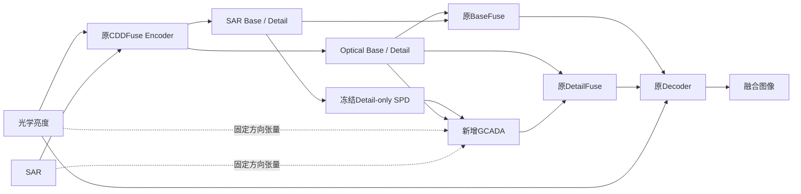

**CDDFuse新增模块：几何条件各向异性细节聚合（GCADA）**

研究优先级更新：为直接挑战C0＋SPD，首轮改为检验[局部统计校准与净化一致监督](D:/#imageInfusion/面向超越C0加SPD的定向设计_20261022.md)。GCADA暂保留为后续局部结构候选，未被证明有效，也不与新方案同时叠加。

效果审查更新：见[当前融合效果与收益审查](D:/#imageInfusion/当前融合效果与改动收益审查_20261022.md)。已有图像显示部分场景存在全区域SAR响应占优；尚无当前B0＋SPD上的方向聚合干预证明GCADA针对主要瓶颈。该模块保留为待验证候选，预期局限于局部空间组织，不承诺纠正整体亮度主导。

日期：2026-10-22。GCADA为工作简称，英文为Geometry-Conditioned Anisotropic Detail Aggregation。本文在保留CDDFuse的研究方案中增加一个明确的架构模块；不引入分割网络、边界预测网络或新的人工标注。本次只完成模块设计与相关工作核查，未修改模型实现、未训练或批量测试。

**最终新增位置：冻结Detail-only SPD之后、原DetailFuse之前。** 原Encoder、BaseFuse、DetailFuse和Decoder全部保留。几何弱监督继续作为训练贡献，固定光学频带读出不进入首版主方法，只保留为后续对照。

**1．模块要解决的问题**

光学与SAR中，同一边界可能亮暗反号；细节特征还会混有颗粒响应。普通局部卷积不明确区分沿边界聚合和跨边界混合；单点可靠性门只能放大或缩小特征，不能决定信息应从哪个邻居流入。

GCADA的研究假设是：**以SAR自身局部方向为基础，仅在光学方向提供一致支持时引入跨模态几何约束，通过沿结构的邻域聚合，改善进入DetailFuse的空间组织，同时减少跨边界混合。**

这不是当前实验已证实的原因。它是新增的可检验假设，不以P0中不成立的“严重负相关相消”或“局部搜索发现真实错位”为前提。模块不执行配准，也不假定结构方向等于融合效用。

**2．整网结构**

\[
(B_o,D_o)=E(O),\qquad (B_s,D_s)=E(S),
\]

\[
\widetilde D_s=\operatorname{SPD}_{detail}(D_s),
\]

\[
D_s^*=\operatorname{GCADA}(D_o,\widetilde D_s,O,S),
\]

\[
B_f=\operatorname{BaseFuse}(B_o+B_s),\quad
D_f=\operatorname{DetailFuse}(D_o+D_s^*),
\]

\[
F=\operatorname{Decoder}(O,B_f,D_f).
\]

GCADA不改变Optical Detail；SAR Base仍走原路径。因而不能把GCADA的权重称为整个网络的SAR贡献率。光学保真仍由最终输出损失约束，不能声称只改Detail就解决所有外观问题。

**3．模块内部：方向张量 → 条件核 → 差分消息**

**3.1　使用对亮暗反号不敏感的几何描述**

对光学和原SAR显示强度分别做固定平滑，再计算结构张量：

\[
g_m=\nabla G_{\sigma}(I_m),\quad
J_m=G_{\rho}(g_mg_m^T),\qquad m\in\{o,s\}.
\]

首版可取σ=1、ρ=2像素，训练前按分辨率规则固定。这里平滑后的SAR只用于几何描述，不重新作为编码器输入，因此不会重复以前“去噪图直接替换主路输入”的实验。

当trace(J_m)超过固定弱响应阈值时：

\[
Q_m=J_m/\operatorname{tr}(J_m),
\]

否则设 \(Q_m=I/2\)，表示方向未知。Q_m是半正定、trace为1的2×2矩阵。强边界时大特征值方向近似法向；其垂直方向近似切向。实现不必显式求特征向量，因此没有角度跳变和特征向量正负歧义。

图像亮暗反号时g变号，而ggᵀ不变。因此几何支路可以容忍反号。完整网络还读取特征，**不能由此宣称整个模型具有严格辐射不变性**。SAR显示图的张量也不是物理散射真值。

定义方向一致性：

\[
a(p)=\max\{0,2\operatorname{tr}[Q_o(p)Q_s(p)]-1\}.
\]

其范围为[0,1]。两边界同方向且清晰时趋近1；一方方向未知或两者方向冲突时较低。a仅是方向支持，不证明两条边界属于同一地物。平行错位和叠掩仍可能造成错误支持，必须在偏移实验中检查。

**3.2　生成带明确几何约束的局部聚合核**

将D_o和D̃_s分别经1×1无偏置投影到16通道：

\[
V_o=P_oD_o,\qquad V_s=P_s\widetilde D_s.
\]

将V_s分为4组，每组4通道。小型条件网络输入归一化的V_o、V_s、两张Q的独立分量及a，预测每组的 \(\lambda_{s,g}(p),\lambda_{o,g}(p)\in[0,8]\)。区间上界是稳定性工程参数，需记录，不是已验证的最佳值。

在5×5固定邻域内，对偏移δ定义 \(\bar\delta=\delta/2\)：

\[
\ell_g(p,\delta)=
-\frac{\|\delta\|^2}{2s_0^2}
-\bar\delta^T\left[\lambda_{s,g}Q_s
+\lambda_{o,g}aQ_o\right]\bar\delta,
\]

\[
K_g(p,\delta)=\operatorname{softmax}_{\delta}\ell_g(p,\delta).
\]

首版固定s₀=1.5像素，邻域含中心点，无学习偏移、无deformable采样。几何项对跨法向传播增加代价，对沿切向传播相对宽松。

这里的非对称规则是关键：

- SAR自身方向Q_s始终作为候选几何依据；
- 光学Q_o只在方向支持a较高时参与核形状；
- a接近0时，SAR原始特征路径仍完整存在，不会因光学不支持就被门控清零。

λ通过训练决定是否采用方向信息，几何不是强制可靠性标签。方向图错误时网络可以降低其影响，但这也意味着它可能完全忽略模块；必须检查学到的核与干预结果。

**3.3　以邻域差分消息更新SAR Detail**

每组计算：

\[
U_g(p)=\sum_{\delta}K_g(p,\delta)
\left[V_{s,g}(p+\delta)-V_{s,g}(p)\right].
\]

最后：

\[
D_s^*=\widetilde D_s+W_{out}[U_1;U_2;U_3;U_4].
\]

W_out为16→64的1×1无偏置投影，初始化为零；P_o/P_s和条件网络使用非零初始化，λ初始为有限值。这样模块初始严格保持D̃_s，整网可复现B0＋Detail-only SPD路径。

只有W_out归零，不再将另一个全局幅度同时归零。第一步上游条件网络梯度可能为零，W_out开始更新后才能收到梯度，这是设计的正常阶段，不能据单步判断梯度断路；也不能长期冻结W_out。

因为K非负且和为1，聚合是局部归一化的；常数V_s的差分消息严格为0。**这只保证常数特征不被新增偏置改变，不保证整个图像均值、亮度或边缘保持。** W_out之后也不是凸平均，不能声称存在无条件去噪或稳定性定理。

这里不采用3%、0.5%等固定微小RMS上限。使用梯度裁剪与偏离量诊断控制优化；如果输出开始漂移，通过预注册的早停/检查处理，而不再次叠加多个压低幅值的门。

**4．为什么它具有实质性的模块差异**

像素门控可写成 \(D_s'(p)=g(p)D_s(p)\)。它只改变中心特征幅值。

GCADA显式依赖 \(D_s(p+\delta)\)。当邻域特征不与中心共线时，这个更新无法一般地写成中心特征乘单一标量。它改变的是邻域信息的传递方式，能够学习沿结构聚合及抑制跨边界传播。

| 已有尝试 | GCADA的区别 |
|---|---|
| SRR/R1可靠性门控 | 不预测“这里是否可靠”的单一贡献图；预测空间聚合的方向约束 |
| P2-A通用残差Adapter | 修正来自归一化邻域差分与明确几何核，不是任意卷积生成的小幅残差 |
| Optical Rescue | 不用光学重建误差估计要补多少；处理进入融合前的SAR邻域关系 |
| Detail-only SPD | SPD做已有去噪任务；GCADA用光学/SAR方向关系调整融合前空间交互，是否超过二次去噪必须消融 |
| 固定频带读出 | 不过滤最终图像的可学习频率；保留原Decoder完整输出 |

这些差异说明它值得作为架构假设检验，但不自动证明它优于上述方法。尤其“SPD之后再平滑”可能冗余，必须用相同容量的各向同性聚合与普通动态滤波对照。

**5．文献边界与本章创新表述**

结构张量、各向异性滤波和动态卷积都已有研究。不能声称首次使用这些基础工具。

- [Two-scale image decomposition based image fusion using structure tensor](https://onlinelibrary.wiley.com/doi/10.1002/ima.22367)已将结构张量用于融合。
- [DSTCFuse，CVPRW 2024](https://openaccess.thecvf.com/content/CVPR2024W/JRDB/papers/Li_DSTCFuse_A_Method_based_on_Dual-cycled_Cross-awareness_of_Structure_Tensor_CVPRW_2024_paper.pdf)已有结构张量相关的融合学习。
- [GLF-CR，2022](https://arxiv.org/abs/2206.02850)已在SAR辅助去云中使用动态滤波后传递SAR特征。[作者机构全文](https://elib.dlr.de/192675/1/1-s2.0-S0924271622002064-main.pdf)

建议的准确表述：**针对光学—SAR局部方向一致与冲突并存的特点，设计以SAR自身几何为基础、按跨模态方向支持引入光学约束的分组各向异性差分聚合模块，并以恒等初始化接入CDDFuse细节融合。**

架构贡献落在“非对称几何条件＋受约束邻域核＋源特征差分更新”的组合。反号容忍、差分聚合、分组和恒等初始化分别并非原创理论。是否足以作为本章有效创新，取决于与普通动态滤波、等容量残差Adapter及方向打乱对照的结果。本次定向检索不证明绝对首创。

**6．训练：新增模块与原融合路径协同适配**

Encoder和SPD冻结；GCADA、原BaseFuse、DetailFuse、Decoder训练。建议模块学习率1e-4，原融合层1e-5，Decoder 5e-6作为开发起点，分别监控梯度与参数漂移。训练和评价统一256整图。

主输出使用原Decoder，不默认采用固定光学保持读出。监督采用已有方案中的光学保真与几何弱参考，并依据审查意见检查弱参考是否过弱、是否重复滤波、是否只在训练评分上有效。模块几何图来自输入图像，标签只用于loss，训练推理接口一致。

本版删除操作选择分类损失，也不添加核方向Anchor或要求核必须各向异性的损失；这样可避免网络只是复述输入张量。最终边界与信息保留收益决定是否需要采用某个方向。

为了隔离架构贡献，首先做“无GCADA/有GCADA × 原监督/几何监督”的2×2小规模对照。四组保持训练模块范围和预算可比；另保留未适配的B0＋SPD基线。没有同监督下的模块收益，不能把全部改善归功于架构。

**7．成本与实现注意事项**

参考配置：P_o/P_s各64→16；条件网络39→16的1×1、16通道3×3深度卷积、16→8的1×1；W_out为16→64。仅卷积核参数约3968，若按上述条件层加偏置约再40个；不含原CDDFuse、SPD和实现中可能增加的归一化参数。实际参数数以代码统计为准。

参数少不等于显存低。256×256、16通道、5×5邻域的完整unfold约有2621万个元素，float32约100MiB/样本，batch4仅该张量就约400MiB，还没计算梯度、核和主干激活。实现宜逐偏移累加或分块，避免直接展开全部64通道。权重图同样按组生成，不生成每通道独立25维核。

可使用标准PyTorch的卷积、shift/pad、Softmax和逐项累加，不依赖自定义CUDA或学习式配准。边界采用明确的填充规则；无效SAR邻域在Softmax前掩蔽，全无效时返回零消息，避免非法归一化。

**8．最小消融和可证伪检查**

保留六项即可：

1. 无模块 vs 完整GCADA：是否在同监督下改善最终融合；
2. 各向同性核 vs 几何条件核：收益是否只是额外平滑；
3. 仅SAR几何 vs 跨模态条件几何：光学方向有没有净收益；
4. 无条件引入光学方向 vs 按a调节：条件化是否减少错误引导；
5. 普通动态核/等容量残差Adapter vs GCADA：是否仅来自增加参数；
6. 无SPD vs 有SPD：GCADA是否与现有去噪互补。

方向图旋转90°、同分布空间打乱、a置零是推理干预诊断；检查模块是否真正使用几何。输入反号时几何支路保持一致的数学性质可以做单元检查，但完整输出不要求严格不变。

至少记录核熵、中心权重、法向/切向聚合质量、a与λ的分布、特征改变量、uint8输出改变比例、边界定位与断裂、光学保真及14项指标。不能仅凭方向核漂亮就宣布成功。

合成单边界、平行边界、拐角、孤立点、随机颗粒以及1/2像素错配用于检查方向混合机制。核只由中心几何控制时可能跨过窄道路另一侧，这属于首版已知风险；若高发，应停止并重新审查邻域，而不是通过更强边界loss掩盖。

最终真实数据仍采用空间互斥开发与确认，几何弱参考和评价口径分开；不使用分割网络、不新增手工训练标注。

**9．失败边界与最终方案**

模块可能失败于：几何方向受散斑污染；SPD已完成类似处理而没有剩余收益；特征的感受野与像素几何不匹配；光学/SAR平行错位造成错误支持；低响应区出现过平滑；Base路径仍保持SAR主导。保留CDDFuse与恒等初始化只能降低接入风险，不能排除这些情况。

如果各向同性核已经同样有效，则不主张几何条件创新；如果只在新监督下有效，则报告明确交互；如果λ或W_out长期不起作用，且最终输出不改善，则模块不通过，不靠强制非零激活制造贡献。

收敛后的主方案是：**CDDFuse＋冻结Detail-only SPD＋GCADA＋几何弱监督与光学保真损失**。架构创新以GCADA为核心，监督设计作为第二条研究内容；固定频带读出不再占据主方法位置。

本次添加的是可实现、可消融的模块设计，尚未获得性能验证。后续若进入实现，应先验证恒等初始化、常数特征零消息、核归一化、无效区域及梯度路径，再提供训练和批量评价CMD；本次未执行这些实验。
