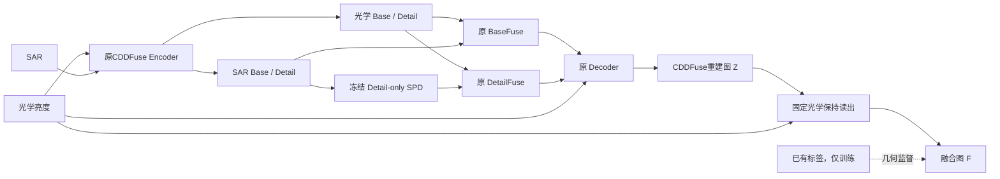

**最终架构修订：保留CDDFuse主干的几何监督与光学保持融合**

架构新增：按用户“添加一个架构、模块上的创新”的要求，当前主方案更新为[CDDFuse＋GCADA模块设计](D:/#imageInfusion/CDDFuse_GCADA架构模块设计_20261022.md)。保留原主干与Decoder输出，在SPD之后、DetailFuse之前加入几何条件各向异性细节聚合；固定频带读出不进入首版主方法。

审查更新：见[创新性与可行性审查](D:/#imageInfusion/CDDFuse方案_创新性与可行性审查_20261022.md)。当前架构为待验证候选；几何弱监督是核心检验对象，固定光学保持读出降为辅助选项，不能预先认定为独立创新。需特别检查带通梯度衰减、弱参考重复滤波、光学复制与固定算子模仿风险。以下保留原候选设计供对照。

日期：2026-10-22。依据用户“不要完全抛弃CDDFuse”的要求修订。本文替代此前独立三操作选择器作为主方法的架构建议；历史实验分析、无需新增标注、不使用分割网络、训练与批量测试只提供CMD等约束继续保留。

**最终决定：保留CDDFuse的Encoder、BaseFuse、DetailFuse和Decoder。以已有较稳定的B0＋Detail-only SPD为初始化，修改输出重建与训练监督。** 独立三操作选择器不再开发为主干；固定操作仅用于离线可行性诊断和构造局部弱参考。

建议章名：**《边界几何监督与光学保持重建的CDDFuse光学—SAR图像融合方法》**。

本次是设计修订，未修改模型代码，未训练或进行批量测试，尚无新方法性能结论。

**1．保留与修改的边界**

| 模块 | 决定 | 理由 |
|---|---|---|
| 原Restormer Encoder | 保留，首版冻结 | 复用已有表示，避免再重建自编码器 |
| SAR Detail-only SPD | 保留，冻结 | 复用现有保信息型去噪结果；不把输出当真值 |
| BaseFuse | 保留、训练 | SAR仍经Base进入输出，需要允许协同适配 |
| DetailFuse | 保留、训练 | 继续承担细节融合，不换成另一套专家路由 |
| 原Decoder | 保留、低学习率训练 | 使解码路径能适应新监督与重建规则 |
| 最终图像重建 | 增加固定光学保持读出 | 限制SAR对全局外观与最细纹理的直接覆盖 |
| 训练监督 | 引入已有标签辅助的边界几何弱参考 | 改变“梯度越强越应保留”的目标定义 |

这仍是CDDFuse改进：融合信息必须经过原编码、Base/Detail融合和解码链，最终图像中的可学习结构来自CDDFuse，不存在独立的SAR图像生成主路。

**2．完整前向路径**

\[
(B_o,D_o)=E(O),\qquad (B_s,D_s)=E(S),
\]

\[
\widetilde D_s=\mathrm{SPD}_{detail}(D_s),
\]

\[
B_f=\mathrm{BaseFuse}(B_o+B_s),\quad
D_f=\mathrm{DetailFuse}(D_o+\widetilde D_s),
\]

\[
Z=\mathrm{Decoder}(O,B_f,D_f).
\]

Z是沿用当前CDDFuse接口得到的单通道图像。保留原Decoder的sigmoid与输入旁路，不把该旁路误称为严格光学恒等映射。编码器中Base/Detail仍是学习表示，不声称等于物理低频与高频。

图中SAR Base绕过SPD进入BaseFuse；实现时调用现有Detail-only SPD接口，保持Base原值。标签只参与loss，不进入模型forward。

**3．修改一：固定的光学保持重建**

定义图像域固定分解：

\[
L(X)=G_{\sigma_2}(X),\quad
M(X)=G_{\sigma_1}(X)-G_{\sigma_2}(X),\quad
H(X)=X-G_{\sigma_1}(X),
\]

其中 \(\sigma_1<\sigma_2\)，初始取1与3像素。三者相加恒等于X，但滤波频带有重叠，不是严格正交分解。

输出为：

\[
F_{pre}=L(O)+M(Z)+H(O)
=O+M(Z-O),
\]

\[
F=\operatorname{clip}(F_{pre},0,1).
\]

光学提供低尺度亮度布局和细纹理分量，CDDFuse负责允许变化的中尺度结构。原光学色度在最终RGB合成时保留，但仍测量颜色变化及RGB裁剪。

这不是在B0输出上增加一个很小的修正量，也不限制为1/255量级的全局幅度；中尺度内容直接取自CDDFuse解码结果。首版不加额外门控、可学习幅度或多级置信连乘，减少退化自由度。

需要准确限定性质：

- 若Z=O，则F严格恢复O；
- 读出前的分解具有代数恒等性，但不保证Gσ₂(F)=Gσ₂(O)，也不保证所有高频与光学完全相同；
- clip会进一步改变频率分布，必须统计越界比例、最终低频偏移和量化后效果；
- 原CDDFuse仍可产生错误结构，固定读出只能限制其修改范围；
- SAR的极细点目标与大范围辐射差异可能被限制，本章主要针对边界和中尺度轮廓，不承诺完整保存全部SAR信息。

为避免大量输出落在clip饱和区，训练对F_pre增加轻量越界惩罚，并在最终保存口径上验证。大面积饱和时判定方案失败，不能仅凭clip后的合法值通过检查。

**4．修改二：用已有边界几何监督最终输出**

保留前版已经明确的规则：标签只提供类别分界几何，源图提供外观；允许反号、轻微定位容差、并列与不确定情况；类内未标注结构不被统一视作噪声。不引入分割器、边界预测器或语义蒸馏。

利用已有东营标签提取局部边界剖面，在有SAR支持的边界附近比较固定的保持、补充、替换图像。**这些操作不作为最终前向网络，只用于离线构造弱参考与发现监督可行性。** 仅有标签而源图无对应证据的片段不强制增强。

所有弱参考首先通过与模型相同的光学保持算子：

\[
\mathcal R_O(X)=\operatorname{clip}(O+M(X-O),0,1).
\]

例如将前版的固定候选C_k变成 \(T_k=\mathcal R_O(C_k)\) 后再评价。这样可避免要求CDDFuse输出结构被最终读出器必然滤掉的目标。候选原像素值与尺度也采用同一范围和预处理。

对连续性、边界定位和错误多峰进行固定规则比较，通过光学保真准入后生成允许集合 \(\mathcal A_j\)。不稳定或没有明确改善的片段跳过正向参考；可靠补充片段的允许集合排除纯光学。这里是图像几何代理，不称融合效用真值。

由于本版不预测操作概率，**前版的操作集合分类损失L_set删除**。直接约束最终输出F的剖面，使其接近允许参考中的至少一个：

\[
L_{geom}=\sum_{j\in\mathcal J_+}q_j
\min_{k\in\mathcal A_j}
\|W_j[\nabla G_\sigma F-\nabla G_\sigma T_k]\|_1.
\]

q_j与参考均离线冻结。对明确应保持光学的边界另计算相对光学的剖面保持项。相反符号的可接受参考不直接平均；最小值选择不等于证明候选唯一正确。

这种方式仍可能受弱参考错误影响。标签几何提供独立约束，但并不能验证所有SAR亮点的物理真实性；训练前必须确认参考在相同读出限制下有真实可见的改进空间。

**5．最终损失与训练范围**

\[
L=\lambda_gL_{geom}+\lambda_oL_{opt}
+\lambda_bL_{boundary\_keep}+\lambda_rL_{range}.
\]

- L_geom：可信SAR补充片段的输出几何参考；
- L_opt：最终图像的光学低频保持，以及接受片段支持带外的光学梯度保持；
- L_boundary_keep：已知光学边界不能因融合而退化；
- L_range：F_pre越界惩罚。

所有loss按有效片段/像素归一化，系数在训练开发集校准后冻结。原始max强度/max梯度损失与C0的梯度择大目标不作为本版默认监督，保留为同架构对照。首版不加门均值、注入覆盖率、额外伪感知头或自适应minimax。

Encoder和SPD冻结，保持SPD输入分布；BaseFuse、DetailFuse与Decoder同时低学习率适配。初始可采用融合层1e-5、Decoder 5e-6，整幅256×256、batch4、梯度裁剪并监控参数漂移。这是开发起点，不是已经验证的最优训练配置。

初始化来自同一套B0＋Detail-only SPD检查点，先验证“关闭新读出时”能复现原基线。开启新读出后输出会变化，不能再称严格基线恒等初始化。首轮不解冻Encoder，不进行新的自编码预训练；训练/验证尺寸保持一致。

**6．与已有失败实验的区别和关联风险**

| 历史方案 | 本次区别 | 仍需检验 |
|---|---|---|
| Optical Rescue | 不用0.5%特征修正补丁，原融合层与Decoder可以适配 | 可训练参数增加，需防止表示漂移 |
| CSR-v1/v2 | 输出外观由固定光学分量构成，不靠小比例恢复SAR主导的最终图 | 固定读出本身可能限制有效SAR结构 |
| OCAF-v1/v2 | 补充结构由CDDFuse联合特征解码生成，无小全局增量上限 | 光学复制仍可能出现，要由可靠几何监督和反事实检查排除 |
| MFFA | 保留CDDFuse全部主要表示与融合模块，固定分解只作用于图像读出 | 仍属频率分工假设，不能因保留CDDFuse就跳过可行性检验 |
| 前版三操作选择 | 三操作仅是离线诊断与弱参考；主网络就是CDDFuse | 标签选择的参考不是融合真值，可能有选择偏差 |

不应把这次修改表述为全新频率分解理论。可主张的是在CDDFuse框架内，将可训练联合结构重建与光学外观保持分开，并用现成标签几何约束最终输出。能否作为两个有效贡献，必须分别通过监督消融与读出消融验证。

**7．实验顺序和停止条件**

第一步仅做固定读出的开发诊断：对已有B0和B0＋Detail-only SPD的保存结果应用相同读出，比较原输出、光学及重建结果；严格匹配数据、归一化和clamp口径。此步骤无需新训练，但属于批量评价，仍只交付CMD。它检查读出的直观影响，不代表端到端适配后的性能上界。

第二步检查弱参考可达性：将已有标签选出的固定候选同样经过读出，在空间互斥开发样本上确认边界收益仍然存在。如果有效参考结构被读出全部消除，应停止该固定尺度设计，先记录并修改协议，不能盲目训练。

第三步做最小2×2消融，四组从相同检查点出发，并保持可训练模块和预算一致：

| 组别 | 输出路径 | 监督 |
|---|---|---|
| A | 原CDDFuse读出 | 原融合监督 |
| B | 光学保持读出 | 原融合监督 |
| C | 原CDDFuse读出 | 新几何监督 |
| D | 光学保持读出 | 新几何监督 |

原监督与新读出可能不一致，这正是2×2需要展示的交互，不通过单独给B调参掩盖。另保留原始未适配B0＋SPD作回归基线，不能以A的再训练成绩替换历史结果。

最终确认还需包括：无SPD、冻结Decoder、光学自身增强、SAR错配/空间打乱对照。使用图像本身的边界定位、连续性、光学保真和原14项指标评价，整个过程不使用分割网络。

只有D在独立数据中同时提供边界改善和光学保真、并超过光学增强对照，才继续完整训练。若C与D无差异，则读出模块不应单独宣称有效贡献；若SAR错配仍有同样收益，则应检查是否只是光学增强；若只在训练评分上改善而独立几何评价无效，则弱参考监督不成立。

主数据采用已有东营配对标签，先核查空间来源、重复副本与模型历史暴露；QXS仅作无标签迁移和历史回归。所有正式比较按项目注册协议执行，不覆盖旧结果。

**8．本次收敛结果**

最终主方法是**CDDFuse＋冻结Detail-only SPD＋固定光学保持读出＋边界几何监督**。CDDFuse负责核心联合表示、特征融合和结构生成；本章研究它如何适应光学—SAR的输出需求。

本文件固定后续实现边界，不要求继续另起一套主干。现有代码尚未按本文件改动；下一步应先实现读出及数据/弱参考诊断入口，训练与批量评价提供CMD。方法性能和创新有效性仍待实验验证。
