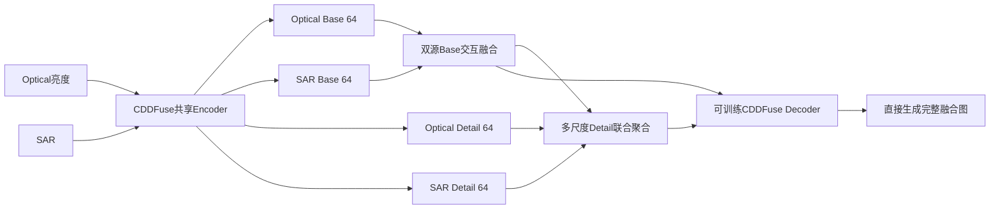

# CDDFuse 直接融合架构改造方案

日期：2026-10-23。按用户本轮要求，停止以固定C0为基底、叠加小修正量的主方法路线。历史PDCF实验保留作为诊断记录，不继续开发其残差Adapter、倍率修正或保护C0输出的训练目标。用户已明确本轮只交付完整架构方案，暂不修改代码；本文不代表实现或实验结果。

**本轮主改动：替换CDDFuse的融合层。两源Base分别进入跨模态交互，两源Detail进入多尺度联合聚合，新的融合特征由可训练Decoder直接生成完整图像。**

本设计是研究候选，不把“结构改动更大”等同于已经有效，也不预先宣称新颖性。

**1. 改造位置与依据**

当前代码在`CDDFuse/train_OS.py`的融合阶段执行：

```text
Bf = BaseFuse(Bo + Bs)
Df = DetailFuse(Do + Ds)
F  = Decoder(O, Bf, Df)
```

`net.py`中的共享Encoder为每个模态输出64通道Base与64通道Detail。先求和再融合，使下游只看到和，无法由这个和唯一恢复两源。改造让可学习融合层在压缩通道之前读取各自来源。

这不是断言现有特征存在严重负相关相消或真实配准误差；此前证据不足以支持这两种原因。Base/Detail也不等于已被证明的物理低/高频。

**2. 主干结构**



前向只计算新模型，不计算C0输出，也不计算`B_C0+ΔB`、`D_C0+ΔD`或`F_C0+ΔF`。不存在修正倍率、固定输出RMS上限或C0一致性损失。

CDDFuse内部Transformer的常规skip connection继续保留，用于深层优化；它不把预训练融合结果作为输出基底。新增融合模块本身直接输出完整特征。

**3. 模块A：双源Base交互融合**

两源采用独立参数的Q/K/V投影，保留来源身份。Q/K使用逐像素LayerNorm后的特征，V直接投影未归一化的Base，以免在值分支中完全消去模态幅值信息。采用CDDFuse/Restormer风格的多头通道交互：每头Q/K为`c×HW`，归一化后形成`c×c`注意力，避免在256×256上构造完整空间注意力矩阵。

```text
U_os = softmax(normalize(Qo) @ normalize(Ks)^T / T_os) @ Vs
U_so = softmax(normalize(Qs) @ normalize(Ko)^T / T_so) @ Vo
Bf   = Projection([Vo, Vs, U_os, U_so])
```

首版通道数64、8个头，每头c=8。Q/K投影为1×1卷积接3×3 depthwise卷积；投影后的L2归一化维度为空间维，带epsilon。每个方向和每个头具有独立温度，`T=softplus(t)+epsilon`，初始化T=1。V为1×1卷积。四组64通道张量拼接为256通道，经1×1卷积压到64，再用3×3 depthwise＋1×1卷积和GELU完成联合变换，直接得到Bf。

拼接同时保留两源值特征与交互特征，交互匹配较弱时仍有直接学习来源信息的通道。两次注意力矩阵均为`N×8×8×8`；空间处理和投影仍然有计算成本，不据此声称整网低于原模型FLOPs。

这是跨模态通道交互，不是空间配准；不能把注意力图解释成真实对应、可靠性或SAR贡献比例。避免只用Optical作Query而丢弃独立SAR路径。

**4. 模块B：多尺度Detail联合聚合**

将Do、Ds分别映射后拼接，再以三个深度可分离卷积分支读取不同邻域。首版使用3×3卷积、膨胀率1/2/3，对应3/5/7像素有效感受野。融合后的Base只作为上下文特征一起拼接：

```text
X  = Project([Do, Ds])
Z1 = Conv_d1(X)
Z2 = Conv_d2(X)
Z3 = Conv_d3(X)
Df = Projection([Do_projected, Ds_projected, Z1, Z2, Z3, Bf_projected])
```

具体通道：Do、Ds各经1×1卷积到32通道，拼接64通道得到X；三个分支各为64通道depthwise卷积再经1×1卷积到32通道；Bf投影到16通道。最终拼接`32+32+32+32+32+16=176`通道，经1×1卷积到64通道，接3×3卷积输出64通道Df。各中间层使用GELU，无全局幅度门。

输出Df为64通道完整Detail。各尺度以拼接和卷积进行学习，不设置稀疏概率门、最小SAR覆盖率或多个置信度连乘。所有输入都能参与最终生成，但网络依然可能学成偏向某一模态，需用干预和指标检查。Base分支收到Decoder路径及Detail上下文路径的联合梯度；没有额外的ΔBase/ΔDetail头。

本模块的假设是局部邻域与Base上下文有利于区分不同尺度响应，不把大感受野或强边缘自动定义为可靠结构；膨胀卷积的网格效应和细目标损失是需要验证的风险。

**5. Decoder必须参与训练**

Decoder复用原CDDFuse的128→64通道压缩、Transformer和图像输出头，但主方案使用`decoder(None, Bf, Df)`，即现有代码已支持的直接重建分支，不再把Optical直接加到输出logit。

移除输入旁路会改变预训练Decoder的输入输出关系，因此不能冻结Decoder，也不能要求初始化复现旧基线。首版从已有B0加载Encoder/Decoder权重：`CDDFuse/models/qxslab_saropt_from_ivf/CDDFuse_OS_20260924_012025/best.pth`，执行前固定SHA。新融合层正常非零初始化；Encoder先冻结，Decoder与两个融合层共同训练。通过pilot后再以更低学习率解冻Encoder末端。

保留原Optical输入旁路作为独立消融，以区分“融合模块改进”与“重建路径改变”。不能将这两项的联合变化全部归功于注意力。

**6. 训练与实验判定**

首轮取消PDCF Predictor、C0输出锚定和零初始化修正头。共享Encoder先固定，避免改造融合层的同时改变全部表示。训练策略应为fusion+decoder，不能继续使用原`fusion_only`选项的冻结Decoder语义。

最小控制矩阵：

| 组别 | 融合 | Decoder | 用途 |
|---|---|---|---|
| R0 | 原求和＋BaseFuse/DetailFuse | 原输入旁路，可训练 | 同预算重新训练控制 |
| R1 | 原求和＋BaseFuse/DetailFuse | 直接重建，可训练 | 解码旁路影响 |
| R2 | 双源concat-conv | 直接重建，可训练 | 来源保留和容量控制 |
| R3 | 双源Base交互＋多尺度Detail | 直接重建，可训练 | 完整改造 |

R2需要按实际参数与计算量匹配R3，不能用无效参数凑数。R3出现收益后再做Base单独替换、Detail单独替换的消融，不先铺开大量组合。

损失也需要控制：前次结果已经证明原frequency-minimax在特定修正方向上与主指标冲突，不能因新网络更大就默认解决。第一轮固定使用项目已有`OpticalSARLosses.fusion_old`对应的源强度/梯度目标作为架构对照，而不继续使用frequency-minimax：

`Y = where(valid_S, max(O,S), O)`

`G = where(valid_S, max(Sobel(O),Sobel(S)), Sobel(O))`

`L_fuse = mean|F−Y| + 10·mean|Sobel(F)−G|`。

这里Sobel沿用现有`Sobelxy`的x/y绝对响应和，不另换归一化口径。该目标只是已有、可匹配的控制目标，最大梯度可能保留斑点，最大强度可能使SAR强散射主导；这两点必须由NAB/F、视觉审查及Optical偏移诊断否决。若此目标导致所有模型明显变坏，再独立改监督，并让R0/R2同步使用同目标，不把损失变化的收益写成架构收益。

选模使用实际256×256验证指标与预先冻结的主指标/NAB/F门槛，训练loss只作诊断。保留原模型作外部比较，不作为新网络forward的一部分。禁止以“输出与C0偏移很大”证明改造有效。

训练与批量测试由用户执行CMD；代理只执行单元测试和单样本smoke。新结果使用唯一目录并按项目规则登记。开发阶段不自动运行test1000。

**7. 范围与风险**

首版只改融合层与Decoder调用，不同时加入SPD、可逆分解、新编码主干或配准模块。主要风险是Decoder适配不足、SAR强响应支配、注意力仅提供容量收益，以及任务目标继续奖励不合适的结构取舍。通过同预算控制、消融与固定样本审查决定是否继续。

这条路线的可检验主张是：在保留CDDFuse编码表示的基础上，学习来源可区分的双模态融合与多尺度细节聚合，能否优于先求和再处理。若R3不能超过R2，应保留更简单的concat融合，不维持不成立的模块贡献。

**8. 明确的张量接口**

| 位置 | 输入 | 输出 |
|---|---|---|
| 共享Encoder，调用两次 | O或S：N×1×H×W | B、D各N×64×H×W |
| 双源Base交互 | Bo、Bs各64通道 | Bf：64通道 |
| 多尺度Detail聚合 | Do、Ds、Bf各64通道 | Df：64通道 |
| 原Decoder通道压缩 | concat(Bf,Df)：128通道 | 64通道 |
| 原Decoder主体和图像头 | 64通道 | F：N×1×H×W，sigmoid范围[0,1] |

新增融合层不下采样，保留与当前CDDFuse一致的空间尺寸；通道注意力读取全图统计，多尺度Detail使用空间局部卷积。所有padding规则在实现时统一并测试奇数宽高，不能通过裁切使两源位置不一致。

**9. 分阶段训练合同**

首轮pilot沿用现有split，从train中固定随机抽取1000对并保存子集清单与SHA；val使用原开发前200张。训练与指标选模均使用256×256，batch2、累积4次，有效batch8。推荐seed42，AdamW、weight_decay=1e-4、clip_grad=1；不同时搜索学习率和模块宽度。

阶段T0：Decoder适配，1 epoch。

- Encoder冻结；融合层不参与此次源图重建；
- 令`O_hat=Decoder(None,Bo,Do)`、`S_hat=Decoder(None,Bs,Ds)`，学习直接重建两源；
- `L_recon=0.5·[(5·DSSIM(O_hat,O)+MSE(O_hat,O))+(5·DSSIM(S_hat,S)+MSE(S_hat,S))]`；SAR项按有效mask归一化，SSIM窗口按固定有效规则处理；
- Decoder学习率1e-4；记录两个方向重建误差、饱和率及均值偏差。这是适配预训练路径，不是融合性能证明；若明显不收敛，应检查取消旁路的影响，不直接叠加更复杂融合模块。

阶段T1：直接融合，5 epoch。

- Encoder仍冻结，新融合层lr=1e-4，Decoder lr=2e-5；
- 目标固定为`L_fuse+0.1·L_recon`，源重建只作为Decoder保持表示能力的辅助；F₀/C0不参与损失；
- 自重建辅助任务不保证融合输出保留两源，因为Decoder可能对不同输入分布形成不同处理，仍须评价真实融合输出；
- 各对照使用相同T0/T1数据和步数。R0自重建保留其原图输入旁路，R1/R2/R3使用None，这正是R0与R1要隔离的结构差异；
- 为避免旧融合权重与新模块随机权重的初始化差异混入模块结论，R0至R3的融合层首轮均从头初始化，Encoder/Decoder加载同一B0。已有完整B0保持为独立外部基线，不删除或覆盖；
- 逐epoch保存权重和完整验证指标，不以最低L_fuse自动宣称best。

阶段T2：只有T1出现明确收益才进行联合微调。

- 用train8000，另立完整训练协议；
- 首先只解冻Encoder的Base/Detail提取层，lr=1e-6，融合层与Decoder保持分组学习率；
- Encoder共同适配需要同预算R0/R2控制，不能将额外训练预算归入模块收益；
- 之后在冻结方案下检查至少三个seed，不在test上挑选checkpoint或重设门槛。

这些epoch和学习率是明确可执行的初始预算，不是已证实充分或最优的配置。若5个epoch仍显示明显训练未收敛，应对所有匹配组采用同一预先定义的延长预算，不能只延长主方法直到获胜。

**10. 验证门槛与实施清单**

开发阶段先看R3相对同预算R0/R2的独立收益，再检查相对原B0是否仍有实际改善；仅超过历史C0不足以证明超过原CDDFuse。建议冻结的初始门槛：QAB/F、FMI、VIF至少两项相对提高0.5%，第三项退化不超过0.5%，NAB/F恶化不超过1%；完整验证对候选与基线进行逐图配对统计，视觉审查固定样本，最终用三个seed和冻结test协议确认。

必须报告参数量、训练参数量、单样本推理时间、显存、每个模态置零/置换时的变化、强散射区与平坦区失败样例。模态干预会造成分布外输入，只用于发现忽略某模态的迹象，不能单独证明因果互补。

R3若只靠更大的网络获益，需以有效计算匹配的R2为准。R3若只有显著视觉变化而主指标/伪影门槛失败，也不能宣称成功。主指标上升但图像变得颗粒化时，必须把收益解释为指标取舍并重新审查目标，不能用指标替代图像质量。

后续实现应新建直接融合模块和独立模型入口，复用`net.py`的Encoder/Decoder；原历史路径保留。需要验证：两源梯度均可达、所有新增层从第一步收到有限梯度、跨模态张量方向正确、没有C0模型参与forward、Decoder参数可训练、None旁路行为与checkpoint重载一致。再生成训练/验证CMD交用户运行。本轮到设计交付为止，不创建或运行训练任务。
