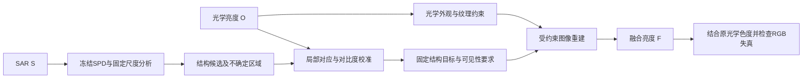

**光学—SAR 图像融合：历史实验复盘与最终设计建议**

最终实施文件：[边界几何监督与结构操作选择方案](D:/#imageInfusion/光学SAR融合_最终设计方案_边界几何监督与结构操作选择_20261021.md)。后续旧版状态说明用于记录演进，具体架构与验收协议以最终文件为准。

当前实施约束以[V3无分割网络修订](D:/#imageInfusion/光学SAR融合_无分割网络约束修订_V3_20261021.md)为准：无需新增标注，训练、推理与评价均不引入分割网络。本文历史实验分析保留。

日期：2026-10-21。本文基于工作区已有结果、实现代码和可核验论文；本次没有执行训练、模型推理或批量测试。新增内容是研究分析与设计，所有新方法性能均待验证。

后续修订：依据“不新增人工标注”的要求，以及本地东营配对标签的核查，实施路线已由[V2可行性复审](D:/#imageInfusion/光学SAR融合_可行性复审与免新增标注方案_V2_20261021.md)更新。本文历史分析保留；人工候选标注、人工对比度校准与首版复杂约束求解不再作为推荐实施前提。

**核心建议：将本章收敛为“光学保真与结构可见性约束下的 SAR 结构传递融合”。** 保留现有 SPD 作为候选结构提取工具，以图像域的可解释重建替代当前融合解码路径；只学习小型结构校准器，直接约束最终图像中的光学失真和 SAR 补充结构对比度。B0 + Detail-only SPD 保留为主要工程基线。

这个方案的可行性来自问题范围、优化变量和失败判据都比较明确，不代表现有证据已经证明它会成功。首先要验证：可靠 SAR 候选结构经过可控重建后，是否存在光学外观和结构可见性同时合格的解。

**1．证据范围与比较口径**

本次检查了包含36条实验的注册表、生成索引、正式 test1000 表、近期 val1000 原始 summary、P0 特征审计、U0 局部干预、SRR 收尾和先验审计、部分训练历史，以及 CDDFuse/C0/OCAF/CSR/MFFA 的关键实现。还查看了已有样本4的 CSR-v2、MFFA、OCAF-v2 预览。单样本预览只用于解释现象，不代表全数据集比例。

证据优先级采用：原始输出与协议 > 注册表 > 总结文档 > 早期研究计划。结果分为三层：已登记的同组定量结果、未完整登记的探索性诊断、根据代码和文献提出的机制推断。

发现两处需要避免沿用的旧说法：

- `U0_LOCAL_SAR_UTILITY_PROTOCOL.md` 写着“尚无实测结果”，但实际已有 train24 和 val24 输出。
- `EXPERIMENT_INDEX.md` 末尾仍写“SPD只有val200”，但其前面的表格和注册表已经包含 SPD 的 test1000。

本文没有修改这些生成文件，也没有把历史诊断重新登记成新实验。论文定稿时，应单独补齐诊断结果的登记和可比性审查。

**2．正式结果支持什么结论**

下面各行均来自注册组 `QXS-TEST1000-PAPER-CLAMP-v1`。数值为均值，不能据此声称统计显著性。

| 方法 | FMI↑ | QAB/F↑ | NAB/F↓ | VIF↑ | 判断 |
|---|---:|---:|---:|---:|---|
| B0 | 0.6946 | 0.7138 | 0.1145 | 0.3948 | 传统结构指标高，已有可视样本明显偏向SAR |
| B1-v5 | 0.2976 | 0.3825 | 0.0522 | 0.2359 | 抑制响应同时损失大量结构信息 |
| C0-minimax | 0.4358 | 0.5905 | 0.0585 | 0.2503 | 改变了折中位置，未获得全面改善 |
| C0 + SPD特征净化 | 0.4307 | 0.6007 | 0.0556 | 0.2516 | 在C0上局部改善，仍受基线限制 |
| B0 + SPD全特征净化 | 0.6553 | 0.7015 | 0.0813 | 0.3554 | 抑制伪影代理指标，伴随信息损失 |
| B0 + Detail-only SPD，原SPD权重 | 0.6960 | 0.7141 | 0.0933 | 0.3958 | 当前最稳妥的保信息型改动之一 |
| B0 + Detail-only SPD，独立重训 | 0.6954 | 0.7137 | 0.0946 | 0.3953 | 与前一结果接近，可作工程主基线 |

重训 Detail-only SPD 相对 B0 的 NAB/F 约下降17.4%，FMI、QAB/F、VIF的均值基本保持。但 NAB/F 不是直接的斑点噪声测量，因此准确结论是“降低了当前评价器定义的伪影指标，同时基本保持信息指标”，不能直接写“真实散斑减少17.4%”。

去噪子任务中，SPD在内部50张数据上把 PSNR 从21.2698提高到25.5198，SSIM从0.5474提高到0.7140，说明它确实具备该数据域上的去噪能力。不过，这不证明其 QXS 输出就是干净SAR真值，也不证明所有被删除成分都是噪声。

来源：[实验注册表](D:/#imageInfusion/CDDFuse/EXPERIMENT_REGISTRY.json)、[五方法正式表](D:/#imageInfusion/CDDFuse/test_result/v21_softmask/five_method_test1000_comparison/comparison_14_metrics.md)、[SPD内部去噪结果](D:/#imageInfusion/CDDFuse/test_result/v21_softmask/spd_nomask_seed42_internal_test50/summary.json)。

**3．近期方法为什么没有继续取得收益**

以下表格单独使用 `QXS-VAL1000-SPD-SCALE-SWEEP-v1` 注册组，不能与上一张 test1000 表作数值横比。

| 方法 | FMI↑ | QAB/F↑ | NAB/F↓ | VIF↑ |
|---|---:|---:|---:|---:|
| B0 | 0.7122 | 0.7192 | 0.1119 | 0.3985 |
| 重训Detail-only SPD | 0.7104 | 0.7191 | 0.0916 | 0.3989 |
| P1来源保持细节路由 | 0.7119 | 0.7191 | 0.1128 | 0.3983 |
| P2-A完整残差 | 0.7073 | 0.7180 | 0.1001 | 0.3964 |
| Optical Rescue | 0.7100 | 0.7190 | 0.0907 | 0.3989 |
| CSR-v1 | 0.7103 | 0.7190 | 0.0907 | 0.3989 |
| CSR-v2 | 0.7097 | 0.7190 | 0.0870 | 0.3984 |
| OCAF-v1 | 0.3836 | 0.3269 | 0.0009 | 0.5038 |
| OCAF-v2 | 0.3761 | 0.3263 | 0.0076 | 0.5022 |
| MFFA Phase-2 | 0.3419 | 0.4167 | 0.1150 | 0.1882 |

来源：[注册索引](D:/#imageInfusion/CDDFuse/EXPERIMENT_INDEX.md)。下述诊断则追溯到各自原始文件。

**3.1　P0不支持“大量特征相消”作为主要原因。**

P0 val200 的 Detail 光学/SAR RMS 分别为0.1314、0.1259，SAR能量占比约0.4894；同位余弦约0.7350，负余弦比例仅0.000725，定义的相消量约0.0696。这组数值不足以支持“特征能量严重失衡”或“多数位置发生负相关相消”。不能把来源保持、双编码器当成已经证实的必要解法。

局部最佳余弦提高到0.9243，但25个位移的众数比例只有0.0443，接近均匀的0.04，归一化位移熵高达0.99957。这更符合局部搜索偏差，不能直接解释成发现了可恢复的真实错位。

Detail扰动敏感度在SAR-only区约0.0620、平坦区约0.0683，存在小差异，但尚无可靠性分类精度证据。由此支持的结论是“现成特征及简单相似度不足以提供清晰、可解释的路由依据”。

来源：[P0原始审计](D:/#imageInfusion/CDDFuse/audit_result/fusion_feature_p0/b0_val200_seed42/summary.json)。

**3.2　SRR证实了门控可以学会，但没有证实它学到融合效用。**

SRR后期正负Anchor门控均值能够分离到约0.9881和0.1119；然而融合仍差，关闭Complementary分支反而改善多项指标。两候选分支余弦约0.90–0.92，未形成可信的功能分工。后期使用数据规模发生变化，这些数字只能用于诊断，不能作为公平性能主表。

固定结构先验审计还发现：阈值0.5下高响应覆盖约1.73%，约73.88%的连通域面积不超过5像素。它具有结构偏好，但主要是碎片、亮点和短线段集合。把这张图同时用作网络输入和Anchor标签，容易形成“学习复述先验”的捷径。

来源：[SRR收尾](D:/#imageInfusion/CDDFuse/SRR_RELIABILITY_ROUTING_CLOSURE.md)、[FSE独立审计](D:/#imageInfusion/CDDFuse/test_result/reliability_v5/fse_v2a_prior_audit_24/FSE_V2A_PRIOR_AUDIT.md)、[Anchor语义审计](D:/#imageInfusion/CDDFuse/test_result/reliability_v5/srr_anchor_quadrant_audit_24_center_checked/ANCHOR_SEMANTIC_AUDIT.md)。

**3.3　U0有局部方向差异，但不足以启动新的效用路由网络。**

val24共384个tile。在扰动强度0.1时，正向和负向的QAB/F真增益比例分别约28.65%、22.14%，但多指标Pareto代理的正向比例仅13.80%，负向为0；强度0.2时，Pareto正向降至7.29%，负向仍为0。两个强度下都非中性的稳定性统计仅覆盖100/384个tile，不能把条件内100%一致解释成所有区域都稳定。

此外，干预影响有约10%–11%的跨ROI外溢。当前证据显示的是局部指标权衡，尚未证明存在可广泛学习、同时有益的正负SAR贡献标签。

来源：[U0逐强度统计](D:/#imageInfusion/CDDFuse/test_result/reliability_v5/u0_local_utility_val24/strength_summary.csv)、[U0稳定性](D:/#imageInfusion/CDDFuse/test_result/reliability_v5/u0_local_utility_val24/stability_summary.json)。这部分未见于当前36条注册记录，作为探索性证据使用。

**3.4　CSR/OCAF的瓶颈已从“门能否打开”变成“输出是否真正改变”。**

CSR-v2光学门均值已经达到4.23%，但最终修正RMS只有0.000465，换算为8-bit灰度约0.119级。NAB/F相对重训SPD约下降5.0%，其他指标基本不动，不能因此认定光学道路或田界已恢复。

OCAF-v1的SAR门均值约0.0235%，独占增量RMS约7×10⁻⁶；OCAF-v2的SAR门提高到4.86%，独占增量RMS提高到0.000208，但也只有约0.053个8-bit灰度级；总增量RMS约0.000854，即0.218级。全图RMS不能代表每个ROI都不可见，但清楚说明整体变化尺度很小，必须补看ROI对比度和量化后变化。

同一次 OCAF-v2 评价的 Optical-only 为 FMI=0.3886、QAB/F=0.3270、NAB/F=0、VIF=0.5041。OCAF-v2的这些数值与它很接近且多数未改善；SCD由0.5410升至0.5918，说明不能说完全没使用SAR，但现有记录未验证可见的有效结构补充。

代码也限制了其表达能力：Common主要沿光学已有中频符号增强；Exclusive采用 `sign(S_band)·relu(|S_band|-|O_band|)`，只允许正超额幅值。它容易漏掉“幅值弱于光学背景、但几何位置不同”的SAR结构。候选、门控、小幅度目标共同限制输出，单独提高门控覆盖率无法解决这一点。

来源：[CSR-v2原始结果](D:/#imageInfusion/CDDFuse/test_result/csr_v2/calibrated_routing_seed42_val1000/summary.json)、[OCAF-v2原始结果](D:/#imageInfusion/CDDFuse/test_result/ocaf_v2/independent_amplitude_seed42_val1000/summary.json)、[OCAF-v2实现](D:/#imageInfusion/CDDFuse/ocaf_v2.py)。

**3.5　MFFA说明“可重建”与“可融合”是两个不同问题。**

Phase-1的光学MAE约3.22×10⁻⁵、SAR MAE约3.66×10⁻⁴，两者SSIM均接近1。但 Phase-2 仍表现很差。自编码器能重建单模态，不能保证混合特征位于解码器已学习的有效表示范围，也不能保证融合监督正确。

Phase-2仅训练融合层，沿用C0 frequency-minimax，运行5轮。内部val loss从1.4123降到1.2080，末期仍在下降。因此既不能断言“再训练一定无用”，也不能把全部失败归因为“没训够”。当前更强的证据是：重建闸门不足以检验融合目标与混合表示，需要额外的来源贡献和输出结构闸门。

来源：[Phase-1结果](D:/#imageInfusion/CDDFuse/test_result/mffa_v1/phase1_dtypefix_seed42_val1000/summary.json)、[Phase-2结果](D:/#imageInfusion/CDDFuse/test_result/mffa_v1/phase2_seed42_val1000_evalfix/summary.json)、[训练历史](D:/#imageInfusion/CDDFuse/models/mffa_v1/phase2_seed42/history.csv)。

**3.6　换输入层、解冻编码器尚未显示解法优势。**

C1 Base/Detail Adapter在各自val200对照中普遍表现为NAB/F下降、QAB/F下降；E1双stem和编码器解冻结果也未超过对应C0对照。解冻E1与解冻C0同时恶化，说明不应把问题简单归因于“共用一个stem”。这些历史输出尚未纳入当前同组主表，只作为既有探索结果。

来源：[C1对照](D:/#imageInfusion/CDDFuse/test_result/reliability_v5/validation_c1_adapters_final/c1_vs_c0_summary.csv)、[E1对照](D:/#imageInfusion/CDDFuse/test_result/reliability_v5/validation_e1_dual_stem_final/e1_vs_c0_summary.csv)、[解冻对照](D:/#imageInfusion/CDDFuse/test_result/reliability_v5/validation_e1_unfrozen_final/e1_unfrozen_comparison_summary.csv)。

**4．失败原因的统一解释**

**第一，任务目标没有被足够严格地定义。** 光学—SAR融合不是同时重建两张辐射机理不同的图像。若期望结果便于视觉判读，就应明确保持光学亮度布局与纹理，并把SAR提供的可靠几何证据显示出来。原始SAR强散射灰度不应自动成为输出亮度目标。若要保存定量后向散射，则一张光学风格RGB图不是足够的产品，需要另存原SAR或多通道数据；本章限定为结构增强的可视融合。

**第二，监督把响应强度与有效信息混在了一起。** 原始 `Fusionloss` 使用逐像素强度max及梯度幅值max。SAR散斑和强散射也会产生强梯度，因此该目标在机制上可能鼓励传递这些响应。其确切因果贡献还需匹配损失消融，不能仅凭代码定量归因。

C0虽然改成频率分工，`fusion_frequency_decoupled`仍依据平滑SAR与光学的梯度幅值比较选择目标。平滑后仍有斑点，跨模态边缘还可能反号；SmoothMax只平衡误差大小，不修正目标本身的物理含义。

**第三，潜变量分支不等于物理频带，也不等于独立信息通道。** CDDFuse的Base/Detail是学习到的表示，缺少严格频率支持约束。SAR还会通过Base到达解码器。SRR混合路径诊断显示两支强协同，单个Detail门无法独占控制最终SAR贡献。P0也不支持把失败简单解释为相加抵消。

**第四，结构证据、噪声概率和融合收益是三种不同量。** 线响应高只说明局部形态显著；SPD删除量大不必然说明噪声大；光学/SAR不一致也可能来自互补、时相变化、错配或叠掩。把它们组合成一个“可靠性真值”会引入循环论证。

**第五，模型容易在两个退化解之间移动。** SAR监督强时，输出接近SAR；光学保真、稀疏或一致性监督强时，输出接近光学。保真约束只规定“不要改太多”，缺少对经过核验的补充结构“必须显示多少”的约束，OCAF就可能满足损失却缺乏可见融合。

**第六，指标不足以排除上述退化。** 当前NAB/F把融合梯度超过两源梯度的情况视作伪影，直接复制源图天然有利；VIF、SSIM又是两源与融合图的平均，Optical-only取得约0.5并不表示有效融合。EN/AG/SF也不能区分噪声和信息。历史FMI采用本项目的DCT量化实现，不能直接与其他论文不同实现的FMI比较。

来源：[原始损失](D:/#imageInfusion/CDDFuse/utils/loss.py)、[C0训练实现](D:/#imageInfusion/CDDFuse/train_OS.py)、[编码解码器](D:/#imageInfusion/CDDFuse/net.py)、[指标定义](D:/#imageInfusion/CDDFuse/PAPER_METRICS.md)。

另一个工程细节是原Decoder执行 `sigmoid(residual + optical)`，并非严格的光学恒等旁路；将“输入了光学”解释成“天然保留光学”并不成立。MFFA的logit频带可逆合成也不保证sigmoid后的强度频带仍严格独立。

**5．相关论文给出的设计依据与创新边界**

| 论文 | 可借鉴的结论或方法 | 对本项目的边界 |
|---|---|---|
| Zhao等，CDDFuse，CVPR 2023 | 相关驱动的Base/Detail双分支与两阶段训练 | 原论文主要验证红外—可见光和医学融合，不能直接假定其分解对应SAR噪声/结构。[论文](https://arxiv.org/abs/2211.14461) |
| Ye等，SOSTF，GRSL 2022 | 明确利用SAR结构和光学纹理互补，结构—纹理分解参与监督 | “SAR结构+光学纹理”已有先例，不能作为本章唯一创新。[IEEE论文](https://ieeexplore.ieee.org/document/9936631/) |
| Kong等，Dense-UGAN + GS，Remote Sensing 2021 | 将SAR纹理、斑点抑制和光学光谱保持分别考虑 | 支持任务分工；没有必要为本项目再引入GAN训练负担。[论文](https://www.mdpi.com/2072-4292/13/21/4274) |
| Dalsasso等，SAR2SAR，JSTARS 2021 | 利用多时相有噪观测、时相变化补偿和斑点统计开展学习 | 给同一有噪SAR再乘随机扰动，不等价于独立观测，也不能证明得到干净结构。[论文](https://arxiv.org/abs/2006.15037) |
| Li等，RIFT，TIP 2020 | 相位一致性与Log-Gabor描述降低非线性辐射差异对匹配的影响 | 可借鉴结构对应与反号容忍；配准描述子不是融合可靠性真值。[作者论文](https://ljy-rs.github.io/web/Files/TIP2020.pdf) |
| Pérez等，Poisson Image Editing，SIGGRAPH 2003 | 通过优化重建把梯度信息与目标图像约束结合 | 提供成熟的可解释重建基础，梯度域本身不是新贡献。[论文](https://www.cs.jhu.edu/~misha/Fall07/Papers/Perez03.pdf) |
| Li等，Fusion of SAR and Optical Image for Sea Ice Extraction，2021 | 已将Poisson方程用于SAR—光学融合，并评估海冰提取 | 不能声称首次将Poisson用于该任务。[出版页](https://link.springer.com/article/10.1007/s11802-021-4824-y) |
| Hou等，CSP-MCIN，Remote Sensing 2026 | 独立编码器、多尺度交互、模态相关/语义目标及PCGrad | 提示模态偏置和目标冲突值得关注；现阶段本项目缺少引入大语义教师的必要性。[论文](https://www.mdpi.com/2072-4292/18/7/975) |

本次检索还发现高度相关的 [FSDFuse出版条目](https://www.sciencedirect.com/science/article/pii/S1566253526007050) 与[作者代码页](https://github.com/Dejavuee/FSDFuse)。可获取摘要描述了频域/空域解耦和分频融合；代码页当前仅公开部分解耦模块。这里未核验完整正文和最终书目信息，不据此声称具体对比效果，也不把“频率解耦+非对称门控”包装为新的核心贡献。上述文献比较是针对本方案的定向检索，不是穷尽的新颖性检索。

**6．最终方案：光学保真与结构可见性约束下的SAR结构传递融合**

建议章名：**《面向光学—SAR图像融合的可校准结构传递与约束重建方法》**。

工作简称为 CSTF（Calibrated Structure Transfer Fusion，仅作为项目简称，正式使用前检索重名）。研究问题压缩成一句话：

> 在保持光学外观的条件下，把经过验证的SAR补充结构，以足够可见且不过度失真的对比度传递到融合图像。

本章主任务限于已配准、无明显云遮挡的光学/SAR图像对，关注边界、连续线状结构和局部轮廓。孤立强散射点、复杂叠掩与真实时相变化作为困难案例单独报告。方案不承担SAR到真实光学反射率反演，也不宣称解决所有几何畸变。

总体数据流：

原B0融合图仅作为对照，不进入新方法的必需前向路径。SPD及其编码依赖可以复用；新增可学习部分只负责结构校准，不生成任意纹理。

**6.1　模块一：SAR候选结构与三态证据**

输入光学亮度 \(O\in[0,1]\) 与SAR显示强度 \(S\)。先使用固定SPD得到 \(\hat S\)。同时保留原SAR、清洗SAR及它们的差异，以便审计真实结构是否被删掉。

在2—3个中尺度上计算方向、边界/脊线响应和连通支撑，生成结构片段集合 \(\mathcal R=\{r_j\}\)。初始尺度可以取平滑σ约1、2、4像素，最终值只由训练/验证确定。这不是把某频带直接命名为“纯结构”；尺度分析只用于提出候选。

每个候选输出：几何位置、支撑宽度、方向、跨尺度持续性、局部对比度、不确定度。必须区分三种状态：接受、拒绝、不确定。不确定区域不自动变成噪声负样本。

共同结构依据局部几何支持识别，并允许辐射反号；SAR补充结构依据SAR内部证据及光学支持不足提出，不要求它的梯度比光学更强。原SAR与SPD输出的一致性只是证据之一，不直接生成可靠性真值。点目标不能套用“长线越长越可靠”的同一规则，本章首版暂不把它们列为强制传递对象。

QXS当前代码读入的是8-bit灰度并除255。没有标定元数据时，不能把它自动当线性SAR强度，并将Gamma噪声训练称作精确物理建模。真实数据上的变换是表示归一化；严格斑点模型只用于定义明确的受控合成实验。

**6.2　模块二：把SAR结构映射为光学域可解释的对比度**

对候选 \(r_j\) 定义线性对比算子：

\[
C_j(F)=\operatorname{mean}_{A_j}F-\operatorname{mean}_{B_j}F.
\]

边界采用两侧窄条带；脊线采用中心与两侧背景。使用平滑权重代替硬框，避开无效SAR边界。候选宽度和算子定义在求解前固定。

共同边界优先保持光学符号，不强迫它匹配SAR灰度正负。仅SAR可见的候选使用稳定SAR响应符号作为一种可视编码，明确不把该符号解释为真实光学反射率。

目标对比度 \(c_j^*\) 由SAR结构的局部标准化对比度映射而来，并限制在训练集可见结构的合理范围；禁止用整幅图的SAR最大值直接定标。小型校准器输入候选局部证据，预测结构置信 \(q_j\) 和有限范围内的对比度修正。初版采用约3—4层卷积、16—32通道及ROI池化；参数量目标不超过0.5M，需实现后实测。

校准器不预测任意融合特征，不学习与候选幅值互相补偿的多重门；它输出的是可以通过ROI两侧灰度差检查的量。置信度只决定候选是否进入约束或被标成不确定，不允许在联合训练中通过把 \(q_j\) 降到零来逃避结构监督。

**6.3　模块三：直接求解融合图像**

记 \(A_k=\nabla G_{\sigma_k}\) 为固定的多尺度梯度算子，\(H=I-G_{\sigma_h}\) 为光学高频算子。由已校准结构构造目标场 \(t_k\)：候选支撑外采用 \(A_kO\)，支撑内根据候选方向和目标对比度生成结构场。候选冲突时先按几何一致性合并，无法一致的标为不确定，不逐像素取最大梯度。

用以下凸优化作为首版重建器：

\[
\begin{aligned}
\min_{F,\xi\ge0}\quad
&\frac{\lambda_0}{2}\|F-O\|_2^2
+\frac{\lambda_T}{2}\|W_T H(F-O)\|_2^2\\
&+\sum_k\frac{\lambda_k}{2}\|W_k(A_kF-t_k)\|_2^2
+\frac{\lambda_N}{2}\|W_N\nabla(F-O)\|_2^2
+\mu\sum_j\xi_j,
\end{aligned}
\]

满足：

\[
0\le F\le1,\qquad
\|G_{\sigma_L}(F-O)\|_2/\sqrt N\le\varepsilon_L,
\]

\[
\|W_T H(F-O)\|_2/\sqrt{\sum W_T^2+\epsilon}\le\varepsilon_T,
\]

\[
|C_j(F)-c_j^*|\le\tau_j+\xi_j,
\quad j\in\mathcal R_{\mathrm{accepted}}.
\]

其中 \(W_T\) 在未接受SAR补充的光学区域较强，在接受候选的局部允许有限改变；\(W_N\) 只在明确的平坦/低结构区域惩罚新增颗粒；\(W_k\) 是求解前冻结的非负结构权重。所有范数均只计算有效区域，掩码归一化避免不同覆盖率改变损失量级。

对于光学中缺失的候选，只有当 \(|c_j^*-C_j(O)|\) 超过候选不确定度和预设可见性阈值时，才进入强制可见性集合。这样，在零松弛条件下，直接复制光学不能同时满足这些候选约束。无可靠补充结构时，输出接近光学是合理行为，不人为要求每张图都增加SAR信息。

固定目标和权重后，目标是凸二次项加线性松弛惩罚，约束是凸集合；\(\lambda_0>0\)保证融合图像解的唯一性。局部梯度场不一定可积，重建器求其与光学约束共同允许的近似图像，不声称精确实现所有梯度。

首版使用标准原始—对偶或ADMM迭代；无约束版本可用共轭梯度作诊断。**不要用“解完再clip”冒充受约束求解**，因为clip会破坏对比度和保真约束。没有必要首版就把迭代展开成深网络；先验证求解器收敛与实际收益，再决定是否需要加速。

松弛变量用于处理结构冲突、范围边界及光学保真要求之间的不相容。它不代表问题已经解决：必须报告违约量、违约候选比例与原因。大量候选靠松弛被放弃时，应判定候选或任务假设失败。

RGB输出结合原光学色度，但还要报告颜色变化及裁剪比例。固定色度不保证视觉颜色完全不变；Y变化和RGB裁剪都会产生影响。所有保真与可见性指标同时检查浮点输出和最终量化输出。

**6.4　为什么这条路径与OCAF-v2有实质区别**

| 维度 | OCAF-v2 | 本方案 |
|---|---|---|
| 被控制的量 | 像素门和全局增量尺度 | 最终图像的ROI结构对比度、光学失真预算 |
| 结构候选 | SAR相对光学的正超额频带幅值 | 几何片段，允许较弱但位置不同的SAR结构 |
| 输出幅度 | 预设小全局上限，再乘局部门 | 局部对比度定标，受输出失真预算约束 |
| 防复制 | 门控/能量目标，可能仍产生很小变化 | 已接受补充候选的可见性约束及违约检查 |
| 重建机制 | 直接叠加增量 | 显式求解带保真和结构约束的图像 |
| 失败定位 | 门、先验、候选和幅值容易混合 | 区分候选错误、对比度错误、约束冲突和求解误差 |

若将本方案简化成“继续增加OCAF门的幅度”，就丢失了主要设计价值。真正要检验的是输出空间中是否存在满足双侧要求的解。

**7．训练与数据策略**

先完成无训练版本，冻结SPD、结构算子和重建器。只有验证存在收益空间后，才训练结构校准器。首版不联合更新SPD或B0，不用C0的minimax作为新方法的默认训练目标。

校准器训练分两类数据，二者结论分开报告：

1. **受控合成数据。** 显式构造共同结构、光学独有纹理、SAR独有线/边界和噪声区域，使目标融合图及结构支撑已知。SAR强度域采用定义清楚的乘性噪声；幅度域使用对应平方根关系。加入辐射反号、对比度变化、尺度变化与轻微错位，并设“没有互补结构”的负例。合成目标为保留光学背景并显示已知SAR独占结构，不能把原光学图一律当目标，否则会再次学会复制光学。
2. **少量真实结构标注。** 建议从旧train中选20—30对，标注约100—200个候选为“共同结构、可解释补充结构、明显颗粒/伪影、不确定”，仅校准可信度与对比度范围。真实val保留独立候选用于检验误检与域差；最终留出不得参与这些阈值选择。预算允许时用两次独立判读记录分歧，不确定样本不强作正负标签。

合成部分可以利用已知支撑和对比度，使用平衡分类损失与鲁棒对比度误差。真实小样本部分只对确定标签监督置信度，避免要求人标注整幅理想融合图。校准器训练完冻结，再执行受约束重建；这切断“把置信度降到零就能降低融合损失”的途径。

这是一条弱监督/受控合成辅助路线，应如实命名。若完全不愿提供任何真实候选标注，只能将置信输出称为启发式得分，并降低对真实结构可靠性的结论强度。小样本标注需求比收集理想融合真值低，但不能假装它不存在。

现有split元数据写有20000对可用、10000对已使用、10000对未使用。这个记录支持继续审计剩余数据，但不证明剩余数据从未被其他脚本使用，也不证明它们与旧样本空间独立。新最终留出应先检查图像哈希、近重复、相邻裁块及场景来源；能按地理场景分组时优先按场景留出。旧test1000只作历史回归集，不能继续称为从未使用的最终测试集。

**8．最小验证路线与停止条件**

所有训练、数据集批量审计和批量测试由用户在Windows CMD执行。本次只提出协议，不运行这些工作。

**阶段A：先证明重建路径有收益空间。** 从旧train固定抽取24对，依据场景覆盖而非方法效果选择候选。设置“人工核验候选”和“自动候选”两条路径；人工路径是诊断上界，不能当最终方法。固定光学保真预算，比较Optical-only、简单线性混合、标准混合梯度重建、B0+Detail-only SPD、本方案无学习版本。

关键问题是：能否在保留道路、田界、纹理等光学结构的同时，让独立核验的SAR补充结构获得可见对比度？如果人工核验候选也无法达到这一点，就停止训练校准器，先修改表示或收窄任务。网络无法弥补没有收益空间的输出定义。

**阶段B：候选可靠性和自动化。** 固定所有目标范围，在独立旧val子集检验自动候选相对人工候选的差距。若上界有效但自动候选无效，投入只集中在候选校准；不继续扩大融合主干。训练校准器时使用3个随机种子，并以“图像/场景”作为统计单位，不能把同一图的多个ROI当完全独立样本。

**阶段C：完整验证与新留出确认。** 冻结方法和阈值后再执行val1000、旧test回归及新场景留出。若外部数据可用，追加跨数据集检验，但不把不同分辨率/预处理的结果混进同一数值表。

建议在阶段A开始前预注册以下工程闸门，数值是启动建议，不是历史实测或文献标准：

- 光学低频RMSE初始预算取2/255；另报告不同预算下的折中曲线，最终预算仅由开发集确定。
- 保留区域的光学结构召回建议不低于Optical-only的95%，以人工核验边界计算，允许的定位容差预先固定。
- 在已核验补充ROI中，以目标对比度达到率和量化后可见性为主；建议至少80%的接受候选达到目标的80%，同时报告候选本身的准确率，禁止通过只接收极少量容易候选刷通过率。
- 在合成已知平坦区，新增高频能量应低于未经处理的SAR直接传递，并同时保持独占结构召回；真实平坦区使用经核验的固定ROI，不用自动掩码自证正确。
- 含松弛的候选违约率和不确定候选覆盖率必须报告，不能只计算成功传递的子集。
- 相对Optical-only必须出现经独立结构评价确认的增益；相对SPD基线必须出现光学可读性改善。若只有NAB/F下降或全图微小数值变化，则不算完成目标。

这些门槛不能保证取得更好的所有14项传统指标。若“QAB/F、FMI必须同时全面超过当前B0”是硬要求，当前证据不足以承诺这条路线能满足；论文应提前采用与任务一致的主评价，而不是看结果后更换标准。

**9．论文实验矩阵与创新性表述**

基础对照应包含Optical-only、SAR-only、简单混合、Laplacian/Wavelet、标准梯度域重建、B0、B0+Detail-only SPD，并在复现成本允许时加入SOSTF或CSP-MCIN这一类专门面向光学—SAR的近期方法。外部论文结果只有相同数据与评价实现时才可进入本项目主表；现有`comparation`目录结果在完成登记及协议核验前不与注册表直接拼接。

必要消融控制在六项：

| 消融 | 要回答的问题 |
|---|---|
| 原SAR候选 vs SPD候选 | 去噪是否有助于提取可传递结构，是否误删细线 |
| 固定校准 vs 学习校准 | 小网络是否比透明规则更好 |
| 无光学保真约束 | 是否重新出现SAR主导 |
| 无结构可见性约束 | 是否重新退化为光学复制 |
| 直接叠加 vs 约束重建 | 收益是否来自重建路径，而非单纯增大幅度 |
| 人工核验候选 vs 自动候选 | 失败主要来自候选还是重建能力 |

鲁棒性至少覆盖噪声强度、1/2/3像素偏移、辐射反号和弱SAR结构。已有有噪SAR上叠加扰动，只能称附加扰动敏感性；不能称为独立多视斑点真值实验。SAR错配/打乱对照需结合人工核验结构，合理预期是误检受控或更多拒绝，不要求网络对完全错误输入给出固定差异量。

评价分三层：

- **主评价：** 光学低频误差、光学结构保持、经核验SAR补充结构的精确率/召回率/局部对比度、固定平坦ROI新增颗粒、违约率。
- **兼容评价：** 原14项指标全量保留，分别解释信息保持、源图偏置和伪影代理，不挑有利指标。
- **外部证据：** 固定随机样本的盲评；若已有可用标签，再加入边界或分割任务。没有标注与实验时，不声称改善下游任务。

主评价中的ROI标签须独立于训练目标生成器。例如不能用同一套自动结构检测器同时生成候选、训练标签和唯一的测试真值。统计报告按图像/场景做成对置信区间，分别报告3个训练种子的波动；目前历史表只有均值的项目不补造显著性结论。

本章可以形成两个明确、可消融的贡献：

1. **面向异质成像的可校准结构传递。** 将SAR作为几何结构来源，将光学作为外观和纹理来源；用局部结构对比度表达传递目标，并允许不确定性拒绝，避免将原SAR灰度或梯度最大值直接作为融合目标。
2. **光学保真与补充结构可见性的双侧约束重建。** 对最终图像同时规定外观误差上界和已核验补充结构的对比度要求，显式记录不可兼容候选，抑制SAR主导和光学复制两类退化。

结构提取、SPD、Poisson重建和小卷积网络分别都有先例；创新性应落在上述任务定义、校准接口和可检验约束的组合上。对于毕业论文一个章节，这样的贡献范围合理，但仍需消融和独立结果支持，不能只凭架构图认定创新有效。

建议章节叙事按“历史失败证据 → 双侧退化问题 → 结构对比度表示 → 约束重建 → 自动校准 → 消融与失败案例”展开。已做的SRR、P0、U0、MFFA实验可以成为问题分析和设计依据，不必全部包装成方法组件。

**10．实现边界与交付建议**

当前交付为设计文档，新方法尚未实现。因此不提供看似可直接运行、实际上不存在的训练命令。后续实现建议新增独立目录，至少包含候选提取、局部对比算子、约束求解器、校准器、评价器和带唯一输出目录的CMD入口。每次产生新的模型结果后按现有规则登记实验并维护索引。

实现前的单元测试应覆盖：无接受候选时退化为光学；线性对比算子与梯度算子的数值一致性；输出范围及保真预算；可行候选约束的满足率；不可行条件下松弛报告；RGB与uint8转换后的可见性变化。它们验证工程性质，不能替代24对可行性实验和最终场景留出。

研究资源应集中在“候选是否可信、目标对比度是否合理、约束是否可同时满足”这三个问题。B0+Detail-only SPD已经提供了可靠的保底对照；新方法只有在这三个问题得到数据支持后，才进入完整训练和正式比较。
