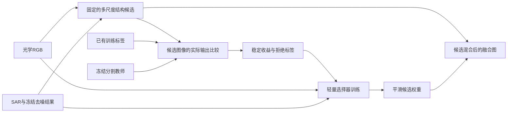

**光学—SAR融合可行性复审：利用现有语义标签的修订方案V2**

最终实施文件：[边界几何监督与结构操作选择方案](D:/#imageInfusion/光学SAR融合_最终设计方案_边界几何监督与结构操作选择_20261021.md)，训练、推理和评价均不使用分割网络。

状态：本版已因“不引入分割网络”的明确约束被[V3修订](D:/#imageInfusion/光学SAR融合_无分割网络约束修订_V3_20261021.md)替代。本文分割教师、语义收益蒸馏及分割评价器均不再实施；数据核查事实仍保留。

日期：2026-10-21。本文接续[历史复盘与第一版设计](D:/#imageInfusion/光学SAR融合_历史复盘与最终设计方案_20261021.md)，按“不新增人工标注、优先利用现有数据”的要求修订后续路线。第一版历史结果分析仍保留；本文件替代其人工候选标注、人工对比度校准和首版复杂约束重建的实施建议。

本次只做文献核查、本地文件目录计数和1组图像/标签格式读取，没有训练模型，没有运行批量评价，没有新模型性能结果。

**结论：推荐“现有语义标签监督的结构候选效用学习”，以本地东营数据起步。** 由固定候选产生器提供几种可解释的融合图，用现成标签和冻结分割器判断候选是否带来实际收益，再训练一个轻量选择器。推理只输入光学与SAR，不需要标签或分割教师。研究标题建议为《语义增益监督与光学保真约束下的光学—SAR结构融合方法》。

这是一项利用现有标签的有监督研究，融合图像本身没有真值；应称“无需新增标注”，不应称“完全无监督”。

**1．第一版中需要修正的可行性判断**

| 第一版环节 | 实际问题 | V2处理 |
|---|---|---|
| 人工选SAR补充结构 | 需要判读、标ROI，并可能存在主观差异 | 使用配准的现成分割标签构建训练与独立评价 |
| 局部目标对比度真值 | 语义类别无法决定融合图像应该亮几级、正负号是什么 | 不拟造目标灰度真值，比较有限候选的真实输出效用 |
| 强制SAR结构可见 | 候选错了可能强制引入伪结构；松弛变量又可能使模型放弃约束 | 保留光学候选，只有有稳定收益的样本/区域才监督引入SAR |
| 多重约束求解 | 数学凸性不保证视觉正确，参数、收敛和不可行性处理都有成本 | 首版用确定性候选与平滑混合，复杂优化降为后续对照 |
| SPD即可靠清洗SAR | 现有去噪验证不保证跨域可靠 | 冻结SPD，但先做适配检查并保留无需学习的平滑对照 |

第一版仍值得保留的内容是：光学提供外观与颜色；SAR贡献应在最终图像中验证；光学复制与SAR主导都要用对照识别；结构可靠性不能被先验响应直接替代。

**语义标签能告诉我们“这块区域属于什么类别”，通常不能告诉我们“这个SAR亮点是真目标还是散斑”，也不能给出理想融合图。** 因此，简单将标签边界当SAR可靠性正样本、区域内部当噪声负样本，会重复之前Anchor监督的错误。同类区域内也存在有效道路纹理、建筑轮廓和散射结构；边界附近还可能有配准误差。

**2．本地已经具备配对标签，优先级高于重新找数据**

本次实际目录计数与单样本检查如下：

| 路径 | 文件数量 | 样本1格式 |
|---|---:|---|
| `datasets/Dongying/GF2` | 7,831个JPG | 256×256，RGB，uint8 |
| `datasets/Dongying/GF3` | 7,831个JPG | 256×256，灰度，uint8 |
| `datasets/Dongying/label` | 7,831个PNG | 256×256，单通道uint8 |

样本 `label/1.png` 的像素值为0和1，无调色板。这只表明该张图含这些索引，**不代表整个数据集只有两类，也不代表0应被忽略**。完整类别映射、ignore值、标签来源和场景切分仍需审计。

历史[数据记录](D:/#imageInfusion/CDDFuse/DONGYING_PRETRAINED_TEST.md)记载三目录同名配对已通过，数据来自DDHRNet。当前本地还有 `datasets/DDHRNet_DATA/xian/no_cloud` 与 `korea/no_cloud` 下的GF2/GF3/label目录，可在映射确认后考虑做跨场景实验；`Dongying`与`DDHRNet_DATA/shandong`应先按重复副本处理，不能分放训练和测试。

作者仓库对应论文为Ren等《A dual-stream high resolution network: Deep fusion of GF-2 and GF-3 data for land cover classification》，2022。作者README提供数据入口，但引用的旧代码目录本次没有成功获取，不能假定其旧Paddle训练工程可以直接运行。现阶段可以使用现有PyTorch环境新建简洁分割基线。[作者来源](https://github.com/XD-MG/DDHRNet/blob/main/README.md)

**3．公开数据集选择**

| 数据集 | 适合提供的监督 | 主要限制 | 本项目排序 |
|---|---|---|---|
| DDHRNet东营 | 本地已有RGB/SAR/像素标签；无需新增标注 | 标签索引、裁块重叠、空间来源和历史训练暴露需核验 | 首选，先完成闭环 |
| WHU-OPT-SAR | GF-1光学、GF-3 SAR及像素类别；RGB+NIR，5m；作者给出7个有效类别及背景 | 5m类别边界不等于1m精细结构；原始大图要按场景切分 | 优先外部验证或备选主数据 |
| OpenEarthMap-SAR | 0.15–0.5m、8类；公开分割基线与权重 | 部分人工标签、全量伪标签，不能视为全量精确真值；跨传感器域差大 | 扩展验证，优先真实标签子集 |
| SpaceNet 6 | 配对SAR/光学和建筑轮廓，可用于边界任务 | 建筑单任务；SAR叠掩与地面轮廓可能不一致 | 建筑专题时再选 |
| SEN12MS/DFC2020 | 大尺度地物语义；DFC2020含更高分辨率评价标签 | SEN12MS原生MODIS标签为500m，虽重采样到10m仍是粗标签 | 不作为本章细结构主监督 |
| 仅光学分割数据 | 可预训练光学编码器或评价器 | 缺配对SAR，无法直接监督SAR的边际贡献 | 仅辅助 |

WHU官方标签编码为0背景，10农田、20城市、30乡村、40水、50森林、60道路、70其他。只有采用WHU时才按它的规则映射，不能套用到东营。作者也特别说明论文类别占比表存在错误，统计应以实际公开数据为准。[WHU作者说明](https://github.com/AmberHen/WHU-OPT-SAR-dataset/blob/main/README.md)

OpenEarthMap-SAR作者给出5033幅1024×1024图像、35个区域，以及部分人工/全量伪标签的明确区分。其官方基线在“仅每区域5张真实标注”配置下，Optical mIoU=65.10，SAR+Optical=60.16；在“伪标签”配置下分别为56.56与56.32。这些是该基线和协议的结果，不是模态融合不可能有效的证明，但足以说明增加SAR并不自动带来语义收益。[数据和基线](https://github.com/cliffbb/OpenEarthMap-SAR)、[论文](https://arxiv.org/abs/2501.10891)

SEN12MS的标签原生分辨率与采样间隔差异已由竞赛官方明确说明，不能把上采样标签用于精细轮廓真值。[DFC2020官方说明](https://www.grss-ieee.org/community/technical-committees/2020-ieee-grss-data-fusion-contest/)。建筑专题数据见[SpaceNet 6论文](https://arxiv.org/abs/2004.06500)。

**4．最终主方法的具体定义**

方法简称可暂用 SGUF（Semantic-Gain-guided Utility Fusion，正式命名前另查重名）。核心目标是：在满足光学外观容差的候选中，学习选择能增加地物语义与边界信息的SAR结构贡献。

它包含固定结构候选产生器、离线语义效用标注器、轻量候选选择器三个部分。仅后两者涉及新训练，其中语义教师不参与最终融合推理。

图中标签和教师只用于训练。独立测试标签只供评估，不生成测试权重、不挑选测试候选。

**4.1　固定产生少量可解释候选**

保留光学色度，在亮度域构造候选。记光学亮度为O，去噪SAR为Ŝ，固定中尺度带通为 \(B(X)=G_{\sigma_1}X-G_{\sigma_2}X\)。由训练集冻结的稳健对比度规则得到 \(\widetilde B(Ŝ)\)，并构造：

\[
R_m=\widetilde B(Ŝ)-B(O),\qquad
F_k^Y=\operatorname{clip}(O+\alpha_kR_m,0,1).
\]

首版只保留 \(\alpha\in\{0,0.25,0.5,1\}\) 四档；第五个候选可在中尺度之外加入少量去噪高频，只有四档显示收益后再启用。具体σ和对比度映射由训练/开发集固定，候选规模保持小。上述数值是待验证初始设计，不是已经调优的最优参数。

候选0严格等于光学。候选是结构替换而非全图强度混合，SAR不直接覆盖光学区域均值；但有限滤波、clip和空间变化的权重仍会改变低频，因此必须测量最终图像的低频误差，不能声称严格零低频泄漏。

候选标准化不能无限放大平坦区，需设最小能量保护和训练集确定的增益上限；RGB转换也要纳入最终输出。所有候选经过与正式结果一致的保存/量化口径后再离线评分。

此处确实复用经典多尺度结构融合，并不把它作为单独创新。它提供受限、可解释的输出空间，减少任意生成纹理与门控/幅值互相补偿的自由度。如果这组候选没有收益，应先否定候选表示，不继续训练选择器。

**4.2　用“候选融合图的任务改善”定义效用**

训练一个小型RGB分割器H，例如ResNet-18编码器的U-Net。H只读取候选RGB图，不能旁路读取原SAR或两模态特征，否则任务提升无法归因于输出图像。

H的训练样本包含光学和固定候选的均衡增强，以降低纯光学教师排斥所有融合外观的偏差。候选构造不看标签，标签只用于分割监督。先完成H训练，然后冻结参数和归一化统计。

对于区域r和候选k，以类别均衡交叉熵及边界邻域加权误差定义可相加的局部损失：

\[
\ell_r(H(F),Y)=\operatorname{mean}_{p\in r\cap V}
\left[w_{Y(p)}(1+\lambda_b b_Y(p))\,
\mathrm{CE}(H(F)(p),Y(p))\right].
\]

\(V\)表示有效标签，\(b_Y\)由已有标签自动生成有容差的边界带。类别权重仅用训练标签统计。边界定位不确定区可忽略或降权，不能越过类别边界随意寻找最有利对应。这里的边界带只调整评分位置，不把真实标签轮廓画进融合图。

候选收益定义为：

\[
u_{r,k}=\ell_r(H(O),Y)-\ell_r(H(F_{r,k}),Y).
\]

首轮r取全图，验证候选有无收益空间。局部版本才使用四个重叠、平滑过渡的区域，并显式构造 \(F_{r,k}=O+M_r(F_k-O)\)，让教师对实际修改后的整图重新前向。不能把全图替换时的局部分数直接当作局部替换效用，因为分割器具有较大感受野。

在少量预先规定的翻转和温和光度变化下求均值与波动：

\[
\widetilde u_{r,k}=\operatorname{mean}_a u_{r,k}^{(a)}
-\eta\operatorname{std}_a u_{r,k}^{(a)}.
\]

这是一种稳健任务收益代理，不是物理因果效应，也不是通用感知真值。

**4.3　将保真作为候选准入条件，避免任意加权掩盖取舍**

对实际候选检查光学低频误差、光学高频偏离、范围裁剪与颜色变化。只有满足预先冻结容差的候选进入集合 \(\mathcal K_r\)。

\[
k_r^*=\arg\max_{k\in\mathcal K_r}\widetilde u_{r,k}.
\]

收益超过开发集预定噪声阈值δ、且对扰动稳定时才接受非零候选；所有候选无可靠收益时选择0。近似并列时优先改动更小的候选。收益不确定但非明显负收益的样本可以降权，不强作噪声负例。

这避免同时把若干不同量纲的指标随意加成一个总分。候选保真与任务收益分别报告，不因mIoU提高而掩盖明显的图像损坏。δ、容差和候选参数只能用开发集确定。

**4.4　学习选择并检查最终混合输出**

轻量网络 \(N_\theta(O,S,Ŝ)\) 输出粗网格上的K类权重，双线性上采样并平滑后得到 \(w_k(x)\ge0,\sum_kw_k(x)=1\)。先以区域候选标签做交叉熵/软标签蒸馏，不在首版增加任意残差解码器。

\[
F(x)=\sum_k w_k(x)F_k(x).
\]

由于各候选均在合法范围内，凸组合可保持数值范围；但它**不保证**低频误差预算、分割收益或梯度上界。空间权重的梯度会产生额外响应，多个局部修改也可能相互作用。因此必须以最终混合图重新检查保真和语义增益，并加入对权重的平滑正则；必要时对局部候选组合做一次离线修正，而非声称所有局部最优自动成为全局最优。

首版网络采用少量卷积及浅层多尺度编码，输出1/16或1/32分辨率权重，目标参数规模约0.1M—0.5M，实际规模与速度待实现测量。粗网格限制是为了减少接缝和利用微小纹理编码标签的机会，代价是小目标适配有限，需要作为限制报告。

训练损失首先使用选择蒸馏、实际输出光学保真和权重平滑。冻结教师只负责离线收益标签；首版无需让分割梯度直接优化输出图。若以后加入小权重任务微调，必须单独消融，不能用训练教师的mIoU自证效果。

**5．如何避免再次出现历史失败**

| 失败模式 | V2的处理与必须验证的条件 |
|---|---|
| SRR学会先验阈值却无收益 | 监督来自实际候选输出与现有标签的误差差值；不能只预测固定证据 |
| U0只有无参考指标取舍 | 使用真实类别标签的任务误差，但承认它仍是任务限定效用 |
| OCAF增量近乎不可见 | 候选包括有实际对比度变化的完整结构替换档位；量化后评分 |
| 纯光学复制 | 如果所有候选都不改善标签任务，明确判定数据/表示缺收益空间；不强迫每张图注入SAR |
| SAR主导 | 保真准入限制及光学候选兜底，最终输出仍需审查 |
| 语义纹理编码或迎合教师 | 固定候选、粗权重、独立评价器与量化/重采样稳定性复核 |
| 标签边界被当SAR结构真值 | 标签仅用于训练评分，推理不输入GT，类内真实结构不被强制删除 |
| SPD跨域误删结构 | 原SAR、固定平滑和SPD候选进行对照；SPD不作为真值 |

监督改变了任务定义，所以历史QXS结果不能直接证明新路线成功。V2的主结论应限定为“保真约束下有利于地物分割/边界判读的图像融合”；若只在某一类地物或受控弱光学条件下有效，应相应缩小论文主张。

**6．分割教师、独立评价和数据泄漏控制**

首先固定场景/空间块划分，再裁图、统计归一化参数和生成候选。已有数字ID本身不证明空间独立；同一大图邻接裁块、cloud/no_cloud版本及重复目录必须同组。没有地理来源时，应审计近重复与裁块邻接，不能将简单随机裁块划分称为严格跨场景验证。

开发阶段可采用训练空间块A训练H，训练空间块B生成收益标签并训练选择器，验证集只作参数选择。正式阶段若要充分利用数据，可在训练集内做两折交叉拟合：每块收益由未见过该块的教师生成。代价约为两次小分割器训练，应计入训练成本。

最终至少保留一个不同结构、未用于产生收益标签的分割器V，例如教师用U-Net、评价用DeepLabV3+或另一独立结构。V只在允许的训练块上训练；不能在测试图像或标签上适配。可报告两套互补协议：

- **冻结独立V：** 在开发前定义的光学及固定候选增强上训练，冻结后统一评价所有融合方法，说明增强分布可能带来的偏好。
- **等预算下游训练：** 每种融合方法分别训练相同结构、相同数据和预算的分割器，衡量该图像表示的可用性。结果不能混入冻结V表格，也不用于重新选择融合方法。

额外训练一个光学+SAR双流分割模型用于检查原始模态是否有互补信息。它是参照，不是图像融合的同预算竞争者：输入带宽、参数和训练成本不同。双流方法无收益时新图像融合收益更可疑；双流有收益也不保证一张RGB融合图能保留这些信息。

最终评价器只读取实际保存的融合RGB。不给它原SAR、选择权重、隐藏特征或标签边界，才能把成绩归于融合图本身。

**7．无需新增标注的实验闭环**

全部主要实验使用已有分割标签。人工目视检查可作为辅助展示，但不产生新的训练ROI、类别标签或主量化真值。

主指标采用mIoU、每类IoU及容差固定的Boundary F1；Boundary F1衡量语义类别边界，不代表所有细纹理和SAR散射目标。没有出现某类的单张图不把该类IoU记零再平均，统计口径要固定。报告场景/图像级成对置信区间和随机种子波动。

图像评价包括原14项指标、光学低频误差、颜色变化、量化前后差异和固定尺度的新增高频能量。类别内部不自动视为均匀噪声区；真实噪声结论仍需谨慎。受控合成数据可用于补充检测“抑制噪声是否同时删结构”，不能替代真实标签上的结果。

必要对照：Optical-only、SAR显示图、简单混合、标准多尺度融合、B0、B0+Detail-only SPD、固定最优全局候选、本方案；再添加光学自身锐化/对比度增强候选与错配SAR对照，排除收益只是光学增强。直接双流分割单独列。

最小消融保持四个：

1. 固定全局选择 vs 学习区域选择，检验学习式空间选择是否确有价值。
2. 普通分割损失训练 vs 候选实际收益蒸馏，检验效用监督是否必要。
3. 无保真准入 vs 有保真准入，检验是否以图像失真换任务分数。
4. 原SAR/固定平滑/SPD，检验SPD在当前数据域的价值。

再做同均值常数权重或空间打乱权重诊断，检查路由空间布局，而不仅检查门均值。对0、1、2像素配准扰动及温和附加噪声进行测试；这些批量工作只提供CMD供用户执行。

训练时可以少量加入自动生成的低对比/模糊光学版本以研究互补性，标签不变；干净光学条件必须单独作为主表。只在人工退化条件有效时，结论应改为退化条件下的结构补偿，不能泛化到正常输入。这里不把云去除或SAR到光学生成引入首版。

QXS没有现成语义标签，因此仅用于额外视觉迁移、历史指标回归及不依赖标签的稳定性检查。由本方法教师产生的QXS伪标签不能作为独立真值证明方法有效。

**8．阶段性可行性闸门及成本**

第一步不是训练融合模型，而是核查已有标签和划分。全数据审计需要统计类别、同名配对、尺寸、无效值、近重复和空间来源。单样本已证实标签是可读索引图，但不能替代全量审计。后续批量审计由用户运行。

第二步建立小分割基线。先用已有train的一部分训练H，在空间独立开发样本上验证光学分割是否达到基本可用水平。没有同域可靠教师时，直接套用一个“现成权重”不能省略这一检验。

第三步做有限候选的开发集上界检查。固定64对有类别覆盖的开发样本、4—5个全图候选，在同一光学保真容差下，使用H与标签选候选，再交给独立V复核。这里的标签参与了选择，因此结果只是“已知标签的候选上界诊断”，不是可部署结果；不能进入最终方法主表。

通过条件应同时包括：独立V下有稳定增益、超过仅光学增强对照、图像失真在预算内、收益不只来自个别场景。可将“平均mIoU约提高1个百分点且按场景的成对区间支持正收益”作为初始工程目标，但最终主指标和容差必须在相应确认集使用前冻结。0.01的mIoU差是1个百分点，不写成相对1%。

第四步才扩大到局部选择。四个区域、四个非零候选约需16次干预前向，加一个基准；与双重图像增强结合约翻倍。这是相对前向次数估计，不是GPU耗时承诺。可缓存候选和效用，先用约1000对开发训练样本；确认有效后再覆盖全部训练数据。不要一开始对8000对进行密集像素级反事实搜索。

第五步训练选择器，检验它能否在未见过的场景接近开发诊断收益，并超过固定全局候选。最终推理只保留固定候选产生器、去噪器（若有效）和小选择网络，不保留H/V。训练所需的多个分割模型仍是成本，必须在论文中说明。

停止条件：

- 同保真条件下，已有标签选出的候选在独立V中也无稳定收益：停止学习式选择，说明候选缺乏可用信息或视觉压缩不可行。
- 候选有效，但选择器跨场景不能优于固定候选：不再堆模块，检查收益标签一致性和数据量。
- 只有评分教师变好，独立V和等预算下游均无提升：判定为教师适配，不能称有效融合。
- 只有人为退化场景有效：缩小研究主题。
- 得分提高但图像出现类别块、接缝或伪轮廓：不通过视觉融合验收。

**9．论文依据与创新边界**

[SegMiF，ICCV 2023](https://arxiv.org/abs/2308.02097)已研究融合与分割的交互；[TDFusion，CVPR 2025](https://arxiv.org/abs/2412.03240)已利用任务损失学习融合目标；[SAGE，CVPR 2025](https://arxiv.org/abs/2503.01210)已引入SAM语义先验和教师蒸馏。因而“用语义分割指导融合”“训练时有教师、推理时去掉教师”都不能单独作为本章创新。

本章可以主张的待验证贡献是：

- **SAR结构候选的边际任务收益监督：** 在冻结评价模型与光学基准下，对实际可见候选输出进行对照，由已有地物标签产生效用和拒绝监督，并显式考虑扰动稳定性。
- **光学保真限制下的轻量结构选择：** 将SAR贡献约束在可解释的多尺度候选空间，训练时学习区域选择，推理时无需语义教师，结合独立任务评价排除复制和教师适配。

这两点将历史“可靠性不等于效用”的负结果转化为可验证设计。创新范围属于有针对性的监督与架构组合，不声称首创任务驱动融合或严格因果推断。主实验仍需证明它比普通语义损失、固定候选和光学增强更有价值。

不建议首版引入SAM大模型、双层优化、GAN或Diffusion。SAM可提供分组或边界先验，但不能自动产生SAR可靠性真值，且本地已有像素标签。上述选择基于本项目成本与证据，不是对这些方法普遍有效性的否定。

**10．本次复审后的实施决定**

优先级固定为：本地东营标签审计 → 小分割基线 → 有保真限制的候选收益检查 → 轻量选择器 → 独立场景确认。WHU为外部验证优先候选，OpenEarthMap-SAR为真实标签/跨传感器扩展。首版不要求新增人工标注，不实施第一版的复杂约束求解器。

本次没有新增训练入口，因此不提供不存在的可执行训练命令。实现时应新增独立的语义融合目录及唯一输出路径，训练、离线收益生成和批量测试均提供Windows CMD，由用户执行。每次实际产生模型评价后按项目规则登记，语义协议与旧融合指标协议分组存储。

当前最确定的进展是：标签来源已经存在，监督可以自动生成，推理可以保持轻量；尚未证实的是SAR候选在正常光学输入上是否有足够稳定的任务增益。后一个问题应先由小规模上界实验回答，再投入完整训练。
