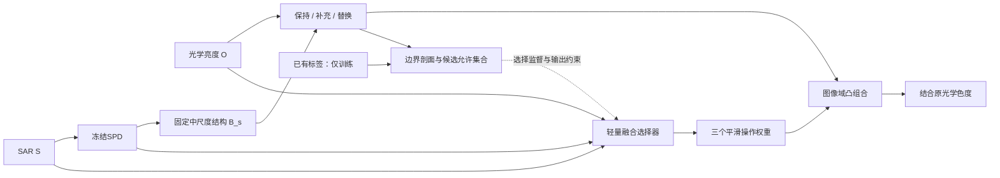

**最终设计方案：边界几何监督与结构操作选择的光学—SAR图像融合**

2026-10-22更新：用户要求保留CDDFuse主干，架构已由[CDDFuse改进最终修订](D:/#imageInfusion/CDDFuse改进_最终架构修订_20261022.md)替代。本文独立选择器不再作为主方法；历史审查和几何弱参考规则继续保留。

日期：2026-10-21。本文件完成V1—V3的创新性与可行性复审，并依据最终审查补齐边界极性、局部候选一致性和颜色输出链，作为后续实现依据。历史实验分析继续有效，旧版方法建议以本文件为准。

固定约束：中文文档；无需新增人工标注；训练、推理、评价均不引入分割网络、分割教师、SAM或边界预测网络；训练和批量测试只提供Windows CMD供用户执行。本次没有训练、推理或批量评价，新方法没有实测性能。

**最终判断：V3直接实施的创新性偏弱，经过两处修正后，可以形成主题明确、工程规模可控的毕业论文章节。** 修正一是消除“多个强度候选其实等价于单门控”的冗余；修正二是将模糊的边界打分，明确为具有几何容差、并列候选和不确定样本处理的监督协议。核心贡献是监督与输出操作的结合，不是提出一种新主干。

推荐章名：**《边界几何监督与结构操作选择的光学—SAR图像融合方法》**。可以称为“已有标签辅助的融合学习”；它使用已有像素类别标签，不能称完全无监督，也不能冒称弱监督语义分割。

**1．创新性审查：已有内容与本章空间**

| 对照工作 | 已有思想 | 本方案需要明确区分的地方 |
|---|---|---|
| CDDFuse，CVPR 2023 | 相关驱动的Base/Detail分解与融合 | 不将学习特征分支当成可靠结构/噪声的物理分解；在图像域控制SAR贡献。[论文](https://arxiv.org/abs/2211.14461) |
| SOSTF，GRSL 2022 | SAR结构、光学纹理互补及结构—纹理损失 | “结构＋纹理”已有先例；本章重点是如何选择具体结构操作及监督其净收益。[作者论文](https://ktqizhi.github.io/papers/ye2022unsupervised.pdf) |
| IDEAL，ICML 2026 | 将局部模态贡献作为决策变量，结合差异、频谱条件和不确定性 | “决策式融合、可解释权重、不确定时保守”均不足以独立构成新贡献；本章使用外部标签几何和实际操作结果形成监督。[正式论文页](https://proceedings.mlr.press/v306/pan26d.html) |
| SegMiF / TDFusion | 利用分割交互或任务损失引导融合 | 本方案没有任务网络，标签只作为离线几何参考。[SegMiF](https://arxiv.org/abs/2308.02097)、[TDFusion](https://arxiv.org/abs/2412.03240) |
| STSFusion，2026（红外—可见光） | 分割分支同时提供语义、区域和边界监督 | 它不是光学—SAR方法，只能说明“加入边界监督”并非空白；本方案不预测边界或类别，监督的是源图可形成的结构操作结果。[出版页](https://link.springer.com/article/10.1007/s44443-026-01217-0) |
| FSDFuse，在线出版条目 | 面向SAR—可见光的频域/空域解耦、分频融合与分割引导精化 | 这是同模态直接对照；不以分频、结构仲裁或非对称门控本身宣称创新。本次核验限于摘要和出版页；页面卷期标为2027年3月，DOI为2026年，不写成已读完整正文。[出版条目](https://www.sciencedirect.com/science/article/pii/S1566253526007050) |
| Detection-as-strategy，在线出版条目 | 面向SAR—可见光的可靠性约束聚合、稳定结构/脆弱细节分离，并以检测监督作调制先验 | “可靠性路由”和“任务监督不直接注入内容”均已有同任务先例；本方案的区分点只能落在标签边界几何、实际图像域操作及允许集合的组合。[出版条目](https://www.sciencedirect.com/science/article/pii/S0957417426024590) |

定向检索未发现与下述完整实现完全相同的方案，但这不证明全球首创。毕业论文可以主张针对光学—SAR失败机制设计的、可消融的组合贡献。不能把“只有几个卷积却指标提高”预先当作创新成立，也不承诺达到某期刊的录用标准。

**1.1　V3必须纠正的数学退化**

V3采用 \(F_k=O+\alpha_kR\)，再作空间凸组合。若暂不发生clip，有：

\[
\sum_k w_kF_k=O+\left(\sum_kw_k\alpha_k\right)R.
\]

所以多个强度候选只是一个有效系数 \(\alpha_{\mathrm{eff}}\)。clip会打破严格等价，但裁剪饱和不是合理的创新来源。最终方法因此不把这类候选叫多专家，改为控制两种不同的残差方向：添加SAR结构，与移除光学中尺度后替换为SAR结构。

**1.2　最终保留的两个贡献**

1. **具有几何容差和不确定性处理的结构操作监督。** 使用现有地物标签提供的边界位置，比较源图操作后真实输出的定位、连续性和局部轮廓；并列候选用允许集合监督，证据不足的样本不强造标签。标签不进入前向路径，不变成可靠性真值。
2. **光学保真约束下的双操作结构融合。** 显式区分“补充SAR”与“替换冲突的光学中尺度”，并保留恒等操作。使用同一套可见候选进行离线监督与在线合成，直接检查输出是否发生有效变化，避免潜特征幅值补偿。

第二点的加法/替换和Softmax本身是常见运算，贡献依赖其与第一点共同解决具体问题。不能把“决策式融合”“可靠性路由”“边界监督”或“结构—细节分工”单独列为创新。若独立消融显示两种操作没有不同作用，应减少贡献表述，不能只依据命名宣称分工。

**2．历史证据对设计的约束**

| 已有证据 | 对最终设计的约束 |
|---|---|
| Detail-only SPD在原test1000上基本保持FMI/QAB/F/VIF并降低NAB/F | 保留它作为基线和可复用去噪资产；不称SPD输出为干净真值 |
| SRR能拟合Anchor却没有融合收益，分支高度相似 | 不用固定先验阈值作为可靠性标签；操作必须有直接可测效果 |
| P0不支持大规模负相关相消，局部位移熵近1 | 不以“特征严重相消”或“已发现可恢复错位”为新方法依据 |
| U0的局部指标收益主要是权衡，val24负向Pareto比例为0 | 不能把QAB/F变化直接当效用真值；新收益应有外部几何参考 |
| CSR-v2修正RMS约0.000465；OCAF-v2总增量RMS约0.000854 | 不继续叠加小全局幅度和多重置信门；关注量化后局部效果 |
| MFFA单模态重建很好、融合仍差 | 不再以重建精度代替融合收益验证；不重建整个自编码主干 |

来源详见[历史复盘](D:/#imageInfusion/光学SAR融合_历史复盘与最终设计方案_20261021.md)、[SRR收尾](D:/#imageInfusion/CDDFuse/SRR_RELIABILITY_ROUTING_CLOSURE.md)、[U0原始统计](D:/#imageInfusion/CDDFuse/test_result/reliability_v5/u0_local_utility_val24/strength_summary.csv)。不同split的数值不混成同一性能表。上述RMS乘255后仍较小，但不能据全图RMS判定所有局部变化都不可见。

**3．最终架构：固定三种操作，只学习选择**

输入为已配准光学RGB和SAR显示灰度。先按3.1节的冻结颜色链将光学分为亮度O和色度，SAR经冻结SPD得到Ŝ。主方法首版保留SPD，固定平滑/无SPD仅作预先规定的消融；若开发闸门发现SPD跨域不适用，应停止并记录协议变更，不静默换实现。

原B0 Encoder/BaseFuse/DetailFuse/Decoder不再承担新融合路径。SPD本身如依赖原编码器则保留其冻结依赖，资源统计不得漏算。B0+Detail-only SPD是必备对照，不是新模型输出的锚点。

**3.1　固定颜色链与中尺度表示**

先冻结唯一的颜色与保存链。首版统一采用sRGB输入及ITU-R BT.601全范围YCbCr数值定义；uint8 RGB先除以255得到sRGB编码值，再以固定矩阵得到亮度O与Cb/Cr，不先做线性光反解。融合后使用同一逆矩阵结合原Cb/Cr重建RGB，随后按RGB通道clip到[0,1]，以round-half-up规则量化到uint8并保存无损PNG。不得在不同实验中混用OpenCV limited-range YCrCb、PIL YCbCr或Lab。具体矩阵、通道顺序、舍入规则和库版本写入配置与单元测试。

离线候选打分、监督缓存生成和正式评价均读取上述链路产生的实际RGB/PNG；几何指标从保存后的RGB按同一BT.601矩阵重新计算亮度。训练反向传播使用完成RGB clip、但尚未uint8量化的浮点输出，并另行记录clip比例；开发闸门必须同时检查浮点输出和量化输出，量化后收益消失则判定候选无效。该约定是可复现的显示域协议，不表示物理反射率守恒。

\[
B_o=G_{\sigma_1}(O)-G_{\sigma_2}(O),\qquad
B_s=c\,[G_{\sigma_1}(Ŝ)-G_{\sigma_2}(Ŝ)].
\]

初始 \((\sigma_1,\sigma_2)=(1,3)\) 像素，核与边界填充全程固定。尺度只表达允许修改的空间范围，不宣称中频是纯结构、其他频带是纯噪声。

c是显示对比度校准常数，不学习空间幅值，也不由当前光学弱结构决定。建议从训练集有效非平坦图块的 \(\mathrm{RMS}(B_o)/\mathrm{RMS}(B_s^{raw})\) 中位数估计，限幅到预先声明区间如[0.25,4]，并保存校准样本清单。分母近零样本不用于估计；验证、测试不重新拟合c。若c大量触及限幅或域间分布明显偏离，应视为表示风险。

QXS/东营读入的是显示用uint8图，没有标定元数据时不将其视作线性后向散射，也不把简单乘性增强称为精确SAR物理模型。

**3.2　三种确定性操作**

\[
F_P=O,
\quad F_A=\operatorname{clip}(O+B_s,0,1),
\quad F_R=\operatorname{clip}(O-B_o+B_s,0,1).
\]

- P：保持光学；
- A：保留光学中尺度，同时补充SAR结构；
- R：允许撤去冲突的光学中尺度，再加入SAR结构。

未裁剪时最终输出可以写成：

\[
F=O+(w_A+w_R)B_s-w_RB_o.
\]

与单一残差缩放相比，它在一般情况下控制两个方向。两模态中尺度局部共线时仍可能退化，三权重也不一定可唯一解释；不能把它们直接叫物理信息占比。需通过“仅A、仅R、A+R”及固定权重消融验证实际分工。

三候选都先生成真实可保存图像，最终使用：

\[
F= w_PF_P+w_AF_A+w_RF_R,\qquad
w_k\ge0,\quad\sum_kw_k=1.
\]

凸组合保持亮度范围。它不保证严格频带隔离：clip和空间权重都会带来低频/高频泄漏。原色度也不保证RGB颜色不变，因此保真检查覆盖最终RGB和uint8输出，并严格使用3.1节的冻结链。此处不再增加复杂频域投影或迭代求解器。

**3.3　轻量选择器**

输入只含O、S、Ŝ、B_o、B_s及可选固定梯度。双浅层卷积分别处理光学与SAR，再拼接进入小型多尺度卷积模块，输出三个操作logits。使用1/4分辨率输出、固定双线性上采样和轻度平滑，再逐像素Softmax；不使用类别头、边界头或任意RGB残差头。

建议通道16/32/64，参数目标约0.1M—0.5M，实际需实现后统计；不提前承诺速度。训练整幅256×256，验证和推理同尺寸，避免再引入128训练/256评价差异。

初始化偏向P，如概率约0.8/0.1/0.1，三操作都保留梯度。该初始化不是严格光学恒等；强制权重[1,0,0]时应严格等于光学，用作单元检查。不同时把全局幅度和门控初始化为零。

**4．核心监督：标签提供几何，源图提供外观**

标签Y只用于训练侧的确定性运算。忽略类别名称，只保留有效类别变化位置。0是否为有效类必须先确认，不能照搬WHU规则。所有候选的像素内容均来自源图操作，不依据标签直接画线、染色或指定灰度。

**4.1　边界片段与对应容差**

由类别差分提取边界，分成局部方向相对稳定的片段 \(\gamma_j(t)\)，估计法向 \(n_j(t)\)。在法向两侧采样窄剖面：

\[
g_X(t,s)=\left|n_j(t)^\top\nabla G_\sigma X(\gamma_j(t)+s n_j(t))\right|.
\]

初始半宽h=5像素、定位容差δ=2像素；训练数据校准后冻结。剖面使用梯度绝对值，允许光学/SAR边缘反号。两模态几何是否对应仍须检查，反号不意味着可互换灰度。

无效标签邻域、三类交汇、极短片段标为不确定。相邻平行边界如道路两侧应采用两个允许峰区间；无法稳定区分的降权并报告数量，不强制压成一条线。真实叠掩、明显时相变化和超出容差的偏移不由本模型修复。

可在小范围内用原源图估计每个片段的共同参考偏移，但偏移必须在评价候选之前冻结，对所有方法一致；不得为每个候选或每个像素单独寻找最有利匹配。先记录未平移结果，再记录容差结果。

**4.2　边界极性与两侧亮度顺序准入**

绝对梯度只解决光学与SAR可能反号时的几何对应，不能证明两者灰度可以直接互换。对每个片段同时计算光学有符号法向对比度：

\[
p_O(j)=\operatorname{median}_{t}\left[
G_\sigma O(\gamma_j(t)+d n_j(t))-G_\sigma O(\gamma_j(t)-d n_j(t))
\right],
\]

其中d、采样带宽和有效比例由训练校准集冻结。仅当\(|p_O(j)|\)超过量化与等变扰动噪声裕度，才把光学两侧顺序视为可靠。此时A/R候选除满足几何分数外，还必须满足候选有符号对比度不反号，且相对光学的幅值变化不超过冻结上限；否则标为有害或不确定，不能因为绝对梯度更大而成为正监督。

当光学边界过弱、无法可靠确定两侧顺序时，只评价定位、连续性、集中度和额外峰，不把SAR灰度正负解释成地物反射率语义。首版不隐式逐片段翻转\(B_s\)，也不增加\(\pm B_s\)候选；若开发诊断表明反号是主要失败原因，应先停止并把“增加显式正负候选”登记为方案变更及独立消融，而不是在缓存生成中静默选有利符号。

**4.3　“有标签且有SAR支持”仅表示可评价，不直接表示应注入**

用原SAR/Ŝ在两个固定尺度的边缘位置与方向一致性判断是否有SAR支持，单个高亮点不能单独成为支持。这个判断只是选择可以比较的样本，不直接规定操作权重。

输出监督分为：可靠改进、明确伤害、并列、不确定。无标签边界的类内区域不自动作为噪声负例。已知光学结构但候选会破坏它的片段，可以成为保持操作的负向选择证据。

所有被跳过或不确定片段都保留原因和数量。正式评价同时报告完整可评价边界集合和预先由源图定义的“SAR支持、光学较弱”子集，防止只在有利子集上展示。

**4.4　局部候选必须与在线混合使用同一渲染定义**

为片段j构造冻结的非负平滑支持掩码\(M_j(x)\in[0,1]\)。掩码沿有效片段覆盖、在法向接受带内为1，并在固定过渡宽度内衰减到0；不得依据候选结果改变掩码。局部候选统一定义为：

\[
F_{j,k}^{Y}=O+M_j\odot(F_k-O),\qquad k\in\{P,A,R\}.
\]

上式中的\(F_k\)是3.2节已经逐候选clip后的亮度图；局部合成后按3.1节重建、clip、量化和重新读取亮度，得到实际评分图\(F_{j,k}^{save}\)。缓存中的候选分数和训练目标均来自这一相同渲染链，不能用全图候选分数代替局部施加结果。

区域平均权重仅作为门行为诊断量，固定为掩码加权平均，不再作为 (L_{set}) 的聚合输入：

\[
\bar w_{j,k}=\frac{\sum_xM_j(x)w_k(x)}{\sum_xM_j(x)+\epsilon}.
\]

此外记录沿中心线有效点的操作覆盖率；正向集合要求非P概率不仅均值达标，而且在预定比例的中心线位置达标，防止网络只在支持区一小部分集中高权重。覆盖阈值仅由训练数据冻结。

候选缓存生成时，任意两个有效支持掩码重叠且允许集合冲突的片段均不参加\(L_{set}\)和\(L_{profile}\)，仅保留为评价困难例；允许集合相容的重叠片段可以分别计分，但损失按像素覆盖次数归一化，避免道路双边界或密集轮廓被重复加权。三类交汇仍按4.1节跳过。首版不设置基于分数的片段优先级。

**4.5　比较实际操作结果，使用几何分数而非梯度最大值**

每个局部候选都按4.4节实际施加、保存并重新读取，再生成剖面；掩码过渡区与候选范围对所有方法一致。评分包括：

- 连续性C：沿边界出现有效匹配响应的位置比例；
- 集中度A：允许峰区间中的剖面梯度能量，占整个剖面能量的比例；
- 定位误差D与额外峰：候选主峰距离参考边界的误差，以及明确单边界区域新出现的平行峰。

主排序可固定为 \(Q=0.5C+0.5A\)，并将D不恶化、额外峰不增加以及4.2节的可靠光学极性不反转作为准入条件。阈值仅用训练校准集确定一次。对比度作为辅助观测，不用CNR最大化单独训练，以免把平滑和放大当作成功。

保真准入单独检查最终图的低频RMSE、标签接受带外的光学结构偏离、颜色及裁剪比例。初始低频预算可取2/255；这是待冻结的工程起点，不是感知标准。训练/验证需展示预算折中，正式测试前固定。

操作改进必须超过纯光学以及预先固定的光学自身锐化对照的评分噪声裕度。裕度由训练开发子集上的量化与等变变换波动估计；不使用测试集调节。若只增加梯度幅值而没有连续性或集中度改善，不生成SAR正向监督。

**4.6　允许集合监督，避免伪造唯一最优操作**

对于片段j，得到合法、稳定且评分接近最优的允许集合 \(\mathcal A_j\subseteq\{P,A,R\}\)：

- A/R稳定优于光学及锐化对照：集合不包含P；
- 候选明确有害：允许集合为{P}；
- A和R近似并列：允许{A,R}，不强制二选一；
- 证据不足：跳过该处选择监督，不把它等同于{P}。

为避免“片段少数位置概率很高、其余位置错误”仍通过区域平均，集合监督直接沿片段计算。记 \(\widetilde w_{j,k}(t)\) 为t处法向支持带内按 \(M_j\) 归一化加权的操作概率，\(T_j\) 为排除端点、无效邻域和冲突重叠区后的有效中心线采样点，则：

\[
L_{set}=-\sum_j\frac{q_j}{|T_j|}\sum_{t\in T_j}
\log\left(\sum_{k\in\mathcal A_j}\widetilde w_{j,k}(t)+\epsilon\right).
\]

该形式要求允许操作沿有效片段持续出现，不允许用局部极高权重补偿其他位置。法向平均核、中心线采样间隔和端点排除宽度均随监督缓存固定。q_j由离线判定的支持与扰动稳定性决定并冻结，不由网络自己预测，避免通过降低q逃避损失。所有集合和参数仅用训练标签生成，验证/测试标签不生成权重。

该监督借用集合标签学习的常见形式，不能声称损失公式首创；本章的重点是集合来自独立标签几何与实际SAR结构操作的结合。

**5．损失函数与训练安排**

首版只训练选择器，使用四项：

\[
L=L_{set}+\lambda_pL_{profile}+\lambda_oL_{opt}+\lambda_sL_{smooth}.
\]

- L_set：上述允许集合监督；
- L_profile：对可靠改进片段，让最终混合图的固定尺度梯度剖面接近允许候选中的至少一个，采用集合内最小L1误差；目标候选离线冻结，不对相反符号候选求平均；
- L_opt：全图光学低频保持，加接受片段支持带外的光学梯度保持；对4.2节判定为光学极性可靠的片段，同时惩罚最终输出有符号法向对比度越过零点或超过冻结变化上限；
- L_smooth：权重图总变差或固定网格相邻差，抑制接缝。

可写为：

\[
L_{profile}=\sum_{j\in\mathcal J_+}q_j\min_{k\in\mathcal A_j}
\|W_j[\nabla G_\sigma F-\nabla G_\sigma F_{j,k}]\|_1.
\]

损失中的 \(F\) 是最终混合亮度完成RGB重建、RGB clip并重新提取后的量化前浮点亮度；\(F_{j,k}\)则指4.4节经相同软掩码和同一输出链得到的量化前浮点评分图，不得重新实现另一套目标生成路径。\(W_j\)排除端点、无效标签邻域和冲突重叠区，并按像素覆盖次数归一化。集合内最小值出现严格并列时使用固定操作顺序仅保证数值复现，不赋予该顺序物理含义。

各项按有效像素/片段质量归一化，训练前使用固定训练子集估计尺度，避免掩码覆盖变化改变权重含义。λ按归一化后的量级设置少量开发配置，冻结后不再引入动态minimax或一组新的自适应损失。

L_profile用于检验“权重学会了，输出却没有传递结构”的情况；不是指定人造理想灰度。候选本身如果错误，这项损失也错误，所以必须先通过候选可行性闸门。

不加门均值目标、最低SAR覆盖率或全图非零注入约束。没有可靠补充结构时，P是合理选择。确有可靠改进时，集合排除P与输出剖面约束共同提供训练信号；这仍不构成所有测试样本都不复制光学的保证。

建议初始训练配置：256整图、batch4、AdamW、学习率1e-4、最多20轮、按验证边界与保真联合闸门早停。仅作起始工程配置，不预先保证收敛；最终3个种子分别报告。SPD不联合微调，新方法没有自编码预训练阶段。

**6．可行性审查与阶段闸门**

**工程可行性：较高。** 需要固定滤波、确定性边界采样、小型卷积选择器和标准训练器；本地已有图像及标签；新增模型数量为一个融合选择器。无需人工ROI、分割器、大模型或迭代图像求解。

**研究有效性：有条件，当前未证实。** 最主要风险是正常光学图已经给出较好边界，SAR候选没有额外收益；其次是标签与SAR结构不对应，以及去噪域差。不能给出可信成功概率，也不能据设计保证14项指标全面超过B0。

| 阶段 | 具体工作 | 通过条件 | 不通过时 |
|---|---|---|---|
| A：数据审计 | 类别映射、ignore、配对、重复副本、空间来源、既有训练暴露 | 可形成有效、互斥的开发与确认划分 | 停止正式性能主张，先修复协议 |
| B：无训练候选诊断 | 旧训练块固定64对发现、独立开发块固定32对确认；只比较三操作及光学增强 | 相同保真下存在跨图像稳定的边界净收益；标签辅助选择的收益可确认 | 不训练选择器；否定当前操作空间 |
| C：选择器Pilot | 按图像/场景分组，先使用约1000对训练，固定验证协议 | 优于固定全局权重与单残差门；量化后仍有收益 | 检查监督一致性，不加新大模块 |
| D：完整训练与确认 | 固定配置，3种子，空间留出与跨数据集 | 几何改善、光学保真、错误边缘控制同时成立 | 如实报告失败或缩小主张 |

阶段B的标签辅助选择是诊断参照，不是可部署结果，也不一定是连续混合模型的数学上界。它使用了开发标签，不能放入最终方法主表冒充推理性能。不存在稳定收益时，复杂网络也没有可靠学习目标。

建议阶段B同时报告：有效SAR支持片段比例、正收益片段比例、含正收益的图像比例、跨尺度/阈值稳定性及未选中区域的损失。若只在极少数样本有效，不能靠重采样或放大正例比例伪装成普遍收益。

正收益的工程门槛应由开发波动预注册。可将边界匹配覆盖相对光学提高约3个百分点、定位误差不恶化、低频RMSE不超过冻结预算作为初始目标；必须使用按场景/图像成对置信区间，并同时报告全部边界集合。阈值是项目推进标准，不是公认指标标准。

候选生成和剖面评价均为确定性CPU/GPU图像运算，成本通常低于训练额外任务模型，但本次未做速度测量。局部候选需要重算实际输出，缓存开销也应记录。先固定少量片段/区域，不对每个像素穷举大规模动作。

**7．数据与公平比较**

主数据优先使用本地东营7831组GF2/GF3/label；已有标签只作为融合几何弱参考。本地 `Dongying` 与 `DDHRNet_DATA/shandong`是同源副本候选，必须查重，不能作不同数据集。Xi’an/Pohang的cloud/no_cloud版本应按原场景分组。

先分地理场景/空间块，再切patch；数字文件名不代表独立性。缺少空间来源时，先查近重复和邻接，明确独立性限制。老东营训练/测试、QXS反复测试已经有历史暴露，不把它们自动叫全新最终集。冻结SPD与基线的训练来源也应核查，不能只检查新选择器是否见过测试图。

WHU-OPT-SAR作为外部候选，但5m与东营尺度不同，应冻结按地面距离换算的剖面/滤波尺度规则，不能跨域后按指标重新挑σ。若缺少分辨率元数据，零样本迁移结果只能按该限制解释。[WHU作者说明](https://github.com/AmberHen/WHU-OPT-SAR-dataset/blob/main/README.md)

QXS无标签，用作视觉迁移和历史14项指标回归，不为它伪造语义/结构真值。新标签监督协议和旧无标签融合协议分别建组；报告哪些方法用了标签，增加同骨干同标签训练对照，以区分额外监督和结构设计的贡献。

**8．最小实验矩阵**

基础对照至少有：Optical-only、仅光学锐化/对比度增强、标准多尺度融合、B0、B0+Detail-only SPD、SOSTF（可复现时）、本方案。IDEAL如代码和训练条件可落地，作为决策式融合对照；不可复现时只比较方法，不抄论文异协议数值。所有模型用同一输入尺度和保存策略。

消融控制在六组，不扩展成无限版本：

| 消融 | 核心假设 |
|---|---|
| 同一网络＋原max-gradient监督 vs 边界几何监督（含极性准入） | 收益是否主要来自监督定义，并检验是否避免边界明暗反转 |
| V3单残差门 vs P/A/R双操作 | 是否确实需要分开补充与替换 |
| 只允许A、只允许R、A+R | 两种操作是否有互补收益 |
| 硬单一候选标签 vs 允许集合/不确定跳过 | 标注误差和并列处理是否提高稳定性 |
| 无L_profile vs 有L_profile | 是否解决权重变化却输出无有效改变 |
| 原SAR/固定平滑/SPD | 收益是否依赖特定去噪器 |

常数权重、同均值空间打乱权重、仅光学输入的选择器、错配SAR是诊断对照，不必全部进行独立完整训练。SAR置零需明确分布外属性，不能单凭它掉分就认定有真实互补信息。

评价不使用分割网络，不报告分割mIoU。主指标为最终保存图中的边界匹配覆盖、位置误差、最长断裂长度及明确单边界附近的新增多峰；辅以光学低频误差、纹理/颜色保持、14项传统融合指标。真实图的NAB/F或平坦度都不能直接换算为散斑减少率。

训练评分使用剖面C/A，最终评价同时采用独立实现的固定边缘检测与一对一匹配，在预定多个阈值下汇总；禁止给每种方法调到自己的最优阈值。类别标签不覆盖所有真实边缘，类内边缘不能全部计为假阳性，Boundary IoU也不能直接套到灰度融合图。

加入具有已知干净结构和噪声的合成诊断：共同结构、光学独有、SAR独有、噪声、反号边界、1/2像素错位，分别报告结构召回与假边缘。它用于揭示机制，不替代真实数据有效性；显示域噪声增强与物理强度域乘性噪声实验严格分开。

**9．必须接受的限制与停止规则**

- 此方法优先改善已标注地物分界及相邻轮廓，不能据此宣称保留全部SAR散射机理、点目标或类内纹理。
- 三操作只张成受限图像空间，不能修复任意错配、散斑或光学缺失；如果候选不包含好结果，学习不会自动创造好结果。
- 同样的手工几何目标用于训练和唯一评价会形成自证，所以独立场景、多阈值、光学增强及已知真值合成对照必不可少。
- 成功标准是结构改善与保真共同成立，不是某一门控非零或某一个传统指标上升。
- 如果本方法仅在人工退化光学条件下有效，必须改称退化条件下的结构补偿，不能作为正常输入融合成功。
- 如果允许集合、双操作或输出剖面损失没有可复现独立贡献，论文贡献表述应相应缩减，而不是继续添加模块。

**10．最终落地范围**

方法结构至此固定：冻结SPD、固定中尺度三操作、一个轻量选择器、边界允许集合监督、输出剖面/光学保真/平滑约束。当前不加入分割、伪感知重建头、生成式模型、局部配准网络或复杂频域求解。

后续实现应独立新增数据审计、边界剖面、三操作、监督缓存、选择器、训练与评价入口；既有实验目录和模型不覆盖。首先做强制P恒等、三操作公式、极性反转拒绝、局部候选与空间权重等价、重叠冲突排除、候选并列集合、无有效片段、RGB重建与uint8回读、最终混合范围、标签不进入forward等单元检查，再把阶段B的批量命令交给用户。

本次交付是最终研究设计，不是代码实现，所以没有编造可执行训练命令。未来新增训练与批量评价统一提供CMD；实际产生结果后遵守注册表、唯一目录和同组比较规范。

**结论：** 本方案的创新性定位为针对SAR异质结构问题的监督与可解释操作组合，适合以一个毕业论文章节的规模开展验证；工程复杂度可控，最关键的不确定性仍是数据中是否有足够的真实补充结构收益。固定候选的开发诊断通过后再训练，构成这套设计可行性的必要条件。
