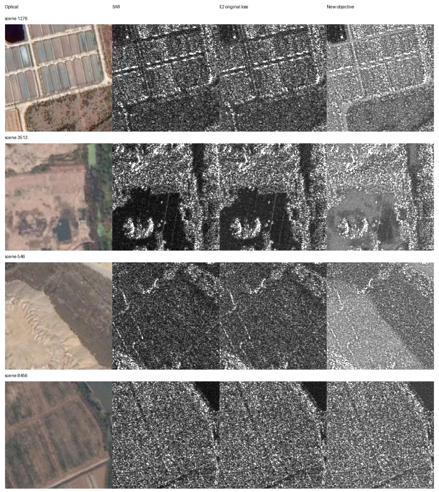

# E2 新监督小试结果分析

日期：2026-11-19。对象：`objective`，train1024/val64、4轮重建+12轮融合、seed42，固定使用最终 `epoch_016.pth`。本轮只检查已有训练日志、指标、元数据、哈希与固定四场景图像，没有执行训练、模型推理或批量重评。

**结论：训练和验证完整完成，新监督降低了 NAB/F，并提高光学相似性、SCD 和 MS-SSIM，但 FMI、VIF、QAB/F 与平均 SSIM 明显下降。当前没有通过保住互补信息与有效结构的联合筛查，不建议直接扩大训练、执行 test1000，或默认继续训练 readout/joint 来补救。**

这是改变两源取舍的结果，不是全面失败或全面提升；不能把 NAB/F 下降称为真实散斑按同样比例减少，也不能把光学 SSIM 上升直接称为困难边界已恢复。

**结果完整性与可比口径。**

- 16个 epoch checkpoint 均存在，4轮重建和12轮融合记录完整；最终 train/val loss 分别为0.369812、0.370607。
- 候选与对照同属 `QXS-E2-SOURCE-OBJECTIVE-V1-OBJECTIVE-VAL64-REFERENCE-FMI`，使用相同64个场景、相同顺序、相同 manifest SHA-256，以及 `reference_v2_candidate_with_paper_fmi` 和 clamp/uint8 输出策略。
- 验证 metadata 中候选 checkpoint、原 E2 checkpoint、manifest 和 evaluator 的哈希均与当前文件一致；`artifacts_sha256.json` 中200个产物全部匹配。
- 候选灰度图、RGB图和三联预览各64张。原E2复用已保存的匹配输出，没有额外训练或重跑。
- 训练和两项验证记录已存在于 `EXPERIMENT_REGISTRY.json`；本次分析不新增实验条目，也不改写原指标文件。

这仍是单种子开发集结果。候选记录了 Python3.10/PyTorch2.5.1+cu121 等环境，对照旧配置缺少同等详细的运行环境记录，不能声称所有数值环境都严格一致；本轮不据此默认安排基线重训。

**完整14项指标。** 数值均为方法间共同有限场景均值；MS-SSIM 的共同样本为53，其余为64。相对变化为 `(新监督/E2−1)×100%`，不是质量提升率。

| 指标 | 原 E2 | 新监督 | 相对变化 | 共同样本 |
|---|---:|---:|---:|---:|
| EN | 7.342382 | 7.296324 | −0.63% | 64 |
| MI | 3.525443 | 2.692996 | −23.61% | 64 |
| FMI | 0.630553 | 0.496579 | −21.25% | 64 |
| PSNR | 14.046515 | 13.786854 | −1.85% | 64 |
| QAB/F | 0.789001 | 0.779176 | −1.25% | 64 |
| NAB/F ↓ | 0.031860 | 0.019926 | **−37.46%** | 64 |
| AG | 18.857216 | 18.115979 | −3.93% | 64 |
| SF | 44.277900 | 42.617299 | −3.75% | 64 |
| SD | 50.522917 | 47.611316 | −5.76% | 64 |
| CC | 0.567552 | 0.607422 | +7.02% | 64 |
| SCD | 1.324327 | 1.541558 | **+16.40%** | 64 |
| SSIM | 0.529315 | 0.521049 | −1.56% | 64 |
| MS-SSIM | 0.587618 | 0.600315 | **+2.16%** | 53 |
| VIF | 0.335292 | 0.281236 | **−16.12%** | 64 |

来源：[原始配对表](../test_result/e2_source_objective_v1_objective/val64/seed42/paired_comparison.csv)、[逐图候选指标](../test_result/e2_source_objective_v1_objective/val64/seed42/candidate/metrics.csv)。

**代价不是少数异常图造成。**

- NAB/F：64/64图改善。
- FMI：52/64图下降；QAB/F：44/64图下降；VIF：42/64图下降；SSIM：37/64图下降。
- AG、SF：均在64/64图上降低，说明幅值/高频统计的改变具有普遍性，但不能由此区分删去的是噪声还是真结构。
- SCD：45/64图改善；MS-SSIM：53个共同有限场景中33图改善。

原始配对表的场景 bootstrap 95%区间中，FMI差为[−0.171109,−0.097697]，VIF差为[−0.068799,−0.040055]，QAB/F差为[−0.013621,−0.006139]；NAB/F差为[−0.012922,−0.010951]。这些分别支持该开发集上的明确取舍，不能替代训练种子或地理独立验证。

**来源相似性表明输出发生了模态取舍。**

| 来源读出 | E2 | 新监督 | 绝对变化 | 共同样本 |
|---|---:|---:|---:|---:|
| 光学 SSIM | 0.305154 | 0.353978 | +0.048824 | 64 |
| SAR SSIM | 0.753476 | 0.688121 | −0.065355 | 64 |
| 光学 MS-SSIM | 0.406249 | 0.497214 | +0.090964 | 55 |
| SAR MS-SSIM | 0.815945 | 0.745686 | −0.070258 | 62 |

光学 SSIM 在64/64图上提高，SAR SSIM 在62/64图上下降；光学 MS-SSIM 在55个共同有限场景全部提高，SAR MS-SSIM 在62个共同有限场景全部下降。

按原 E2 `SSIM_S>0.95` 固定的36图中，光学 SSIM 平均变化+0.050186，SAR SSIM平均变化−0.085593。不是重新按候选表现挑选子集。结果支持输出不再那么接近 SAR 的描述，但还不能判断降低的是散斑相似性还是有效SAR结构相似性。

新输出的平均 SAR SSIM 仍明显高于光学，未出现旧 G1 那种近乎复制光学的退化。当前代价更多体现为信息、对比与两源关系变化，不能将本轮直接等同于 G1。

来源：[E2来源诊断](../test_result/e2_source_objective_v1_objective/val64/seed42/e2/diagnostics.csv)、[候选来源诊断](../test_result/e2_source_objective_v1_objective/val64/seed42/candidate/diagnostics.csv)。

**训练目标下降并没有建立光学结构保护。**

全部已记录 train/val loss 为有限值，融合阶段最低验证损失位于预定最终第16轮。第5至16轮，新验证总损失从0.525592降至0.370607。按已记录权重作纯算术分解：

| 项目 | 第5轮 | 第16轮 | 对这段总损失下降的贡献 |
|---|---:|---:|---:|
| 低频强度项 | 0.052214 | 0.050012 | 1.42% |
| 结构项（外乘5） | 0.046791 | 0.042158 | 14.95% |
| 不确定区域项 | 0.230857 | 0.108505 | **78.95%** |
| 重建项（外乘0.1） | 0.085640 | 0.013030 | 4.68% |

更值得注意的是，同一阶段光学结构代理误差从0.052083升至0.057256，增加约9.93%；SAR对应误差从0.040480降至0.022333。说明新损失的总体下降没有同时推动拟保护的光学代理变好。它不证明全部光学结构更差，因为该代理本身仍未经结构真值验证；但足以否定“总损失下降说明光学保护目标已达成”。

不确定软权重的验证均值约0.7175，是方向与位置上的平均权重，不等于71.75%的像素没有结构。输入固定证据在各轮保持一致，支持量不下降也不能说明网络学会了更可靠的选择。日志没有保留每次 AMP 跳步与完整梯度轨迹，不能据有限的 loss 记录认证全部优化步骤均无异常。

上述分解仅是损失数值的贡献，不是参数更新或画质变化的因果分解。本次同时改变强度频段、结构目标和梯度权重，不能把全部退化归给某个单项，亦不能把结构未改的 Decoder 认定为唯一原因。

**固定四场景目视。**

检查了预先已有困难场景1276、3513、546、8456，另存如下对照图；前三列为光学、SAR、原E2，末列为新监督灰度输出。

在当前全图显示尺度上，新输出的部分暗区明显抬亮，部分光学大尺度区块更容易辨认；颗粒响应仍明显，8456等场景依旧较接近SAR。没有足够证据描述为困难细边普遍恢复或完成去斑。这里只抽查四场景，并未重新运行独立困难线段探针，也未审查全部64图的逐ROI结构。

**当前决策。**

保留该 checkpoint 和结果，作为“仅更改监督”的有代价消融；不默认延长训练、不执行test1000，也不直接开 readout/joint 试图覆盖目标缺陷。源别读出的价值仍未被本轮验证，既不能宣称需要它才能成功，也不能由本轮否定它。

若继续研究，优先明确新的光学代理是否覆盖并正确奖励困难结构，再分开检验低频强度替换、方向对比目标和权重变化。不要仅因 NAB/F 好看就确认成功，也不要在同一val64上反复筛系数后只报告最佳项。现有数据还不足以证明“改目标已经解决偏向，剩下只需改Decoder”。
