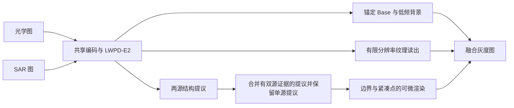

# 从方向特征到结构成图：LWPD-E2 第二机制选型

2026-11-19。检索覆盖光学–SAR 像素级融合、共享与独有表示、重观测监督、展开式重建、生成式融合、可微渲染和外部任务评价。主要依据论文正文、作者预印本和出版方摘要。该检索用于划定近邻与设计对照，未做系统综述式穷尽检索。第 6 节记录首个真实场景的训练前检查。

**建议将「双源证据驱动的结构图元融合解码器」作为第二机制主选。** 保留 E2 的 LWPD 和光学 Base 路径，用一套新的融合解码器接管联合 Detail 聚合与图像生成。模块先从两源提出边界和紧凑目标，再决定哪些提议可以合并，最后用可微渲染生成灰度融合图。论文要验证的是，同一边界能否呈现一次、单源独有结构能否留下、普通纹理是否还能保住。

## 1. 历史实验对选型的约束

- **需要处理成图阶段的损失。** 冻结 E2 的 val16 中，光学候选边传递系数从单源重建的 0.961 降至融合图的 0.333，SAR 对应 0.954→0.931。候选来自梯度规则，单源重建同时使用 Base 与 Detail，因此它只能定位到融合与读出链路。 [源路由诊断](E2_Detail源路由与原损失定位_20261118.md)
- **关系或复杂路由需要证明改变了最终输出。** RCT 的正确跨源条件未建立超过宽本源上下文的预测增量。S2 未建立学习路由对固定组合的独立成图收益。`relation` 的对齐与半幅错位输出几乎重合。局部 Detail 交换有部分指标收益，但光学相似性与权重分布证据不足以归因到真实对应。 [RCT 结果](RCT_预测增量与成图结果分析_20261118.md) · [历史结果](历史实验结果总结_20261118.md) · [跨尺度配对结果](../test_result/e2_cross_scale_pilot_v1_relation/val64/seed42/paired_comparison.csv)
- **避免把另一套梯度域重建重新立项。** 已有极性融合覆盖了共同边、单源边和低频锚定，并用可微求解器从有符号梯度场恢复图像。其匹配 val1000 中 QAB/F 从 0.815793 降至 0.409998，FMI 从 0.688762 降至 0.244533。人工审计的 7 条缺失线均有至少一源连续可见，跨源接线也未建立优势。因此主方案关注原有线段和紧凑点目标的呈现，保留纹理表达能力，并把自然场景覆盖率当作立项条件。 [旧极性架构](../E2_POLARITY_FUSION_DESIGN.md) · [极性验证结果](历史实验结果总结_20261118.md) · [双源沿线证据](E2_双源沿线证据免训练验证_20261117.md)

## 2. 主方案的输入、内部表示与输出



**结构提议。** 在重叠局部窗口内，两源分别从该源 Detail 和源图提出有限个二维图元。边界图元描述中心、法向、长度、宽度和两侧亮度差。紧凑响应图元描述中心、尺度、形状和幅度，作为点状散射候选，其地物身份需要独立标注。训练和评价分开核对源图证据，因为 LWPD 的特征本身可能已使用跨源条件。重复窗口引入的同源候选也要进行合并或抑制。

**联合成形。** 对可确认的同一边界，合并几何参数并保留两源响应的记录，由融合读出决定输出对比。无法确认匹配的候选按各自坐标保留，允许拒配和空提议。相邻平行边、交叉边、同边界反极性、以及一源独有的细点是必要对照。两个模态的对比极性可以不同，不能仅用极性确认或否决几何对应。首版只合并局部重叠结构，跨缺口接线需要单独的观察证据。

**显示输出。** 用有软支撑区域的局部阶跃表示边界，用受限宽度的紧凑核表示点候选。将它们与低频背景、通过固定上采样得到的有限分辨率纹理项合成一张灰度图。形式可写为 `F = sigmoid(L + T + sum_k a_k r_k)`。`L` 来自锚定 Base，`T` 提供一般纹理，`r_k` 由图元坐标和形状直接渲染。该式只是可实现的候选，需检查亮度漂移、软窗端点的伴生边、重叠放大和输出饱和。分辨率限制用来控制旁路表达能力，不能当作严格频率截断。可在同一模型中关闭指定图元并检查对应位置，验证某类结构是否实际通过这条路径进入输出。

**论文贡献的可检验边界。** LWPD 提供有方向的特征；新解码器把它们组织为有源证据的二维结构并生成图像。DiffVG、WIPES 和 IVGF 已分别展示可微栅格化、通用小波图元、三维红外–可见光融合渲染。可主张的差异应落在配对光学–SAR 的二维边界与紧凑候选、共享与独有结构的同图成形，以及可追溯的成图消融。 [DiffVG](https://cseweb.ucsd.edu/~tzli/diffvg/) · [WIPES](https://arxiv.org/abs/2508.12615) · [IVGF 预印本](https://arxiv.org/abs/2601.12697)

## 3. 先验证表示，再训练网络

1. **人工给定几何的表示检查。** 复用现有人工线段、已知伪连接和原 E2 灰度图。额外点目标先从两源图独立核实，再看融合图。给定少量真实局部几何，对低频与纹理背景保持相同，比较图元渲染与等预算的普通局部残差读出。按图报告原边界可辨认情况、边界位置、假双边或假连接、对单源细点的影响和局部纹理损失。再按图元预算变化检查同源重建能力，判断该表示能否覆盖目标结构。使用人工参数只评估表达上限，端到端收益需要另测。若正确几何也无法形成清晰增量，或多数困难样本依赖该表示表达不了的纹理，先停止这一方向。 [现有线段与负例](E2_双源沿线证据免训练验证_20261117.md)
2. **独立检查提议与合并。** 锁定表示检查后的规则，在未参与选择的验证区域按同一标准标记共享、光学独有、SAR 独有及不确定。评估提议召回、同一边界的双重呈现、真实平行边的误合并，以及紧凑点的误报。合成偏移、反极性和邻近平行线用于验证因果控制，自然场景用于检验覆盖率。与固定几何去重和同等候选预算的单源并集比较。
3. **首个完整小试。** 保留 LWPD-E2、锚定 Base 和现有单源重建预算，使用匹配 train1024/val64 和固定第 16 轮，首轮沿用原融合损失来控制变量。只训练新候选，复用归档 E2 权重对应的成图与指标。若候选有成图证据，再补同源输入、近似参数量、同训练预算的密集解码器。关掉合并、图元或纹理支路的同权重结果用于说明路径作用。对于训练适应性的主张，用独立训练的对应对照确认。若原损失无法稳定学习图元，带几何标注的版本需视为新的训练条件，并与同监督的密集头比较。
4. **论文结果门槛。** 在固定的自然验证图上同时检查弱光学边、SAR 独有边与点、共享边的双重响应、纹理与全图指标。报告 `reference_v2_candidate_with_paper_fmi` 的 14 项按共同有限场景汇总，保留逐图配对差。QXS 旧 val64 用于开发筛查，最终结论还需要新留出区域或不同地理切分。公开数据若用于下游验证，先排除其与 QXS 当前划分的场景重合。 [QXS-SAROPT 原始论文](https://arxiv.org/abs/2103.08259) · [SpaceNet 6](https://arxiv.org/abs/2004.06500)

## 4. 同规模备选

| 方案 | 完整模块和证据门槛 | 主要限制 |
|---|---|---|
| **双源结构重观测融合器** | 用新的像素解码器输出单幅图，再从该图的量化或固定尺度版本通过两个受约束的观察器恢复源结构读数。观察器读取局部对比、位置、目标存在性，训练时可用，推理只保留融合图。对照同样的读数作为普通输出损失、允许旁路的重建、仅看最终图的受限重观测。 | EMMA 已做伪传感与等变融合，UniFusion 已用中间表示重建源图。潜在差异是光学与 SAR 的结构能否**从最终可见图独立读回**。若观察器可学习隐藏编码，或只能证明可预测性，论文证据不足。QXS 的显示 PNG 也不支持无校准的物理 SAR 反演主张。 [EMMA](https://openaccess.thecvf.com/content/CVPR2024/html/Zhao_Equivariant_Multi-Modality_Image_Fusion_CVPR_2024_paper.html) · [UniFusion §3](https://arxiv.org/html/2603.14214v1) |
| **面向边界与小目标的任务驱动成图模块** | 用同一新解码器生成融合图，训练阶段引入独立的边界与目标任务约束，测试用不同、冻结的读出器和自然样本验证。设光学、SAR、简单叠加和已有 E2 对照，核对任务收益与画质代价。 | TDFusion 已做下游任务指导融合。区分度需要来自光学–SAR 特有的保真任务和独立外部证据。须先核对可用标注、样本规模和数据重叠。原 QXS 论文有船舶检测应用，现有本地划分能否映射到可用标注尚未核实。 [TDFusion](https://openaccess.thecvf.com/content/CVPR2025/papers/Bai_Task-driven_Image_Fusion_with_Learnable_Fusion_Loss_CVPR_2025_paper.pdf) · [QXS-SAROPT](https://arxiv.org/abs/2103.08259) · [QXS-SAROPT-SHIP 公开记录](https://zenodo.org/records/20000667) |

## 5. 决定技术边界的文献索引

| 检索方向 | 可核对的近邻与对本项目的含义 |
|---|---|
| 光学–SAR 像素融合 | SOSTF 已做结构–纹理分解；VSFF 使用互补分解、显著性和变分重建；WEMFusion 已做方向小波与差异感知 Mamba；SAMDFuse 的方案包括退化增强与语义引导；局部极值自适应金字塔已有自适应尺度和低高频不同融合规则。单独采用这些构件，区分度有限。 [SOSTF](https://ieeexplore.ieee.org/document/9936631/) · [VSFF](https://xplorestaging.ieee.org/document/10438480) · [WEMFusion](https://www.mdpi.com/2072-4292/18/4/612) · [SAMDFuse](https://www.sciencedirect.com/science/article/pii/S0924271626002303) · [自适应金字塔](https://www.mdpi.com/2079-9292/15/10/2129) |
| 两源关系与保真 | ARC³Fusion 已显式建模共识、互补与冲突；ISFuse 已用互补遮蔽、同位置遮蔽和模态丢弃学习稳定表示；UniFusion 已用 DINOv3 与重建对齐；EMMA 已用伪传感和等变自监督。各自的任务和监督条件需要单列。 [ARC³Fusion](https://www.mdpi.com/1424-8220/26/15/4745) · [ISFuse](https://arxiv.org/html/2603.23272v1) · [UniFusion](https://arxiv.org/html/2603.14214v1) · [EMMA](https://openaccess.thecvf.com/content/CVPR2024/html/Zhao_Equivariant_Multi-Modality_Image_Fusion_CVPR_2024_paper.html) |
| 显式求解与展开 | USTDFuse 已用结构–纹理分解和深度展开，CDNet 预印本已展开共同和独有字典表示并加入梯度自适应保真。梯度域融合也有早期先例。单纯把 E2 的新头展开成数步难以形成清楚差异，本地极性成图的失败也提高了这一方向的举证成本。 [USTDFuse](https://www.sciencedirect.com/science/article/abs/pii/S0165168425003767) · [CDNet](https://arxiv.org/html/2605.00461v1) · [POP Image Fusion](https://openaccess.thecvf.com/content_iccv_2015/papers/Finlayson_POP_Image_Fusion_ICCV_2015_paper.pdf) |
| 生成式融合 | DDFM 已把扩散先验与融合约束结合，ReCoFuse 将恢复与扩散融合联合建模，NatureFusion 预印本依赖生成教师、预训练生成模型与下游检测监督。它们适合作为路线参照，直接迁移需要重新界定地物真实性、数据和成本。 [DDFM](https://openaccess.thecvf.com/content/ICCV2023/html/Zhao_DDFM_Denoising_Diffusion_Model_for_Multi-Modality_Image_Fusion_ICCV_2023_paper.html) · [ReCoFuse](https://openaccess.thecvf.com/content/CVPR2026/html/Zhang_ReCoFuse_Ultra-Robust_Image_Fusion_via_Restorative_Multi-Modal_Diffusion_Reciprocal_Coupling_CVPR_2026_paper.html) · [NatureFusion](https://arxiv.org/abs/2611.01607) |
| 配准与结构表示 | RIFT 处理跨模态辐射差异，SORF 联合结构配准和去斑融合。DiffVG、WIPES 与 IVGF 提供可微图元及渲染先例。主方案需要在配对 QXS 的二维成图中验证自身的表示价值，尤其是共享边和单源小目标的联合收益。 [RIFT](https://arxiv.org/abs/1804.09493) · [SORF](https://www.sciencedirect.com/science/article/pii/S1566253526007803) · [DiffVG](https://cseweb.ucsd.edu/~tzli/diffvg/) · [WIPES](https://arxiv.org/abs/2508.12615) · [IVGF](https://arxiv.org/abs/2601.12697) |

论文可以围绕「方向小波表征与双源结构图元成图」展开。最先投入的是**可见结构在该表示中的表达检查**。该步骤通过，模块才值得从设计进入训练；若未通过，优先改用双源结构重观测路线，而非扩大图元数量直到逼近密集解码器。

## 6. 首个真实场景的表示检查

入口已实现为 `diagnose_e2_primitive_render.py`。选择固定复核清单的首图 546，复用归档 E2 灰度图作为三组共同背景。图元与普通残差共用人工线段、源图、局部支持窗和量化后改动预算。普通残差用所选源的高通纹理作为对照。源图的固定中心剖面决定应用资格与符号，E2 可见性标签仅用于分层读出。`probes.csv` 中的 `injected` 表示该线段在编辑组被启用，在 E2 行也保留这个标记以便配对。

场景 546 的 A 岸线符合固定位置的源证据条件，B 岸线未达到资格。两种编辑在 843 个支持像素中实现了相同的平均绝对改动，均为 1.1246 个灰度级。

| A 岸线 | 归档 E2 | 普通残差 | 边界图元 |
|---|---:|---:|---:|
| 标注中心的有符号强度中位数 | 0.0019 | −0.0851 | 0.1346 |
| 中心剖面达标比例 | 36.8% | 36.8% | 42.1% |
| 支持窗侧翼高通改动 MAE，灰度级 | 0 | 0.5317 | 0.3346 |

中心响应有局部增益，但最强剖面仍离标注中心约 6 像素，目视也未看到岸线清晰恢复。两条伪连接标注与编辑支持区无交叠，不能用该场景检验抑制伪连接。点图元通过了合成的形状和梯度检查，真实 SAR 独有点尚未纳入。全图指标变化量较小，结果仅作表示检查。 [逐线数值](../test_result/e2_primitive_render_v1/smoke_546/probes.csv) · [改动预算](../test_result/e2_primitive_render_v1/smoke_546/scene_budgets.csv) · [成图](../test_result/e2_primitive_render_v1/smoke_546/preview/546.png)

5 项单元测试通过，诊断已登记并通过实验索引校验。固定 8 图版本使用同一协议，按每项指标取共同有限场景，另保留逐线读数和摘要。交给用户在 Windows CMD 执行：

```cmd
cd /d "D:\#imageInfusion\CDDFuse"
.venv\Scripts\python.exe -u diagnose_e2_primitive_render.py holdout --output-dir test_result\e2_primitive_render_v1\holdout8
```

八图读出重点是标注线段的覆盖范围、中心响应相对等预算对照的增量、侧翼变化以及与编辑支持相交的伪连接。场景 546 出现在这组固定八图中，结果解释应区分已看过的首图和其余七图。本节记录的是单图阶段，八图结果见第 7 节。

## 7. 固定八图后的强度分档检查

用户已执行固定八图。16 条标注连续边中，14 条通过筛查。相对普通高通残差，边界图元在 13 条上提高标注中心响应，排除先看过的 546 后仍为 12/13。三条可渲染的缺失边都获得了局部增益，但原先与光学对比反号的 4880-B 仍反号。9 条与编辑窗口相交的伪连接，其中心达标率在两种编辑间逐条相同。 [八图逐线结果](../test_result/e2_primitive_render_v1/holdout8/probes.csv) · [八图全图配对](../test_result/e2_primitive_render_v1/holdout8/paired_comparison.csv)

新入口 `diagnose_e2_primitive_dose.py` 单独修改一条人工标注的缺失边。除原有高通残差外，加入从同一源图估计的法向亮度剖面。它与图元使用相同的标注几何和窗口，直接采用源剖面在法向的反对称分量。每条边在量化后的同一窗口内匹配 1、2、4、8 灰度级 MAE，并把单像素改动限制在 24 灰度级。无法匹配的档位保留实际改动，退出该档的配对统计。复用八图中未编辑 E2 的逐图全图指标。

单图选择 4880-B，因为它在八图中仍表现为最强的反号中心响应。4 档均匹配。下表是以光学极性为准的中心实际亮度差，单位为灰度级，原 E2 为 −16.39。

| 窗口平均改动 | 高通残差 | 源图法向剖面 | 边界图元 |
|---|---:|---:|---:|
| 1 | −13.04 | −12.69 | −12.66 |
| 2 | −12.83 | −8.65 | −9.35 |
| 4 | −13.62 | −2.63 | −2.96 |
| 8 | −9.82 | +10.30 | +10.58 |

最强一档恢复了两种定向编辑的平均极性，中心剖面达标率为图元 45.5%、源图剖面 50.0%。图元的侧翼有符号响应更低，同时仍需核查是否压制邻近真实结构。成图中强 SAR 亮线仍明显，光学路缘未清楚恢复。单图支持增大改动能改变正确极性的呈现，尚无图元形状优于来自源图的简单法向剖面的成图证据。该轮没有新运行真实平行边或 SAR 独有点检查。 [分档逐线表](../test_result/e2_primitive_dose_v1/smoke_4880_B/dose_probes.csv) · [放大对照](../test_result/e2_primitive_dose_v1/smoke_4880_B/preview/4880-B.png)

9 项图元相关单元测试通过。单图已登记，索引已校验。若要覆盖固定清单中的所有人工缺失线段，以下命令仅执行新分档诊断，原八图结果作为归档输入：

```cmd
cd /d "D:\#imageInfusion\CDDFuse"
.venv\Scripts\python.exe -u diagnose_e2_primitive_dose.py missing --output-dir test_result\e2_primitive_dose_v1\missing4
```
