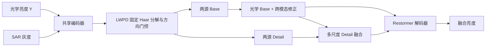

# LWPD E2 光学 Base 保留版技术与实验说明

更新日期 **2026-11-08**。本文记录当前主基线 `lwpd_e2_base_anchor_v1` 的实现、训练和已登记结果。模型从随机初始化开始，在同一次运行内完成 **4 轮源图重建和 12 轮联合融合**。第 16 轮在 QXS-SAROPT 的固定 val1000 上取得 **QAB/F 0.732060、NAB/F 0.060073、SSIM 0.527984、MS-SSIM 0.567437**。当前版本的正式 test1000 尚未登记。

## 1. 版本定义

| 版本 | 结构与训练来源 | 用途 |
|---|---|---|
| 历史 E2，`lwpd_e2` | 固定 Haar 与方向门控，原跨模态 Base 融合和多尺度 Detail 融合。从 Direct Fusion R3 初始化。 | 历史性能参照。论文旧表中的 LWPD V2／E2 使用这一版本的正式 test1000。 |
| 从头训练 E2，`e2_scratch_twostage_v1` | 保留历史 E2 结构，随机初始化，按 4 + 12 轮训练。 | 与光学 Base 版匹配训练安排的结构对照。 |
| **光学 Base 保留版，`lwpd_e2_base_anchor_v1`** | 在从头训练 E2 中，把融合 Base 改为光学 Base 加上零初始化的跨模态修正。 | **当前主基线。** |
| 光学 Base + PAC-Mamba，`lwpd_e2_base_anchor_pac_v1` | 保留光学 Base 路径，在 Detail 融合中加入 PAC-Mamba 修正，采用同样的从头训练安排。 | 已验证的候选。平均 QAB/F 略升，NAB/F 明显恶化。 |

历史 E2 和光学 Base 版的初始化及训练安排不同，两者的差异用于衡量性能，不能单独归因给光学 Base 路径。分析该路径时，主要对照是同样从头训练的两阶段 E2。

## 2. 网络架构



### 2.1 输入与共享编码器

光学图像经 OpenCV 转为 YCrCb，模型接收亮度 Y。SAR 以灰度图读入。两者分别除以 255，转为 `[0,1]` 的单通道张量。共享编码器依次使用重叠 Patch Embedding 和 4 个 Restormer Transformer 块，保持空间尺寸，输出 64 通道特征。光学和 SAR 使用同一组编码权重。旧的编码器 Base、Detail 头保留在模型对象和 checkpoint 中，E2 前向直接取共享特征交给 LWPD。[数据读取](../../utils/dataset_os.py) · [编码器](../../net.py) · [E2 前向](../../direct_fusion.py)

### 2.2 LWPD 固定 Haar 分解与方向门控

每一路共享特征经一级二维正交 Haar 变换，得到 `LL、LH、HL、HH`。对 256×256 输入，每个子带为 64×128×128。奇数高或宽在右侧或底部复制填充，逆变换后裁回原尺寸。

设 `m` 表示当前模态，`other` 表示另一模态，`d` 表示高频方向。拼接四个子带得到上下文，同源和跨源分支的输出相加，再为各方向、通道和空间位置计算门控。

```text
C_m       = Concat(LL_m, LH_m, HL_m, HH_m)
G_m,d     = 0.1 + 0.9 × sigmoid(Self_m,d(C_m) + Cross_m,d(C_m, C_other))
High'_m,d = G_m,d × High_m,d
LL'_m     = (1 + 0.1 × tanh(Projection_m(LL_m))) × LL_m
Base_m    = IDWT(LL'_m, 0, 0, 0)
Detail_m  = IDWT(0, LH'_m, HL'_m, HH'_m)
```

高频门控的理论范围为 `[0.1,1]`，低频调制因子的理论范围为 `[0.9,1.1]`。当前 E2 使用 `gated` 模式，Haar 滤波器固定。E3 的 SAR 高频恢复和 E4 的相位对称调制属于其他版本。**当前实现先对两路 Detail 分别逆变换，再融合 Detail**。此前讨论的子带域融合属于待验证设计。[Haar 与 LWPD 实现](../../lwpd.py)

### 2.3 光学 Base 保留路径

跨模态 Base 分支采用双向通道注意力，分别计算两路源特征投影，以及光学从 SAR 获取、SAR 从光学获取的交互信息。四路结果拼接、压缩并变换，生成修正量。

```text
Base_fused = Base_optical + CrossModalBaseFusion(Base_optical, Base_SAR)
```

修正分支的末端点卷积初始化为零，后续 GELU 对零仍输出零。重建阶段不调用 Base 融合层，因此融合刚开始时，`Base_fused` 等于本次训练学到的光学 Base。之后，SAR 通过可学习的修正量参与低频融合。光学 Base 指共享编码器与 LWPD 产生的内部特征。[Base 融合](../../direct_fusion.py) · [光学 Base 保留路径](../../e2_base_anchor.py)

### 2.4 多尺度 Detail 融合与解码

两路 64 通道 Detail 分别投影到 32 通道，拼接后经过膨胀率为 `1、2、3` 的三路卷积分支。融合 Base 另投影到 16 通道作为上下文。两路源 Detail 投影、三路多尺度特征和 Base 上下文拼接为 176 通道，再经卷积映射为 64 通道融合 Detail。

解码器拼接融合 Base 和 Detail，用 `1×1` 卷积把 128 通道压回 64 通道，再经过 4 个 Restormer Transformer 块和卷积输出头。Sigmoid 输出单通道融合亮度。保存 RGB 结果时，融合亮度替换光学 Y 通道，保留光学 Cb、Cr。指标在融合亮度上计算。[Detail 融合](../../direct_fusion.py) · [解码器](../../net.py) · [评估与颜色重建](../../test_OS.py)

### 2.5 参数规模

| 组件 | 模型中登记的参数量 |
|---|---:|
| 编码器对象 | 599,144 |
| LWPD | 84,928 |
| Base 融合 | 48,208 |
| Detail 融合 | 61,616 |
| 解码器 | 207,936 |
| **总计** | **1,001,832** |

总量与评估元数据一致。其中 **417,544** 个参数属于 E2 前向未调用的旧编码器 Base、Detail 头。按实际前向调用的模块计为 **584,288** 个参数。论文比较参数量时应注明采用哪种口径。光学 Base 保留路径只改变加法和初始化，总参数量与普通 E2 相同。

## 3. 两阶段训练与损失

整套模型只在本次运行开始时初始化。第 5 轮继续使用本次运行前 4 轮得到的编码器、LWPD 和解码器权重。融合器此时开始参与训练。

| 阶段 | 轮次 | 更新模块 | 学习率 |
|---|---:|---|---|
| 源图重建 | 1–4 | 共享编码器、LWPD、解码器。光学和 SAR 分别用各自 Base、Detail 重建。 | 参与模块 `1e-4` |
| 联合融合 | 5–16 | 启用 Base 和 Detail 融合，共享编码器、LWPD、解码器继续更新。 | 已参与重建的模块 `5e-5`，两路融合层 `1e-4` |

源图重建对每种模态计算 `5 × DSSIM + MSE`，采用 Kornia 的 11×11 SSIM 窗口。SAR 重建只在有效像素上计入损失。两模态重建损失取平均，记为 `L_rec`。

融合阶段同时生成融合图。SAR 有效位置的强度目标为两源像素最大值，无效位置用光学值。梯度目标同样取两源最大值，幅值用 `|Gx|+|Gy|` 表示。强度与梯度分别使用 L1 距离。

```text
L_stage1 = L_rec
L_stage2 = L_intensity + 10 × L_gradient + 0.1 × L_rec
```

结构附加损失和过冲损失的权重均为 `0`。训练的 Sobel 幅值与 NAB/F 计算所用的 L2 Sobel 幅值不同。训练 loss 用于跟踪优化过程，融合质量通过独立评价指标比较。[损失实现](../../train_direct_fusion.py) · [两阶段训练入口](../../run_e2_scratch_twostage.py)

| 设置 | 数值 |
|---|---|
| 数据集 | QXS-SAROPT，训练 8,000 对、验证 1,000 对，另留测试 1,000 对 |
| 数据划分 | `cddfuse_8000_1000_1000_seed20260924.json` |
| 随机种子 | `42` |
| 输入图块 | `256×256`。训练随机裁剪、翻转和旋转，训练期间的验证使用中心裁剪 |
| SAR 有效性 | 灰度大于 0 为有效。训练裁剪优先选取有效像素比例至少为 `0.90` 的图块 |
| Batch | 每批 `2`，梯度累积 `4`，名义有效 batch 为 `8` |
| 优化 | AdamW，权重衰减 `1e-4`，梯度范数裁剪 `1.0`，CUDA AMP |

[本次训练配置](../../models/e2_scratch_base_anchor_v1/seed42/config.json)

## 4. 实验结果

### 4.1 训练轨迹

| 轮次 | 阶段 | 训练损失 | 验证损失 |
|---:|---|---:|---:|
| 1 | 源图重建 | 0.072379 | 0.006369 |
| 4 | 源图重建结束 | 0.001777 | 0.002079 |
| 5 | 联合融合开始 | 1.727397 | 1.037047 |
| 8 | 联合融合 | 0.878923 | 0.842242 |
| 12 | 联合融合 | 0.794588 | 0.811304 |
| 15 | 联合融合 | 0.765067 | 0.738302 |
| 16 | 联合融合结束 | 0.755373 | 0.805063 |

第 4 轮光学、SAR 的验证重建损失分别为 `0.001542`、`0.002615`。两阶段使用不同的目标函数，切换时的损失变化不能直接解释为融合退化。第 15 轮的融合阶段验证 loss 最低，第 16 轮的训练 loss 仍在下降。目前完整 val1000 使用第 16 轮。第 15 轮缺少同口径融合指标，尚不能判断哪一轮融合质量最佳或指标是否已收敛。[逐轮训练日志](../../models/e2_scratch_base_anchor_v1/seed42/history.csv)

### 4.2 同口径 val1000 完整指标

以下四组属于 `QXS-VAL1000-DIRECT-LWPD-v1`，使用同一批 **1,000 个验证场景**。已核对场景 ID 与顺序、切分清单哈希、split、offset、指标和输出策略。评估采用 `PaperEvaluator`，亮度先 clamp 到 `[0,1]`，再乘 255、四舍五入并转为 uint8。前四列为逐图均值，最后一列为光学 Base 版的逐图标准差，反映场景之间的差异。

<!-- metrics-table-start -->
| 指标 | 从头训练 E2 | 光学 Base 版 | 光学 Base + PAC | 历史 E2 | 光学 Base 版标准差 |
|---|---:|---:|---:|---:|---:|
| EN ↑ | 7.288438 | 7.330039 | 7.335579 | 7.307614 | 0.381748 |
| MI ↑ | 4.217300 | 4.470054 | 4.417905 | 4.602699 | 1.192481 |
| FMI ↑ | 0.674837 | 0.688762 | 0.686280 | 0.710386 | 0.302946 |
| PSNR ↑ | 13.018104 | 13.742854 | 13.650412 | 13.786141 | 2.179911 |
| QAB/F ↑ | 0.723678 | 0.732060 | 0.732945 | 0.732369 | 0.100786 |
| NAB/F ↓ | 0.119770 | 0.060073 | 0.123906 | 0.064611 | 0.056123 |
| AG ↑ | 24.804816 | 24.144914 | 24.795944 | 24.282695 | 6.886495 |
| SF ↑ | 44.850924 | 43.808824 | 44.953663 | 44.094000 | 10.306125 |
| SD ↑ | 51.101055 | 52.137433 | 52.883802 | 52.358887 | 10.163680 |
| CC ↑ | 0.318007 | 0.562016 | 0.561148 | 0.560927 | 0.094544 |
| SCD ↑ | 0.401386 | 1.269896 | 1.229383 | 1.254257 | 0.325440 |
| SSIM ↑ | 0.354190 | 0.527984 | 0.524655 | 0.528576 | 0.021768 |
| MS-SSIM ↑ | 0.442355 | 0.567437 | 0.565993 | 0.567796 | 0.058929 |
| VIF ↑ | 0.337749 | 0.393301 | 0.392433 | 0.400923 | 0.105877 |
<!-- metrics-table-end -->

QAB/F 衡量源图边缘向融合图的传递。项目中的 NAB/F 对融合梯度超过两源幅值上界的位置计算加权代价。FMI 基于 DCT 特征。VIF、SSIM、MS-SSIM 分别比较融合图与两源后汇总。这些全图指标应配合局部图像判断，才能确定某个 SAR 独有目标是否保留。[指标实现](../../utils/Evaluator.py)

### 4.3 对照结论与限制

- **相对同训练安排的从头训练 E2**，光学 Base 版的 NAB/F 降低 **49.84%**，QAB/F 提升 **1.16%**。SSIM 由 **0.354190** 回升至 **0.527984**，MS-SSIM 由 **0.442355** 回升至 **0.567437**。逐图比较有 **987/1000** 张 SSIM 提高、**958/1000** 张 NAB/F 降低，SSIM 低于 0.2 的图像从 **308 张降到 0 张**。[从头训练 E2 逐图结果](../../test_result/e2_scratch_twostage_v1/val1000/seed42/metrics.csv)
- **相对历史 E2**，光学 Base 版的平均 NAB/F 低 **7.02%**，QAB/F 低 **0.000309**，MS-SSIM 低 **0.000359**。主要差距是 MI **−2.88%**、FMI **−3.04%**、VIF **−1.90%**。SCD 提高 **1.25%**。NAB/F 中位数由 **0.043194** 降至 **0.023688**，第 95 百分位却由 **0.120684** 升至 **0.145450**，超过 0.15 的场景从 **7 张增至 33 张**。平均改善与高伪影尾部恶化同时存在。[历史 E2 验证结果](../../test_result/lwpd_qxs_ablation_v1/val1000/e2_seed42/metrics.csv)
- **加入 PAC-Mamba 后**，平均 QAB/F 比光学 Base 版高 **0.12%**，但 NAB/F 高 **106.26%**，并在 **875/1000** 张图上恶化。SSIM、MS-SSIM、FMI、VIF 的均值也低于光学 Base 版。本次运行支持继续使用光学 Base 版作为主基线。[PAC 逐图结果](../../test_result/e2_scratch_base_anchor_pac_v1/val1000/seed42/metrics.csv)
- **局部案例**中，场景 14504 的 SSIM 由从头训练 E2 的 **0.017424** 回升到光学 Base 版的 **0.527779**，接近历史 E2 的 **0.530342**。这是结构恢复的一个实例。[场景 14504 三联图](../../test_result/e2_scratch_base_anchor_v1/val1000/seed42/preview/14504.png)

### 4.4 与论文 test1000 的对应关系

历史 E2 的正式 test1000 已登记，对应论文旧表中的 LWPD V2／E2。关键均值为 **QAB/F 0.727938、NAB/F 0.066018、SSIM 0.527348、MS-SSIM 0.571832、FMI 0.701122、VIF 0.398218**。当前光学 Base 版的 val1000 用于开发比较。若把这一版纳入论文主表，应先锁定权重，再用相同的测试清单和评价口径独立评估。现有结论来自 seed42 和固定 QXS 划分，跨种子和跨数据集的稳定性仍待验证。[历史 E2 正式逐图结果](../../test_result/lwpd_qxs_full_v1/e2_seed42_test1000/metrics.csv)

## 5. 复现入口与原始产物

在 Windows CMD 中运行以下命令可完成训练和第 16 轮 val1000 评价。已有完整产物时，入口复用并核对结果。

```cmd
cd /d "D:\#imageInfusion\CDDFuse"
.venv\Scripts\python.exe -u run_e2_scratch_twostage.py train-val --optical-base-anchor
```

仅训练可将 `train-val` 换成 `train`。已有第 16 轮权重时，仅评估可用 `val`。保留 `--optical-base-anchor` 以选中本文所述版本。

| 产物 | 位置 |
|---|---|
| 第 16 轮权重 | [epoch_016.pth](../../models/e2_scratch_base_anchor_v1/seed42/epoch_016.pth) |
| 训练配置和日志 | [config.json](../../models/e2_scratch_base_anchor_v1/seed42/config.json) · [history.csv](../../models/e2_scratch_base_anchor_v1/seed42/history.csv) |
| 固定切分 | [QXS-SAROPT split manifest](../../../datasets/QXSLAB_SAROPT/splits/cddfuse_8000_1000_1000_seed20260924.json) |
| 逐图指标和汇总 | [metrics.csv](../../test_result/e2_scratch_base_anchor_v1/val1000/seed42/metrics.csv) |
| 评估元数据 | [run_metadata.json](../../test_result/e2_scratch_base_anchor_v1/val1000/seed42/run_metadata.json) |
| 图像产物 | [灰度](../../test_result/e2_scratch_base_anchor_v1/val1000/seed42/gray) · [RGB](../../test_result/e2_scratch_base_anchor_v1/val1000/seed42/rgb) · [三联预览](../../test_result/e2_scratch_base_anchor_v1/val1000/seed42/preview)，各 1,000 张 |
| 实验登记 | [EXPERIMENT_REGISTRY.json](../../EXPERIMENT_REGISTRY.json) · [EXPERIMENT_INDEX.md](../../EXPERIMENT_INDEX.md) |

第 16 轮权重 SHA-256 为 `02c14ad063b07be4c4021aa949ce13592e3563e77430623e1c6d99181b997e6c`。切分清单 SHA-256 为 `0d540ce16f7fc1a31c16e227ac48100edd6e9a37fd4a01dbf928c46a07954fbd`。
