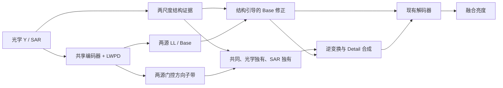

# LWPD E2 结构引导的 Base–Detail 联合融合设计

**状态：首版已实现。** 当前光学 Base + LWPD E2 的两路融合由粗尺度结构证据共同引导。光学 Base 提供低频起点，SAR 在可信区域补充结构。方向子带分别传递两源共同边界和各自独有细节。目标是在保住 LWPD 的边缘和信息优势时，缩小与强对照的多尺度结构差距。完整训练和 val1000 待执行。

## 1. 目标与基线

开发基线是当前从头训练的光学 Base 版，使用 QXS-SAROPT、seed42、4 轮重建和 12 轮融合。第 16 轮在 val1000 上的 QAB/F 为 **0.732060**，MS-SSIM 为 **0.567437**，FMI 为 **0.688762**，VIF 为 **0.393301**。NAB/F 均值为 **0.060073**，第 95 百分位为 **0.145450**。前期验证中，加入 PAC-Mamba 只让平均 QAB/F 提高约 0.12%，NAB/F 却翻倍。这提示新模块需要明确决定哪里应混合、哪里应保留单源、哪里应降低修正幅度。[当前架构与实验](./LWPD_E2_BASE_ANCHOR_TECHNICAL_REPORT.md)

论文主表另有独立的 test1000。历史 E2 的 QAB/F 和 VIF 为 **0.727938、0.398218**，MS-SSIM 为 **0.571832**。CDDFuse 零样本和 U2Fusion 的 MS-SSIM 分别为 **0.602100、0.625111**。因此，新模块的价值既要看相对当前基线的增益，也要看最终模型能否在保持边缘与信息优势时缩小对外部方法的结构差距。光学 Base 版的 val1000 数值只用于筛选和消融，不进入正式测试主表。[历史正式测试汇总](../../../comparation/results/qxslab_paper_1000_manual/summary_with_lwpd.csv)

## 2. 模块接口和位置

模块位于 **LWPD 分解之后、现有解码器之前**。它接管低频修正的空间权重和 Detail 的融合规则，并返回解码器所需的两组 64 通道特征。共享编码器、固定 Haar、源图重建和解码器继续沿用现有结构。建议用一个独立 variant `lwpd_e2_struct_joint_v1` 保存候选配置和权重。

| 输入或输出 | 形状与用途 |
|---|---|
| 两源亮度图与 SAR 有效掩码 | `[N,1,H,W]`，用于计算源图几何证据。SAR 邻域证据只在有效支持内使用。 |
| 两源 LL 与门控后的三个方向高频子带 | 每个子带为 `[N,64,ceil(H/2),ceil(W/2)]`。LWPD 在融合路径显式返回这些张量和原图尺寸。 |
| 两源 Base | `[N,64,H,W]`，来自原有 LL 逆变换，用于构造融合 Base。 |
| 融合 Base 与融合 Detail | 均为 `[N,64,H,W]`，交给现有 Restormer 解码器。 |
| 可选诊断 | 粗尺度结构一致性、两源置信度、局部匹配、方向来源权重。只在诊断模式下保存。 |



重建阶段继续走两路独立的 Base、Detail 合成。联合融合阶段才需要返回子带和计算跨模态匹配。这样，同一次从头训练的阶段一可与原光学 Base 基线保持同一任务。[LWPD 合成位置](../../lwpd.py) · [当前 Base 路径](../../e2_base_anchor.py)

## 3. 前向设计

### 3.1 分开估计源内可信度与跨源一致性

**源内可信度**判断某一模态自己的结构能否作为细节证据。首版在两个平滑尺度提取亮度梯度，用各模态的局部梯度尺度分别归一化，结合局部方向连续性得到每源、每方向的置信图 `R_o[d]、R_s[d]`。归一化只用于比较证据，不用归一化后的强度直接替换特征子带。方向相近且跨尺度响应稳定可作为线状结构的依据。点状散射体和低信噪区域单列观察，连续性低本身不足以判定为散斑。

**跨源一致性**判断两张源图是否在描述同一条边。低频路径使用两尺度的粗轮廓和方向证据得到 `C_base`。高频路径在同一方向上做 **3×3 子带邻域匹配**。一级 Haar 的子带步长为 2，所以一个子带位置的偏移约对应输入上的两个像素。匹配比较无符号方向，避免亮暗极性相反的同一条边因梯度符号而被误判。偏移只作用在共同分支，首版将光学网格作为参考。多个候选分数接近、互相匹配不一致或 SAR 支持无效时，降低匹配置信度。

把高频位置区分为**可信匹配、单源可信、可能错位或证据不足**。光学附近没有同向证据时，可信 SAR 响应仍可通过单源分支。若附近已有潜在同向响应但匹配不确定，降低该方向的独有分支权重，以免把错位边缘再传一次。不同方向的响应独立判断，因此同一位置仍可由两源分别提供不同细节。上述量都是几何证据，无法由单对强度图验证散斑真值或消除所有成像几何差异。

首版可固定为原分辨率的 `σ=1、2` 两个平滑尺度，计算 Sobel 方向梯度，再将证据平均池化至一级 Haar 网格。梯度幅值除以同模态邻域的 RMS，并设分母下限。匹配对每个方向只在九个偏移上计算，使用方向一致性、归一化响应和有效掩码得到候选分数。共同分支用局部候选权重合成对齐的 SAR 响应。匹配置信度由最佳分数、最佳与次佳的差值、正反向匹配一致性共同决定。邻域无同向证据时降低共同分支，候选分数接近时同时降低共同分支并提高不确定性。梯度证据和匹配统计用 FP32 计算，避免平坦区域小分母在 AMP 下不稳定。两尺度与九个偏移是首版实现起点，具体归一化下限和匹配温度在训练前固定并写入配置。

### 3.2 Base 路径保留光学起点

```text
DeltaB   = CrossModalBaseFusion(B_o, B_s)
G_B      = CoarseStructureGate(C_base, R_o_coarse, R_s_coarse)
B_f      = B_o + G_B × DeltaB
```

`G_B` 为 `[0,1]` 的低分辨率空间权重，上采样后跨通道广播。共同粗轮廓一致、SAR 有可信支持时，允许模型补充低频对比。冲突区域的修正减弱。沿用现有修正头零初始化，所以融合刚开始时有 `B_f = B_o`。这个性质保证初始特征，不能保证训练后的输出结构处处不变。

实现中将粗尺度证据和 LL 通道余弦相似度拼接后输入两层卷积，sigmoid 输出再乘粗尺度匹配强度和 SAR 有效支持。粗尺度门控作用于整个 Base 修正向量。对缺失 SAR 的位置，有效支持为零，保留光学 Base。

### 3.3 Detail 路径按方向分流

对每个方向，用 `M[d]` 表示可信共同匹配程度，用 `U_o[d]、U_s[d]` 表示可能错位或证据不确定的程度。建议按以下方式限制各分支的参与范围，再由轻量卷积头预测实际权重。

| 分支 | 输入和空间操作 | 权重约束 |
|---|---|---|
| 共同细节 | 光学子带与局部匹配后的 SAR 子带。两者由小型融合头生成一份共同响应。 | 由两源可信度与 `M[d]` 共同调节。对应位置不明确时降低。 |
| 光学独有细节 | 光学子带，保留原位置。 | 由 `R_o[d]` 决定可用程度，已用于共同分支或可能错位的响应减少独立传递。 |
| SAR 独有细节 | SAR 子带，保留原位置。 | 由 `R_s[d]` 决定可用程度，按 SAR 坐标上的反向匹配抑制重复项。 |

权重采用非负预算分配，允许总和小于 1，未用的权重对应抑制。匹配和抑制在每个方向单独计算。共同分支采用可学习合成，避免直接用潜特征正负号判断源图极性。实际输出应当保存三个来源图，以检查分支有没有长期失活、是否退化成单源占优，以及共同与独有通路是否重复响应。

共同匹配分别记在光学、SAR 自己的坐标上。下式为同一个子带方向，省略方向下标。轻量卷积头输出四个 logits，将结构证据作为先验，与 logits 一起归一化。先验为零的通路权重为零。这样可信细节和抑制分支共用一个权重预算，避免先归一化再乘证据时过度压低细节。

```text
E_common = M_o × min(R_o, Align(R_s))
E_opt    = R_o × (1 − M_o) × (1 − U_o)
E_sar    = R_s × (1 − M_s) × (1 − U_s) × valid_sar
E_suppress = (1 − max(E_common, E_opt, E_sar))²
W = softmax(Logits + log([E_common, E_opt, E_sar, E_suppress]))
```

`M_s` 通过反向匹配在 SAR 原位置计算，避免 SAR 响应已经平移进入共同分支，又在原位置重复进入独有分支。独有通路使用原位置的特征。共同与独有权重在半分辨率上按方向计算，并跨通道广播。遇到全无效 SAR 区域时，直接用光学方向子带作为 Detail 输入，不让缺少另一模态压制有效光学细节。

每路方向特征用零 LL 逆变换，恢复到原尺寸。三个结果与融合 Base 的轻量投影拼接，经过小卷积合成为 64 通道 Detail，再交给现有解码器。合成层保留低频上下文入口，因为此前在验证场景 1401 的单图检查中，现有解码器对 Detail 融合输出内的低频成分敏感。这个观察支持保留合成能力，并不能预测新结构的收益。来源权重的预算约束也不能直接约束解码后图像的 Sobel 幅值。

```text
Detail_f = Synthesis(
    Project(B_f),
    IDWT(0, weighted_common_bands),
    IDWT(0, weighted_optical_bands),
    IDWT(0, weighted_sar_bands)
)
F = Decoder(B_f, Detail_f)
```

## 4. 实现与训练安排

1. **第一版只更换融合机制。** 保留现有两阶段入口、固定 Haar、编码器、解码器和原损失。共用训练清单、seed42、学习率、AMP、batch 和梯度累积配置。整套候选从随机初始化开始，4 轮重建后在同一次运行内接续 12 轮融合。
2. **阶段一复用源图重建。** 分别解码光学和 SAR 的 Base、Detail，优化源图重建损失。新融合模块不参与阶段一。
3. **阶段二启用整个联合融合模块。** 保留现有 `强度 + 10 × 梯度 + 0.1 × 重建`，过冲项和结构附加项权重保持为 0。这样首轮差异可以主要归于融合模块。若判据正确但融合仍偏好强梯度，再单独审查损失。
4. **实现前后的检查。** 检查奇偶尺寸、全无效 SAR、平坦区域、正负极性相反和轻微位移等输入。确认阶段一重建路径仍可反传、阶段二 Base 修正和 Detail 路由可收到梯度、初始化时融合 Base 等于光学 Base，以及评估入口能区分新旧权重。候选使用独立输出目录。

在 Windows CMD 中运行以下命令，训练完成后自动用第 16 轮跑 val1000。

```cmd
cd /d "D:\#imageInfusion\CDDFuse"
.venv\Scripts\python.exe -u run_e2_scratch_twostage.py train-val --structure-joint
```

模型和日志写入 `models/e2_scratch_struct_joint_v1/seed42`，评估写入 `test_result/e2_scratch_struct_joint_v1/val1000/seed42`。逐轮日志和评估的 `gate_stats.csv` 记录 Base 门控及四类路由的均值。需要画空间来源图时可从模型的 `return_features=True` 接口读取逐方向权重。[实现文件](../../e2_structure_joint.py) · [训练入口](../../run_e2_scratch_twostage.py)

## 5. 验收、预期收益与停止条件

### 5.1 开发集验证模块收益

直接复用已完成的光学 Base 版 val1000，候选使用相同 1,000 个场景、`PaperEvaluator` 和 clamp 口径。以下为**训练前建议登记的工程筛选线**。

| 指标 | 光学 Base 验证基线 | 首轮建议 |
|---|---:|---|
| MS-SSIM ↑ | 0.567437 | 至少提高 0.005，达到约 **0.57244** |
| VIF ↑ 或 FMI ↑ | 0.393301／0.688762 | 至少一项提高 1%，即约 **0.39723／0.69565**。另一项同时检查是否明显下降。 |
| QAB/F ↑ | 0.732060 | 守住边缘传递，建议均值下降不超过 0.0005，并报告逐图差值。 |
| NAB/F ↓ | 均值 0.060073，P95 0.145450 | 两项均守住，优先争取减少高伪影尾部。 |

在看候选输出前，用源图固定四类区域，包括共同边界、光学独有纹理、SAR 独有边界、背景颗粒。共同边界查连续性和双边，独有区域查相应源图结构有没有保留，背景查是否出现新增强纹理。把来源图和输出放在同一位置、同一放大比例下展示。均值改善还要结合逐图差值检查，避免少数场景掩盖普遍退化。

**可行的收益是减少光学纹理与 SAR 响应互相覆盖，并改善部分大尺度边界的连续性。** 当前没有足够证据预测具体涨幅。若 NAB/F 降低但 QAB/F、FMI 同时变差，先判定为削弱细节的取舍。若 VIF 上升但 MS-SSIM 没有改善，则只能支持细节收益，不能说明缩小了强结构对照的差距。若路由图显示在固定区域无法区分共同、独有和冲突响应，先修正判据，暂停增加模块容量和完整训练。

### 5.2 正式测试证明外部竞争力

先在验证集选定配置和 checkpoint，再在独立 test1000 上与 Wavelet、U2Fusion、Laplacian、CDDFuse、历史 E2／E4 做同口径比较。训练后的 CDDFuse 应在核实训练切分、权重和评价产物后纳入主对照，零样本版保留为迁移对照。条件允许时加入同任务的 SAR–光学方法，避免结论只建立在传统算法和跨任务模型上。

**约 0.60 的 MS-SSIM 是接近 CDDFuse 零样本结构水平的阶段参照**，同时要检查是否保持历史 LWPD 约 0.728 的 QAB/F 和约 0.40 的 VIF，并与训练后 CDDFuse 的 FMI 0.7102 对比。这些数字是解释正式结果的参照，不能用于测试集选模。若未达到 U2Fusion 的 MS-SSIM 0.6251，可以据实报告结构差距，并在数据支持时主张边缘、信息与结构的折中有所改善。正式结果按项目规则保存全部灰度图、RGB 图、三联图以及 14 项指标的逐图结果、均值和标准差。

## 6. 论文故事与参考工作

**LWPD 把高频按方向拆开，联合融合模块再用共享的粗尺度结构证据协调低频与细节。** 低频路径控制 SAR 何时可以改变光学结构起点。高频路径把共同边界合成一次，同时为可信的单源结构保留通路。论文需要展示这两种行为在哪些固定场景发生、是否与指标变化一致。相对光学 Base 基线的收益用于验证模块，相对外部方法的正式结果用于验证整套系统。

已有工作为结构与细节分开处理、互补信息选择以及局部匹配提供依据。论文可以主张本方案如何把这些机制嵌入当前 LWPD 主干，并用验证和正式测试量化收益。小波分解、结构纹理分流和局部匹配均已有先例。

- [VSFF，IEEE TGRS](https://doi.org/10.1109/TGRS.2024.3366519)研究光学–SAR 互补特征分解与显著结构融合。[作者实现](https://github.com/yeyuanxin110/VSFF)
- [SOSTF，IEEE GRSL](https://ieeexplore.ieee.org/document/9936631/)以结构与纹理分解分别保留 SAR 结构和光学纹理。
- [SORF，Information Fusion](https://doi.org/10.1016/j.inffus.2026.104904)将局部配准与抗散斑融合作为联合问题，为对错位响应单独处理提供参考。
- [U2Fusion，IEEE TPAMI](https://ieeexplore.ieee.org/document/9151265/)采用自适应的源图信息保留，为解释源图相似度与融合效果的取舍提供参照。
